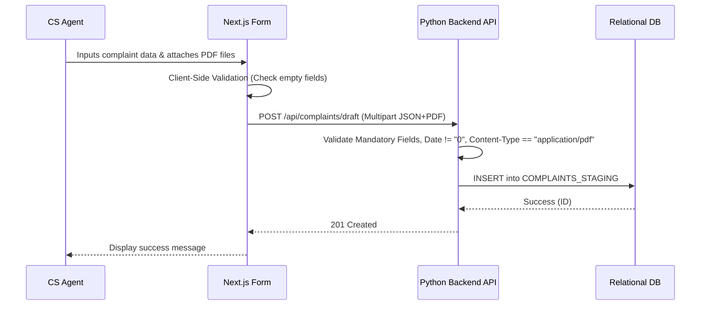

# Module: Complaint Management

> **CHANGELOG: CLEAN ROOM REVISION**
> - Removed ZK framework specifics and Java method calls.
> - Added explicitly discovered validation logic (strict date constraints, PDF file type validations, file existence checks before deletion).
> - Specified the exact JSON payload contract required for submitting a new complaint.

## 1. Module Overview
The Complaint Management module is the core operational unit of the Customer Handling System. Its primary scope is the capture, classification, and lifecycle tracking of customer complaints. It ensures that customer details, incident dates, settlement amounts, and problem categories are accurately recorded and bundled with any supporting documentation (e.g., Pengaduan, Penyelesaian, Perpanjangan files).

## 2. Local Functional Flows & Scenarios
- **Creating a New Complaint (Scenario A):**
  - *Action:* The Customer Service (CS) Representative (Maker) receives a complaint, inputs the customer details, and selects appropriate Branch and Channel data. The CS tags the issue using classification codes (Codes 601-605) and uploads supporting files.
  - *Outcome:* The frontend packages this data into a JSON/Multipart payload and submits it to the API, storing it as a pending request in the staging database.
- **Updating an Existing Complaint:**
  - *Action:* The CS Representative updates a settlement date or attaches a resolution document to an active complaint.
  - *Outcome:* A new pending request for an update is generated via a `PUT` or `PATCH` request and sent to the staging queue.

## 3. Local Technical Flows & Data Life Cycle
- **UI Components:** Next.js views and forms utilizing client-side state management for fluid interaction and pre-validation.
- **API Endpoints:** 
  - `POST /api/complaints/draft`: Accepts a multipart/form-data payload containing JSON fields and file attachments.
  - `PUT /api/complaints/draft/{id}`: Updates a pending draft.
- **State Management:** 
  - Data payload is temporarily marshaled into the `COMPLAINTS_STAGING` entity when submitted.
  - Upon approval, the permanent state resides in the `COMPLAINTS` table.

### Business Rules & Validation Constraints
The backend API **must** enforce the following rules extracted from the legacy application:
1. **Date Validation:** Date values must be valid datetimes. Legacy edge case: The system must reject a date value of `"0"` (`!value.toString().equals("0")`). If violated, return `400 Bad Request`.
2. **File Upload Restrictions:** Uploaded attachments must be strictly validated. The `Content-Type` must be `application/pdf`. If a non-PDF file is submitted, the API must reject the request.
3. **File Management Safeties:** Before overwriting or deleting an existing physical file on disk/storage during an update operation, the backend must verify the file's existence (`if (file.exists() && file.isFile())`).

### Data Contracts (JSON Payload Example)
```json
{
  "customer_name": "John Doe",
  "location": "Jakarta",
  "amount": 500000,
  "atm_card_number": "1234-5678-9012-3456",
  "description": "ATM swallowed card",
  "received_date": "2026-05-31T10:00:00Z",
  "incident_date": "2026-05-30T15:30:00Z",
  "branch_code": "BR001",
  "channel_code": "CH02",
  "codes": {
    "product_601": "PRD_A",
    "problem_601": "PRB_X"
  }
}
```
*Note: Files (`pengaduan_file`, `penyelesaian_file`, `perpanjangan_file`) are transmitted alongside this JSON structure using `multipart/form-data`.*

### Local Sequence Diagram


## 4. Interface & Dependencies
- **Inbound Dependencies:**
  - **Master Data Module:** Requires active reference data (Branches, Channels, Cities, Codes 601-605) exposed via `GET` endpoints to populate UI dropdowns and validate backend constraints.
- **Outbound Dependencies:**
  - **Authorization Workflow Module:** Interacts with the staging queue (`COMPLAINTS_STAGING`) for Supervisor approval.
  - **Reporting & Auditing Module:** Triggers events to log user actions when drafts are created or modified.
