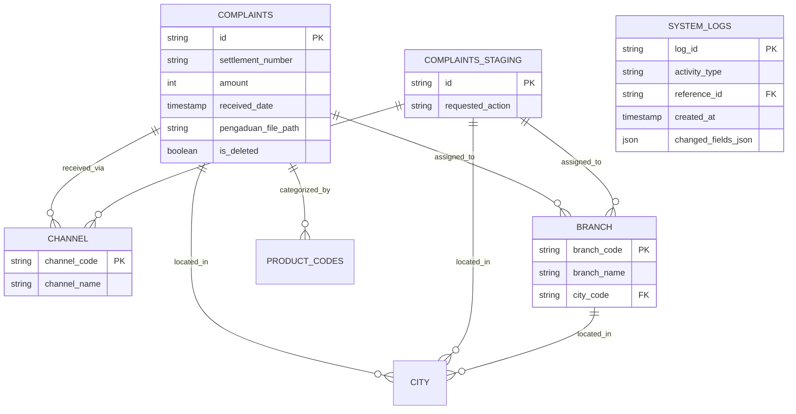

# Data Architecture Document

> **CHANGELOG: CLEAN ROOM REVISION**
> - Removed references to Oracle-specific drivers, Hibernate, JPA, and Java Properties files.
> - Converted schemas to universal Relational Database concepts.
> - Outlined explicit JSON structure for configuration to avoid "Magic Strings" in code.
> - Detailed file storage management and the logical state representations.

## 1. Database Schemas

The application relies on a Relational Database (e.g., PostgreSQL, MySQL, or Oracle) mapped through an ORM (e.g., SQLAlchemy or Prisma) or raw SQL interactions. The primary focus of the data schema revolves around customer complaints processing and its associated master data.

### Key Entities & Data Dictionary

- **COMPLAINTS**: The core transactional table storing complaint records.
  - `id` (UUID or String, Primary Key)
  - `settlement_number`, `extension_number` (String)
  - `customer_name`, `location` (String)
  - `amount` (Decimal or Integer)
  - `atm_card_number`, `description` (Text)
  - `received_date`, `incident_date`, `completion_date` (Timestamp/Date)
  - `aging_days` (Integer)
  - `created_by` (Maker ID), `authorized_by` (Checker ID)
  - `is_deleted` (Boolean, default: false)
  - *Foreign Keys*: `channel_code`, `city_code`, `branch_code`, `product_code_601` to `product_code_605`, `problem_code_601` to `problem_code_605`.
  - *File References*: `pengaduan_file_path`, `penyelesaian_file_path`, `perpanjangan_file_path` (String URI paths).

- **COMPLAINTS_STAGING** (formerly `COMPLAINTS_OTOR`): An authorization queue mirroring `COMPLAINTS`.
  - Contains identical columns to `COMPLAINTS`.
  - `requested_action` (String Enum: `ADD`, `EDIT`, `DELETE`): Represents the pending action the Maker wants to apply to the main database.

- **Master Data Tables**: These tables store lookup values to enforce referential integrity. All share common audit columns: `created_by`, `authorized_by`, `is_deleted`.
  - **BRANCH**: `branch_code` (PK), `branch_name`, `city_code` (FK).
  - **CHANNEL**: `channel_code` (PK), `channel_name`.
  - **CITY**: `city_code` (PK), `city_name`.
  - **PRODUCT_CODES** (formerly `CODE_601` to `CODE_605`): Categories (`product_code` PK, `product_name`).
  - **PROBLEM_CODES** (formerly `CODE_601_INFO` to `CODE_605_INFO`): Specific problems (`problem_code` PK, `problem_name`).

- **SYSTEM_LOGS**: Immutable ledger tracking all user activities and field modifications.
  - `log_id` (UUID or String, Primary Key)
  - `action_by` (Maker or Checker ID)
  - `activity_type` (String Enum: `CREATE`, `UPDATE`, `APPROVE`, `REJECT`, `DELETE`)
  - `reference_id` (String, Foreign Key pointing to Complaints)
  - `description` (Text)
  - `timestamp` (Timestamp)
  - `changed_fields_json` (JSON Blob): Stores exact before/after state of modified fields.

### Entity-Relationship Diagram



## 2. File-Based Data Structures

The system relies on an unstructured file-storage mechanism (e.g., Object Storage like S3, or standard disk storage) for document handling. Files uploaded by the frontend (primarily PDFs) must be stored securely, and only their absolute or relative string paths/URIs are maintained within the database:

- **`pengaduan_file_path`**: Initial complaint document/attachment.
- **`penyelesaian_file_path`**: Resolution/settlement document.
- **`perpanjangan_file_path`**: Extension-related document.

*File Management Constraints:*
When a Maker uploads a replacement file during an `EDIT` operation, the backend must verify the old file's existence and successfully write the new file to the storage system before updating the path in the database. 

## 3. Configuration Externalization Strategy

To ensure zero hardcoded business logic or "magic strings", the Python backend should utilize an environment-aware configuration model.

### Proposed Externalized Structure (`config.json` or `.env`)

```json
{
  "app": {
    "datasource": {
      "url": "ENV:DB_URL",
      "username": "ENV:DB_USERNAME",
      "password": "ENV:DB_PASSWORD"
    },
    "storage": {
      "provider": "local",
      "base_path": "/var/data/comphand",
      "directories": {
        "pengaduan": "/attachments/pengaduan",
        "penyelesaian": "/attachments/penyelesaian",
        "perpanjangan": "/attachments/perpanjangan"
      },
      "allowed_mime_types": ["application/pdf"]
    },
    "workflow": {
      "actions": {
        "CREATE": "ADD",
        "UPDATE": "EDIT",
        "REMOVE": "DELETE"
      },
      "status": {
        "APPROVED": "APPROVE",
        "REJECTED": "REJECT"
      }
    }
  }
}
```
*Note:* The Next.js frontend will communicate using standard JSON definitions over REST or GraphQL, abstracting away any internal database representations.
