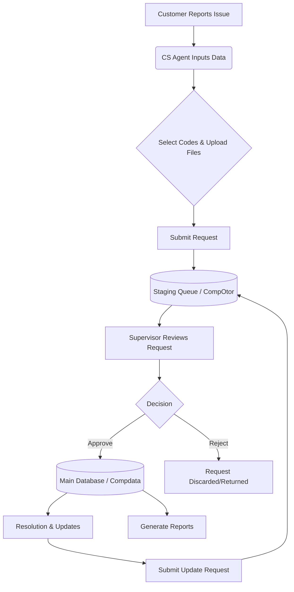
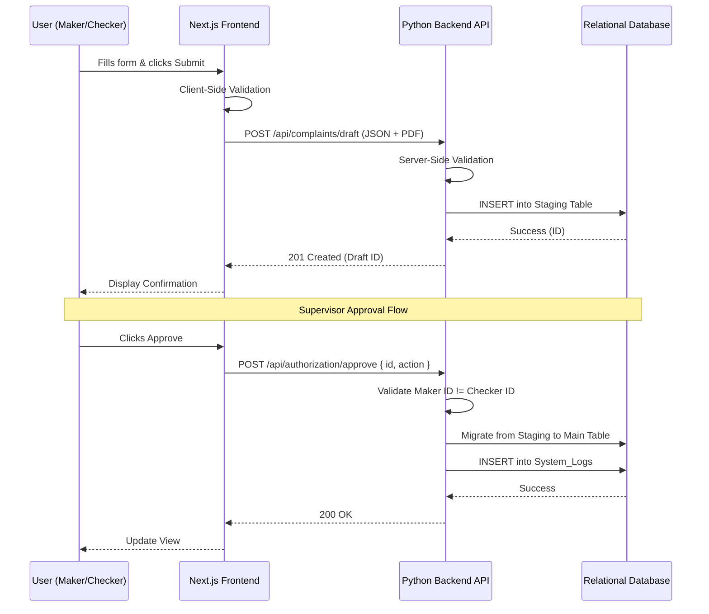

# Master Architecture Document: Customer Complaint Handling System

> **CHANGELOG: CLEAN ROOM REVISION**
> - Removed all legacy framework references (ZK Framework, `.zul`, Java ViewModels, Hibernate, JAX-WS).
> - Abstracted system to a modern architecture (Frontend Next.js, Backend Python REST API).
> - Explicitly defined API Gateway interactions and JSON data serialization patterns.
> - Detailed strict Maker-Checker transactional boundaries and API error handling expectations.

## 1. Executive Summary & High-Level Requirements

### Primary Business Purpose
The primary business purpose of this system is to manage, classify, and track customer complaints and inquiries for Bank Maspion. It ensures that complaints are systematically recorded, assigned proper classification codes, tracked for resolution, and verified through an authorization workflow (Maker-Checker principle) before being finalized in the system.

### Core High-Level Functional Requirements
- **Complaint Registration:** Capture detailed complaint data, including customer details, incident dates, amounts, and associated branch/channel information.
- **Categorization:** Classify complaints using a predefined set of codes (Code 601 through 605) for products and problem types.
- **File Attachments:** Allow users to upload supporting documents related to the complaint (Pengaduan), its settlement (Penyelesaian), and any extensions (Perpanjangan). Strict validation required for file types (e.g., must be `application/pdf`).
- **Authorization Workflow:** Implement a Maker-Checker process where additions, modifications, or deletions of complaints must be approved by an authorized user (Supervisor) before taking effect. 
- **Reporting & Auditing:** Generate reports based on complaint statuses and maintain robust system logs for every database mutation (creation, modification, approval, deletion).
- **Master Data Management:** Manage foundational reference data including Branches, Channels, Cities, and classification codes.

---

## 2. User Scenarios & Personas

### Personas
1. **Customer Service Representative (Maker):** Receives complaints from customers, inputs details, attaches PDF documents, and submits the records for authorization.
2. **Supervisor / Authorizer (Checker):** Reviews pending complaint requests (additions, updates, or deletions) and either approves or rejects them. Cannot be the same user who initiated the request.
3. **Administrator:** Manages system master data and extracts analytical reports.

### End-to-End User Scenarios
- **Scenario A: Creating a New Complaint**
  - *Action:* CS inputs customer details, selects classification codes from dropdowns populated by Master Data, and uploads initial files.
  - *Outcome:* The frontend submits a JSON payload to the API. The system creates a pending authorization request in the staging queue. The status remains pending until a Supervisor reviews it.
- **Scenario B: Approving a Complaint**
  - *Action:* Supervisor logs in, navigates to the authorization dashboard, reviews the new complaint request, and clicks "Approve".
  - *Outcome:* The backend API validates the `checker_id != maker_id`. Upon success, the system commits the record to the main complaint database. An immutable audit log is generated.
- **Scenario C: Rejecting a Complaint Update**
  - *Action:* CS updates a settlement date on an existing complaint. The Supervisor finds the documentation insufficient and clicks "Reject".
  - *Outcome:* The staging update is discarded. The original active record remains unchanged, and the rejection event is logged.
- **Scenario D: Generating Complaint Reports**
  - *Action:* An Administrator requests a report of all complaints within a specific date range.
  - *Outcome:* The system fetches aggregated data, resolves foreign keys to human-readable strings, and exports a detailed report view.

---

## 3. Functional Architecture & Workflows

The application follows a strict workflow centered around data entry, validation, and Maker-Checker authorization.

### Step-by-step Business Logic
1. **Initiation:** User navigates to the complaint creation UI.
2. **Data Gathering:** The Next.js frontend fetches Master Data (Branches, Cities, Channels, Codes) via REST GET endpoints to populate dropdowns.
3. **Submission:** User submits the form. The frontend performs local validation (e.g., date formats, non-empty values) and POSTs a JSON payload to the backend API.
4. **Queueing:** The Python backend validates the payload, extracts files, stores them, and saves the data payload in a temporary staging state (`CompOtor`).
5. **Review:** A Checker requests pending items via a REST GET endpoint on the staging queue.
6. **Decision:** 
   - On **Approve (POST `/api/authorization/approve`)**, the backend merges the data into the main `Compdata` table.
   - On **Reject (POST `/api/authorization/reject`)**, the temporary record is marked rejected or discarded.
7. **Logging:** Every state change explicitly triggers an insert into the `System_Logs` auditing table.

### Functional Flowchart

---

## 4. Technical Architecture & Data Flow

The system is decoupled into a modern web application and an independent backend service.

- **Frontend Application:** A Next.js-based web interface responsible for user interactions, client-side validation, and consuming REST APIs.
- **Backend Service:** A Python-based REST API (e.g., FastAPI, Django, or Flask) that enforces all business rules, handles file uploads, and interacts with the database.

### Technical Data Lifecycle
1. **Trigger:** User interacts with the Next.js form and clicks submit.
2. **API Request:** The frontend serializes the data into JSON (using `multipart/form-data` if file uploads are included) and sends a `POST` request to the backend.
3. **Validation Layer:** The Python backend validates input types, file extensions (`application/pdf`), and business constraints (e.g., `incident_date <= current_date`). If invalid, returns `400 Bad Request`.
4. **Persistence Layer:** An ORM (e.g., SQLAlchemy) is used to map the JSON payload to relational database entities, saving the record to the staging database table.
5. **Response:** Backend returns a `201 Created` status with the staging queue ID.

### Sequence Diagram

---

## 5. State Management & Constraints

### Application State Management
- **Draft/Pending State:** Any unapproved record lives in the staging queue (formerly `CompOtor`). This table tracks the Maker ID (`USER_INPUT`) and the requested transition (`ACTION`: Add, Edit, Delete).
- **Active State:** Approved records reside in the main entity (formerly `Compdata`). They track the exact resolution state, timestamps, and active status.
- **File State:** File metadata (path, name, size) is saved in the database while the physical binary files are stored on a file system or object storage (e.g., AWS S3). If an update replaces a file, the API must verify if the old file exists and optionally delete it to prevent orphaned files.

### Technical Constraints & Validations
- **Strict Maker-Checker Validation:** A Maker cannot be their own Checker. The backend must enforce that `USER_INPUT != USER_OTOR` on all approve/reject endpoints, returning a `403 Forbidden` if violated.
- **Data Validation:** Date fields must be strictly validated (e.g., no placeholder `"0"` dates allowed). Files must be strictly typed (e.g., validating `Content-Type: application/pdf`).
- **Mandatory Codes:** Complaints must be tagged with accurate classification codes mapping to specific products and problems to ensure referential integrity for reporting.
- **Audit Trails:** Every database mutation must securely register an entry in `System_Logs` containing the timestamp, exact action taken, fields modified, and user identifier. Deletions from the main database are implemented as soft-deletes (`is_deleted` flag).
