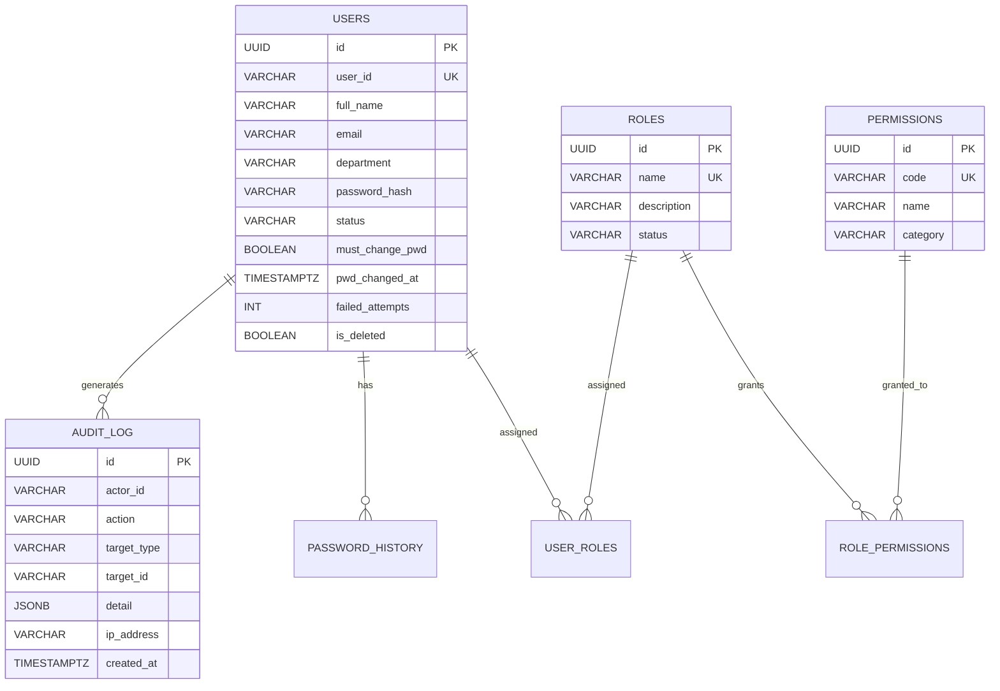
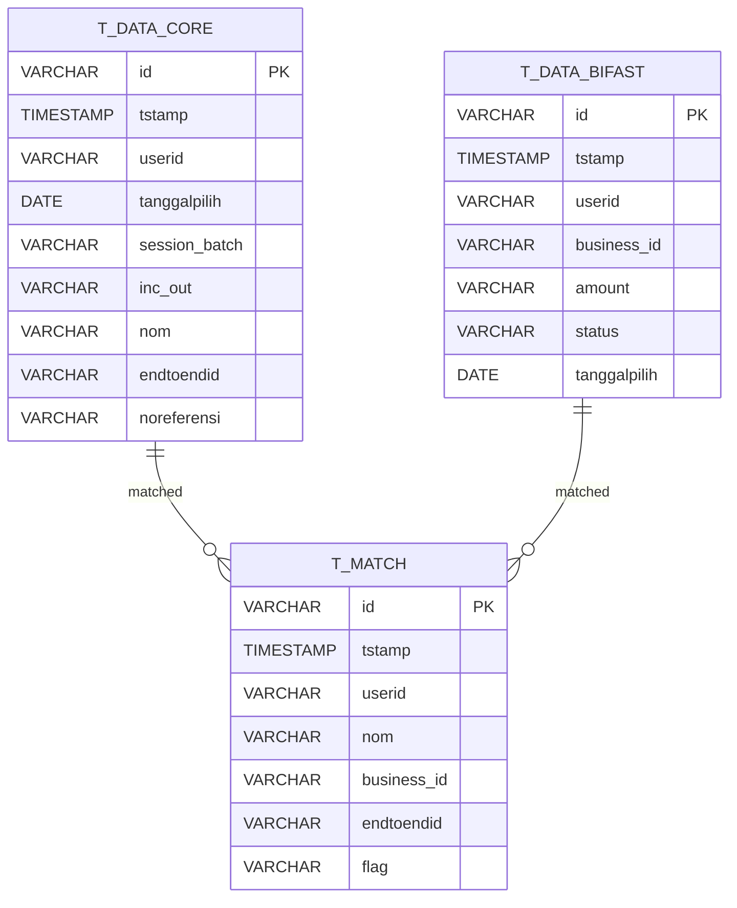
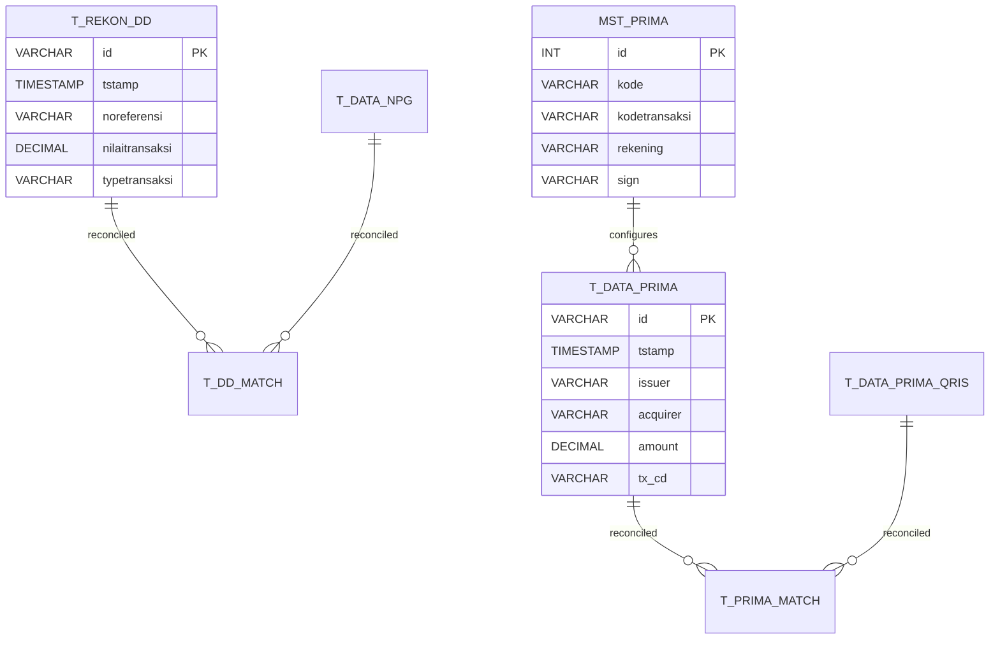
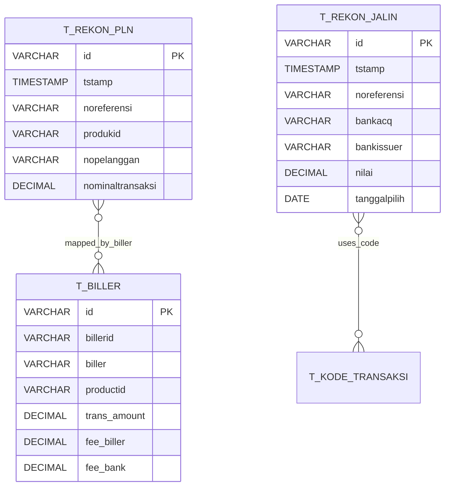
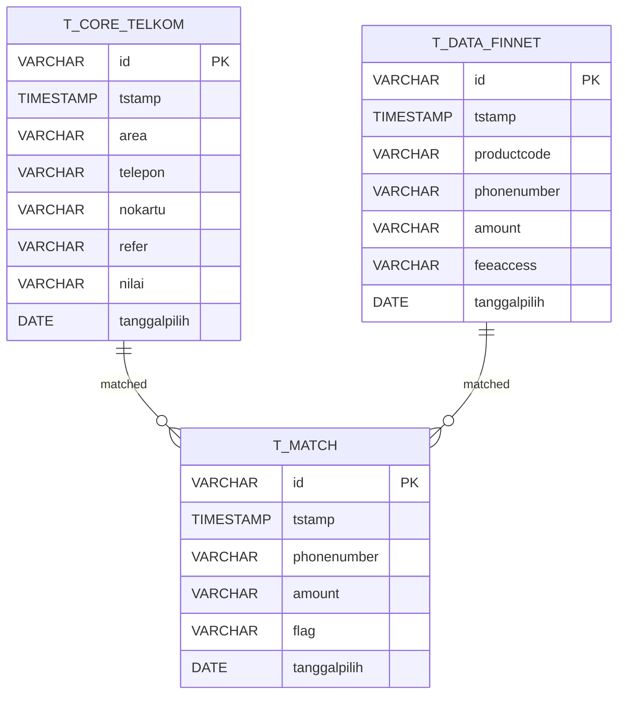
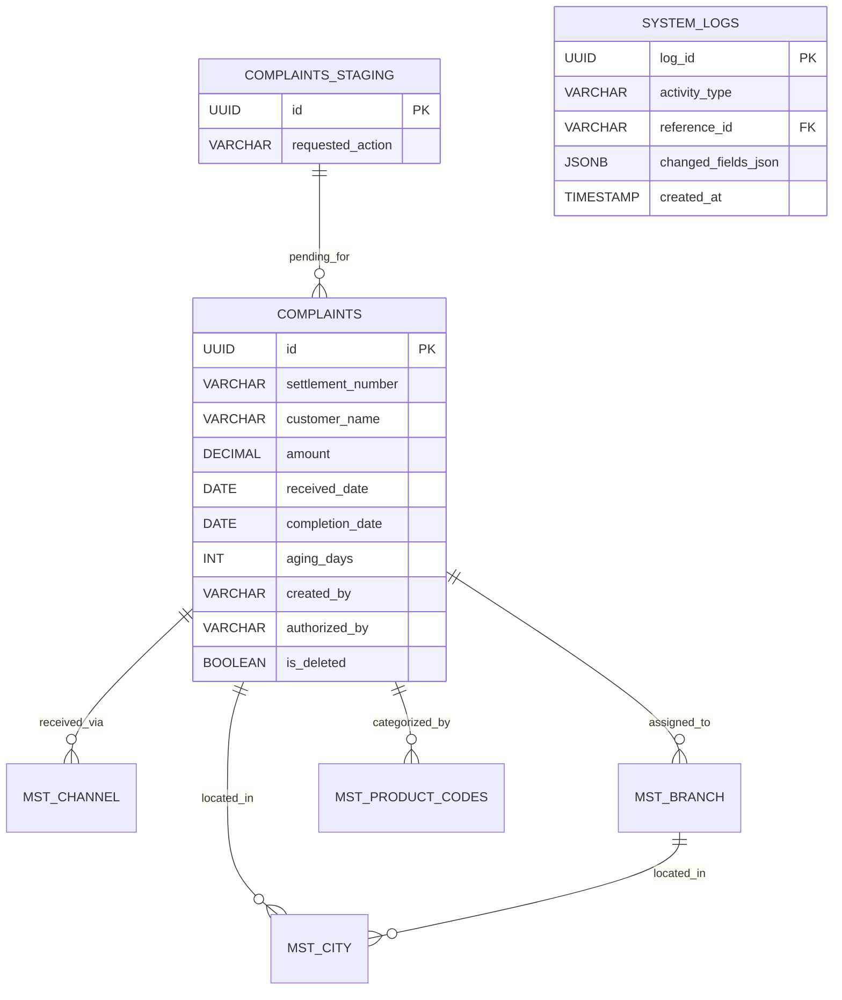
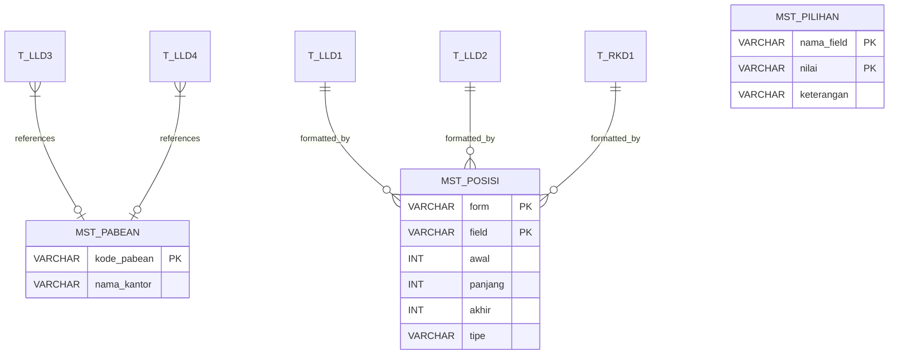
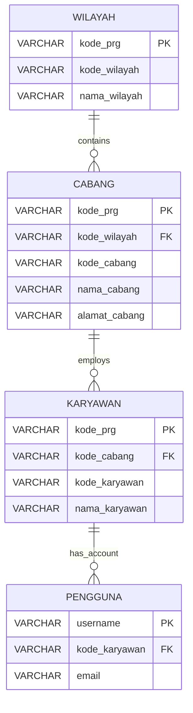
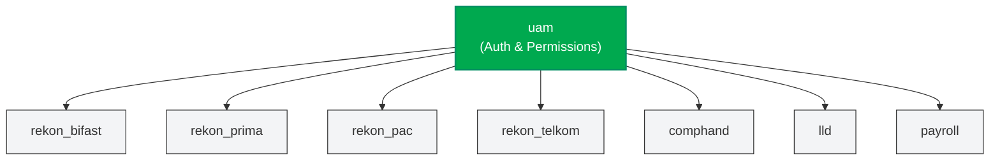

# Database Schema Registry

> **Single PostgreSQL instance** (`bmas_web_db`) on-premise.
> All sub-programs share this database but are isolated via **PostgreSQL schemas**.

## Schema Naming Convention

- All lowercase, snake_case
- Reconciliation modules prefixed with `rekon_`
- Each schema is self-contained — **no cross-schema foreign keys**

## Schema Overview

| # | Schema | Sub-program | Tables | Build Phase |
|---|--------|-------------|--------|-------------|
| 1 | `uam` | User Access Management | 7 | Phase 1 |
| 2 | `rekon_bifast` | BiFast Reconciliation | 6 | Phase 1 (exists as `bifast`, rename) |
| 3 | `rekon_prima` | Prima QRIS Reconciliation | ~20 | Phase 2 |
| 4 | `rekon_pac` | PAC JALIN PLN Reconciliation | 5 | Phase 2 |
| 5 | `rekon_telkom` | Telkom Reconciliation | 5 | Phase 2 |
| 6 | `comphand` | Customer Complaints Handling | 8 | Phase 1 |
| 7 | `lld` | LLD Reporting | 11 | Phase 2 |
| 8 | `payroll` | Payroll | 6 | Phase 2 |

---

## 1. `uam` — User Access Management

Central authentication, authorization, and audit system. Used by **all** sub-programs.

### Tables

| Table | Description |
|-------|-------------|
| `uam.users` | User accounts with password policy fields (status, lockout, must_change_pwd) |
| `uam.password_history` | Last 5 password hashes per user to prevent reuse |
| `uam.roles` | Named roles (e.g., "Reconciliation Officer", "Admin") |
| `uam.permissions` | Menu/function registry (e.g., `reconcile.bifast`, `comphand.view`) |
| `uam.role_permissions` | Many-to-many: which permissions belong to which role |
| `uam.user_roles` | Many-to-many: which roles are assigned to which user |
| `uam.audit_log` | Immutable append-only log of all user actions |

### ER Diagram

---

## 2. `rekon_bifast` — BiFast Reconciliation

> **Migration note:** Currently exists as schema `bifast`. Will be renamed to `rekon_bifast` for naming consistency.

### Tables

| Table | Description |
|-------|-------------|
| `rekon_bifast.t_data_core` | Core system transactions (uploaded CSV) |
| `rekon_bifast.t_data_bifast` | BiFast transactions (uploaded XLSX) |
| `rekon_bifast.t_match` | Matched transactions (core ↔ bifast) |
| `rekon_bifast.t_core_only` | Unmatched core transactions |
| `rekon_bifast.t_bifast_only` | Unmatched BiFast transactions |
| `rekon_bifast.t_config` | Biller/file configuration |

### ER Diagram

---

## 3. `rekon_prima` — Prima QRIS Reconciliation

### Tables

| Table | Description |
|-------|-------------|
| `rekon_prima.mst_prima` | Prima master data (transaction codes, accounts) |
| `rekon_prima.mst_dd` | Direct Debit master data |
| `rekon_prima.mst_dd2` | Direct Debit master data (secondary) |
| `rekon_prima.mst_dd_mjt` | Direct Debit maturity master data |
| `rekon_prima.mst_biaya_prima` | Prima fee configurations |
| `rekon_prima.mst_biaya_biller` | Biller fee configurations |
| `rekon_prima.mst_mcode` | Merchant codes |
| `rekon_prima.mst_mcode_qris` | QRIS-specific merchant codes |
| `rekon_prima.t_rekening` | Account reference data |
| `rekon_prima.t_kode_transaksi` | Transaction code reference |
| `rekon_prima.t_rekon_dd` | Core DD transaction data |
| `rekon_prima.t_rekon_dd2` | Core DD transaction data (secondary) |
| `rekon_prima.t_data_npg` | NPG transaction data |
| `rekon_prima.t_data_prima` | Prima core transaction data |
| `rekon_prima.t_data_prima_qris` | Prima QRIS transaction data |
| `rekon_prima.t_data_pac_qris` | PAC QRIS transaction data |
| `rekon_prima.t_prima_jurnal` | Prima journal entries |
| `rekon_prima.t_dd_match` | DD matched results |
| `rekon_prima.t_dd_core_only` | DD core-only (unmatched) |
| `rekon_prima.t_dd_npg_only` | DD NPG-only (unmatched) |
| `rekon_prima.t_prima_match` | Prima matched results |
| `rekon_prima.t_prima_core_only` | Prima core-only (unmatched) |
| `rekon_prima.t_prima_decline` | Prima declined transactions |

### ER Diagram

---

## 4. `rekon_pac` — PAC JALIN PLN Reconciliation

### Tables

| Table | Description |
|-------|-------------|
| `rekon_pac.t_biller` | Biller mapping data (product IDs, fees) |
| `rekon_pac.mst_dd` | Direct Debit master data |
| `rekon_pac.t_rekon_pln` | PLN reconciliation transaction data |
| `rekon_pac.t_rekon_jalin` | Jalin reconciliation transaction data |
| `rekon_pac.t_kode_transaksi` | Transaction code reference |

### ER Diagram

---

## 5. `rekon_telkom` — Telkom Reconciliation

### Tables

| Table | Description |
|-------|-------------|
| `rekon_telkom.t_core_telkom` | Raw core Telkom transactions (from fixed-width text files) |
| `rekon_telkom.t_data_finnet` | Raw Finnet settlement transactions |
| `rekon_telkom.t_match` | Matched transactions (core ↔ finnet) |
| `rekon_telkom.t_core_only` | Unmatched core transactions |
| `rekon_telkom.t_finnet_only` | Unmatched Finnet transactions |

### ER Diagram

---

## 6. `comphand` — Customer Complaints Handling

### Tables

| Table | Description |
|-------|-------------|
| `comphand.complaints` | Core complaint records (Maker creates, Checker approves) |
| `comphand.complaints_staging` | Authorization queue (pending Checker approval) |
| `comphand.mst_branch` | Branch master data |
| `comphand.mst_channel` | Channel master data (ATM, Mobile, etc.) |
| `comphand.mst_city` | City master data |
| `comphand.mst_product_codes` | Product category codes |
| `comphand.mst_problem_codes` | Problem classification codes |
| `comphand.system_logs` | Immutable activity log with field-level change tracking |

### ER Diagram

---

## 7. `lld` — LLD Reporting (Lalu Lintas Devisa)

Bank Indonesia regulatory reporting for foreign exchange transactions.

### Tables

| Table | Description |
|-------|-------------|
| `lld.t_lld1` | Form 1 — Export/Import transactions |
| `lld.t_lld2` | Form 2 — Balance, debit, credit mutations |
| `lld.t_lld3` | Form 3 — Customs (Pabean) + PEB data |
| `lld.t_lld4` | Form 4 — Payment mechanisms |
| `lld.t_lld7` | Form 7 — Beneficiary/maturity details |
| `lld.t_rkd1` | Rekening Khusus Devisa Form 1 |
| `lld.t_rkd2` | Rekening Khusus Devisa Form 2 |
| `lld.t_lampiran1` | Supporting attachments |
| `lld.mst_pabean` | Master data: customs offices |
| `lld.mst_pilihan` | Master data: dynamic key-value lookups (dropdowns) |
| `lld.mst_posisi` | Master data: fixed-width field positions for flat-file generation |

### ER Diagram

---

## 8. `payroll` — Payroll Processing

### Tables

| Table | Description |
|-------|-------------|
| `payroll.karyawan` | Employee records |
| `payroll.pengguna` | Application user accounts (linked to employees) |
| `payroll.cabang` | Branch offices |
| `payroll.wilayah` | Regional areas |
| `payroll.v_karyawan_um` | View: employee-user mapping for user management |
| `payroll.t_nasabah` | Temporary payroll processing data (from Excel uploads) |

### ER Diagram

---

## Cross-Schema Relationship Map

All schemas share a single PostgreSQL instance but are **logically isolated**.
The only cross-cutting dependency is the `uam` schema, which controls who can access what.

> The `uam` schema grants/restricts access via **application-level RBAC** (JWT + permission checks), NOT via PostgreSQL row-level security. Each schema's backend code checks `require_permission("reconcile.bifast")` before executing queries against `rekon_bifast.*`.
