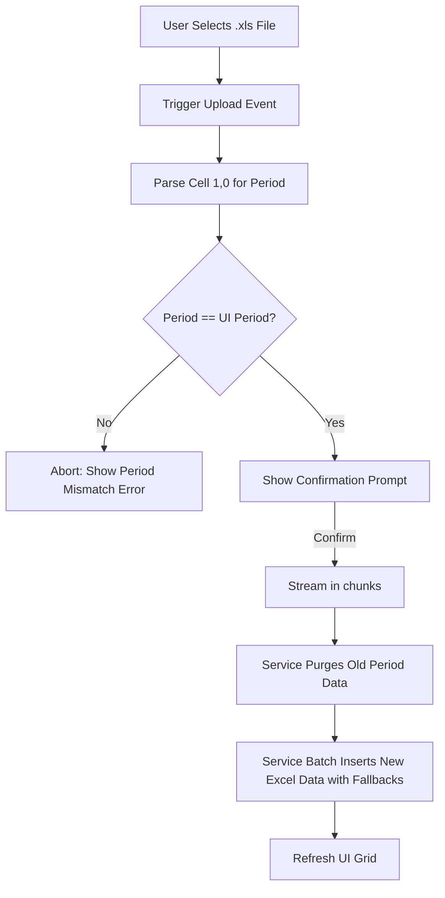

# Changelog
- **Added:** Data transformation rules (comma stripping, default values for numbers and dates).
- **Added:** Explicit functional fallback requirement for temporary ID generation.
- **Removed:** Legacy framework-specific syntax (ZK Framework, LldBoImpl, etc.)

# Bulk Data Upload Module Specification

## Module Overview
The Bulk Data Upload Module facilitates high-volume data ingestion. It allows users to upload Excel files (`.xls`) to completely replace or bulk-load reporting data for specific forms and periods. This module is critical for handling large datasets efficiently without requiring manual data entry.

## Functional Flows & Scenarios
1. **File Selection:** The user navigates to the upload interface and selects an `.xls` file containing transactional data.
2. **Period Validation Guard:** The system reads the reporting period explicitly embedded within the uploaded Excel file (located at Cell row 2, column 1 - zero-indexed as `1, 0`). It compares this with the currently selected active reporting period in the UI. 
    - *Mismatch:* The upload is aborted with an error to prevent overwriting historical data.
3. **Data Replacement:** If validated, the user receives a final confirmation prompt. Upon acceptance, the system streams the file, clears all existing data for that specific form and period from the database, and ingests the new rows.

## Technical Flows & Data Life Cycle
- **File Streaming:** To handle large regulatory datasets efficiently, the Excel upload must be streamed and processed in memory-efficient chunks to avoid out-of-memory errors on the server.
- **Data Transformation & Edge Cases:** During ingestion, the following data transformations MUST occur to ensure functional parity with the legacy system:
    - **Number Formatting:** Any commas within numerical strings must be explicitly stripped before casting to a float/double (e.g., `"1,000.50"` -> `1000.50`).
    - **Empty String Numeric Fallbacks:** Empty numeric strings must default to `0.0` or `0` depending on the target data type.
    - **Empty String Date Fallbacks:** For specific forms (like LLD7), missing date segments have explicit fallbacks: an empty Year defaults to `"0000"`, and an empty Month or Day defaults to `"00"`.
    - **Auto-Generated Identifier:** The system must generate and assign a temporary ID string (the legacy system used the hardcoded string `"x"`) for every bulk-uploaded record prior to persistence.
- **Service Ingestion:** The backend service processes the file, safely purges old data within a single transaction to maintain consistency, and batch-inserts the new records into the database.

## Interface & Dependencies
### Inbound Dependencies
- **External Files:** Expects strictly formatted `.xls` files provided by the user.
- **UI State:** Relies on the active reporting period selected by the user to authorize the upload.

### Outbound Dependencies
- **Database Persistence:** Outputs bulk data payloads to the persistent storage, completely overwriting previously stored data for the target period.
