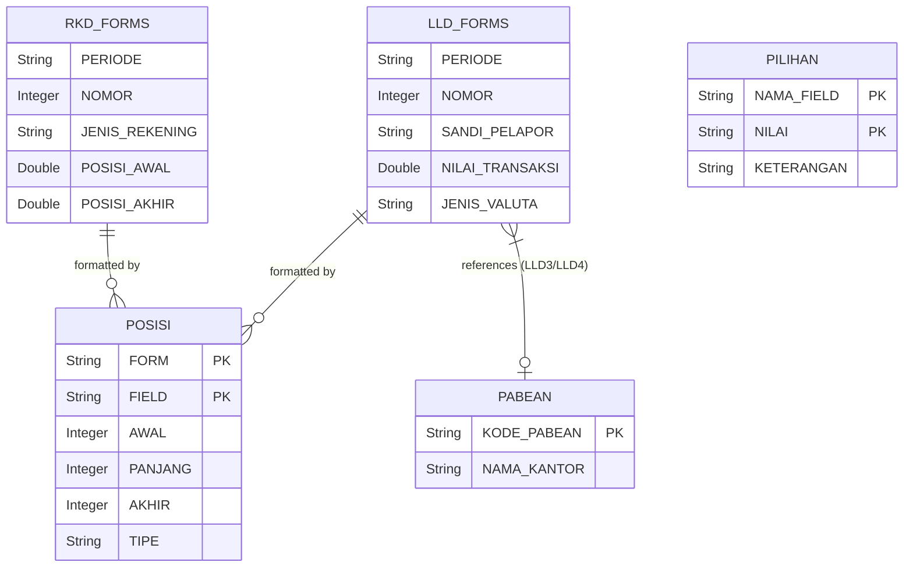

# Changelog
- **Added:** Exhaustive data mapping contracts for LLD2, LLD3, and LLD4.
- **Added:** Discovered fallback configurations (e.g., Sandi Pelapor = "157001").
- **Removed:** References to Oracle DB, Hibernate, JExcelApi, `.zul`, and specific Java classes.

# Data Architecture & Modernization Strategy

## 1. Database Schemas

The application is built on a relational database. The schema is organized into primary reporting forms and supporting metadata tables. The target state architecture must support these structures regardless of the underlying DB technology (e.g., PostgreSQL, MySQL).

### 1.1 Tables and Entities

**Transaction / Reporting Form Tables:**
*   `LLD1`: Lalu Lintas Devisa Form 1 (Export/Import transactions). Contains columns for transaction details, sender/receiver info, bank details, currency, and amounts.
*   `LLD2`: Lalu Lintas Devisa Form 2. Tracks balances, debits, credits, and account mutations.
*   `LLD3`: Form 3, heavily tied to Customs (Pabean) data, export declarations (PEB), and NPWP.
*   `LLD4`: Form 4, manages payment mechanisms and customs office codes.
*   `LLD7`: Form 7 (added later), tracks specific transaction details, beneficiary info, maturity dates, and document numbers.
*   `RKD1`: Rekening Khusus Devisa Form 1. Details specific forex transactions, payer/payee identification, and related documents.
*   `RKD2`: Rekening Khusus Devisa Form 2. Tracks forex account deposits, mutations, initial/final balances, and account statuses.
*   `LAMPIRAN1`: Supporting attachment data.

**Metadata & Configuration Tables:**
*   `PABEAN`: Master data for customs offices (Kantor Pabean).
*   `PILIHAN`: A dynamic key-value store for dropdowns or validation choices. Fields include `NAMA_FIELD` (Field Name), `NILAI` (Value), and `KETERANGAN` (Description).
*   `POSISI`: Defines the strict fixed-width structure for flat-file regulatory generation. Columns include `FORM` (Form ID), `FIELD` (Field Name), `AWAL` (Start Index), `PANJANG` (Length), `AKHIR` (End Index), and `TIPE` (Data Type: STRING, NUMBER, STRNUM).

### 1.2 Entity-Relationship (ER) Diagram



## 2. File-Based Data Structures

The system relies heavily on file-based integration for data ingress and egress, specifically tailored for regulatory reporting to Bank Indonesia.

### 2.1 Excel (.xls) Data Ingestion
*   **Format**: Traditional Excel Spreadsheet format.
*   **Structure**: Fixed-column mapping depending on the form type.
    *   *LLD1*: 25 columns.
    *   *LLD2*: 16 columns (e.g., Col 6: PosisiAwal, Col 11/15: PosisiAkhir).
    *   *LLD3*: 14 columns (e.g., Col 4: SandiKantorpabean, Col 8/9: Nilai).
    *   *LLD4*: 8 columns.
    *   *LLD7*: 18 columns.
    *   *RKD1*: 32 columns.
*   **Parsing Logic**: Iterates through rows sequentially. It must strip commas from numerical strings, handle empty date segments by defaulting to `"00"` or `"0000"`, provide `0.0` for empty numerics, and assign a temporary ID.

### 2.2 Flat-File Generation (Text/CSV)
*   **Format**: Fixed-width text files (`.txt`).
*   **Structure**: Dictated entirely by the `POSISI` database tables.
*   **Generation Logic**: The system maps data properties to specific character indices in a text line. It uses `AWAL` (Start), `PANJANG` (Length), and `TIPE` (Alphanumeric/Numeric) to pad and format strings before exporting them to BI-compliant text files.

## 3. Data Contracts & Business Logic

### 3.1 Hardcoded Business Rules & Fallbacks
The following rules were discovered in the legacy system and MUST be replicated for functional parity:
*   **Supported Forms**: The system must support explicitly: `LLD1`, `LLD2`, `LLD3`, `LLD4`, `LLD7`, `RKD1`, `RKD2`.
*   **Sandi Pelapor (Reporter Code) Fallbacks**: In manual data entry for specific forms (`LLD2`, `LLD3`, `LLD4`), the `sandiPelapor` is explicitly hardcoded to default to `"157001"`. 
*   **Date Fallbacks (`LLD7`)**: Year -> `"0000"`, Month/Day -> `"00"`.
*   **Identifier Fallbacks**: All bulk uploaded objects default to ID `"x"`.

### 3.2 Expected Field Schemas (Representative)
*   **LLD2**: `nomor`, `periode`, `jenisRekening`, `negara`, `jenisValuta`, `posisiAwal`, `debet`, `kredit`, `tanda`, `lainnya`, `posisiAkhir`.
*   **LLD3**: `nomor`, `periode`, `noRef`, `npwp`, `namaPerusahaan`, `sandiKantorpabean`, `noDaftarpeb`, `tglPeb`, `jenisValuta`, `nilaiDhe`, `nilaiPeb`, `sandiKeterangan`, `dokumenPendukung`, `sandiPelapor`.
*   **LLD4**: `nomor`, `periode`, `sandiKantorpabean`, `noDaftarpeb`, `namaFile`, `sandiMekanismebayar`, `rincianMekanismebayar`, `sandiPelapor`.

## 4. Configuration Externalization Strategy

To decouple business data and infrastructure configurations, use a centralized configuration map (e.g., `app-config.json` or YAML) in the new system.

```yaml
app:
  reporting:
    supported-forms:
      - LLD1
      - LLD2
      - LLD3
      - LLD4
      - LLD7
      - RKD1
      - RKD2
    
    defaults:
      empty-id: "x"
      empty-year: "0000"
      empty-month-day: "00"
      default-sandi-pelapor: "157001"
```
