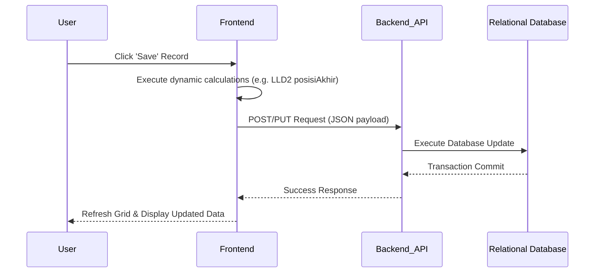

# Changelog
- **Added:** Implicit state dependencies for UI navigation (pagination/context).
- **Added:** Documented hidden functional calculation for LLD2 `posisiAkhir`.
- **Removed:** ZK Framework specifics, Java code references, Hibernate implementation details.

# Data Management Module Specification

## Module Overview
The Data Management Module is the core operational component of the LLD (Lalu Lintas Devisa) system. Its primary scope is to provide user interfaces and backend mechanisms to view, create, edit, and delete individual foreign exchange reporting records across various regulatory forms (LLD1, LLD2, LLD3, LLD4, RKD1, RKD2). It ensures that daily transactional data is accurately curated before reporting.

## Functional Flows & Scenarios
1. **Record Review:** The user selects a specific LLD form type and a reporting period to view all existing records within a data grid.
2. **Manual Data Entry (Add/Edit):** The user manually adds a new transaction or edits an existing one to correct discrepancies. Data validations are applied before saving.
    - *Hidden Logic (LLD2):* When a user edits numerical values for an LLD2 form, the system MUST dynamically calculate and set the Final Balance (`posisiAkhir`) using the exact formula: `posisiAkhir = PosisiAwal + Debet - Kredit + Lainnya`. This must be computed and persisted correctly.
    - *Hidden Logic (LLD2, LLD3, LLD4):* If a manual record is created, the system must set the reporter code (`sandiPelapor`) to the default `"157001"`.
3. **Record Deletion:** The user selects a record to delete. The system triggers a confirmation prompt ("Are you sure?") to prevent accidental data loss.
4. **Grid Refresh:** Upon saving or deleting, the grid automatically refreshes to display the updated dataset for the selected period.

## Technical Flows & Data Life Cycle
- **Frontend State Management:** The frontend UI must maintain implicit state across views. This includes preserving the user's active pagination index (e.g., page 3 of LLD1 records) and securely passing the targeted record object to the "Edit" view.
- **Service Tier:** The frontend sends a stateless data payload (JSON) to the backend API.
- **Data Access:** The backend service receives the data transfer object, translates the payload, and executes standard CRUD operations to commit the transaction to the relational database securely.

## Interface & Dependencies
### Inbound Dependencies
- **User Inputs:** Manual form inputs from banking officers via the Web UI.
- **Master Data Module:** Depends on configurations (like validation choices and identifiers) to populate UI dropdowns and perform frontend data validation.

### Outbound Dependencies
- **Database Persistence:** Outputs data payloads to be persisted in the relational database.
- **Reporting Module:** Provides the curated underlying transactional dataset to the Regulatory Report Generation module when formatting is triggered.
