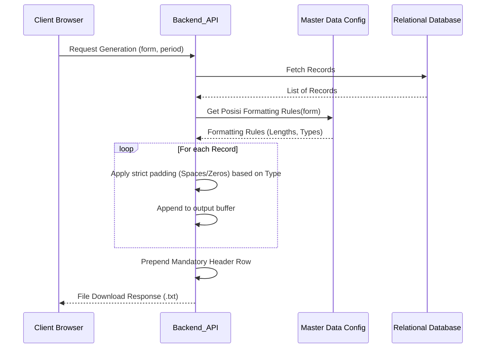

# Changelog
- **Added:** Exhaustive data padding rules for string/number formatting.
- **Added:** Explicit header generation rules.
- **Removed:** Legacy Java specifics (`LLDComposer`, `StringBuilder`, Web Service Client references).

# Regulatory Report Generation Module Specification

## Module Overview
The Regulatory Report Generation (Cetak) Module is responsible for translating standardized database records into strictly formatted, fixed-width flat text files (`.txt`). This module ensures that all generated files pass Bank Indonesia's rigorous structural validation rules.

## Functional Flows & Scenarios
1. **Trigger Generation:** The user selects a period and clicks the "Generate" (Cetak) button on the UI.
2. **Data Aggregation:** The system fetches all transactional records associated with the chosen form and period.
3. **Formatting Application:** The system applies dynamic formatting rules (paddings, fillers, headers) to every field based on configured metadata from the Master Data module.
4. **File Delivery:** A `.txt` file is dynamically generated in memory and served to the user's browser as a file download.

## Technical Flows & Data Life Cycle
- **Data Fetching:** The backend receives the generation request and queries the database for all records matching the selected form and period.
- **Dynamic Parsing:** The module queries the `Posisi` (Position) master data configuration. It iterates over the fetched transactional records and maps object properties to their corresponding `Posisi` length and type definitions.
- **Strict String Manipulation Rules:** Based on the data type metadata (`STRING`, `NUMBER`, `STRNUM`), the system MUST format the fields according to the following specific rules discovered from the legacy application:
    - **`NUMBER`:** Treat as a floating-point number. Format to two decimal places, then physically remove the decimal point (`.`). Pad the resulting string with leading zeros (`"0"`) until it reaches the specified byte length. *Edge Case:* If the number is negative, preserve the minus sign (`-`) at the start, replace the next character with a zero, and pad appropriately.
    - **`STRING`:** Pad the string on the right-hand side with empty spaces (`" "`) until it reaches the specified byte length.
    - **`STRNUM`:** Treat as a string but pad on the right-hand side with trailing zeros (`"0"`) until it reaches the specified byte length.
- **Header Injection:** The system MUST prepend a fixed header row to the file before appending the transaction rows. The header structure includes:
    - `SANDI_PELAPOR`: Derived from Master Data.
    - `JENIS_LAPORAN`: The ID of the form (e.g., "LLD1").
    - `PERIODE_LAPORAN`: The reporting period formatted strictly as `YYYYMM`.
    - `JUMLAH_RECORD_ISI`: The total integer count of transaction records included in the file.
    - `FILLER`: Padded empty space based on `Posisi` rules.

## Interface & Dependencies
### Inbound Dependencies
- **Data Management Module:** Requires the curated transactional data stored in the database.
- **Master Data Module:** Critically depends on the `Posisi` configuration data to dictate the exact byte-length, start/end index, and data type of every field in the text file.

### Outbound Dependencies
- **External Output:** Outputs a `.txt` file payload matching the strict external API contracts defined by Bank Indonesia.
