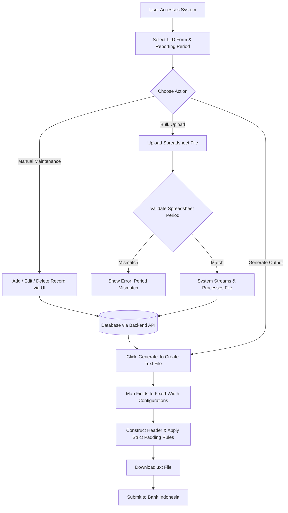

# Changelog
- **Added:** Abstracted the target architecture to reflect a modern Next.js/Python stack.
- **Added:** Replaced legacy Java Enterprise references with universal system flows.
- **Removed:** ZK Framework (ZKoss), `.zul`, Java Business Objects, JAX-WS, Hibernate ORM, `sessionScope`.

# LLD (Lalu Lintas Devisa) System Architecture & Technical Documentation

This document serves as the foundational "source of truth" for the Lalu Lintas Devisa (LLD) customer handling and reporting system. It is designed to provide both human developers and AI coding agents with a comprehensive understanding of the system's functional requirements, workflows, target architecture, and strict constraints.

---

## 1. Executive Summary & High-Level Requirements

### Primary Business Purpose
The LLD System is a regulatory compliance and reporting application designed for Bank Maspion. Its primary objective is to manage, consolidate, and report foreign exchange (Lalu Lintas Devisa) traffic transactions in accordance with Bank Indonesia regulations. The system allows banking officers to curate transaction data and generate strictly formatted flat text files required for submission to the central bank.

### High-Level Requirements
- **Data Management:** Provide interfaces to view, add, edit, and delete foreign exchange records across various regulatory form types (LLD1, LLD2, LLD3, LLD4, RKD1, RKD2).
- **Bulk Data Loading:** Support uploading Excel files (`.xls`/`.xlsx`) to bulk-load or overwrite reporting data for specific periods.
- **Regulatory Report Generation:** Translate transactional data into fixed-width text files (`.txt`). The formatting must strictly adhere to Bank Indonesia's structural definitions, including specific paddings, character lengths, and header/filler configurations.
- **Modern Architecture:** Implement a decoupled, cloud-native architecture separating the interactive frontend from a robust API-driven backend.

---

## 2. User Scenarios & Personas

### Personas
- **Regulatory Reporting Officer (End User):** Responsible for ensuring data accuracy, correcting discrepancies, uploading bulk data, and generating the final regulatory reports.
- **System Administrator:** Manages master configurations such as field positions (Posisi), reporting codes (Pilihan), and customs data (Pabean).

### Key User Scenarios & Edge Cases
1. **Manual Data Entry & Review:** 
   - *Action:* The user selects a specific LLD form and reporting period to view existing records in a data grid. They manually add or edit a record.
   - *System Outcome:* Data is validated against master configurations and persisted to the database via the backend API. The UI grid refreshes to show the updated list. Note: Edits to LLD2 will dynamically update calculated fields.
2. **Bulk Data Upload (Excel):**
   - *Action:* The user uploads a spreadsheet to populate data for a high-volume reporting period.
   - *Edge Case / Constraint:* The system reads the reporting period from the spreadsheet itself (Cell Row 2, Col 1). If it does not match the active period in the UI, the system aborts to prevent accidental overwriting of historical data.
   - *System Outcome:* The system streams the file, extracts the records, clears the existing data for that period, applies data transformation fallbacks, and loads the new data.
3. **Regulatory Report Generation (Cetak):**
   - *Action:* The user clicks the "Generate" button.
   - *System Outcome:* The system retrieves all records for the period, maps each field to its configured byte-length and data type (`STRING`, `NUMBER`, `STRNUM`), applies necessary padding/fillers based on strict logic, prepends the mandatory header, and prompts the user to download a generated `.txt` file.

---

## 3. Functional Architecture & Workflows

The application flow centers around selecting a context (Form + Period), interacting with the data, and generating the final regulatory output. 

### End-to-End Functional Journey

---

## 4. Target Technical Architecture & Data Flow

The system is to be built on a modern decoupled architecture.

### Technical Stack & Components
- **Frontend Presentation Layer:** Built using **Next.js** (React). It handles routing, UI state management, dynamic grid rendering, and form validations.
- **Backend Service API:** Built using **Python** (e.g., FastAPI or Django). It acts as the stateless intermediary, exposing RESTful or GraphQL endpoints to the frontend, handling complex data transformations, and orchestrating database interactions.
- **Data Access Layer:** Utilizes a modern ORM (e.g., SQLAlchemy) to map Python models to the relational database tables, ensuring persistence.

### Data Payload Lifecycle
1. **Trigger:** User clicks "Save" on an edit form.
2. **Client Binding:** The React component reads the UI state values and binds them to a Data Transfer Object (JSON payload).
3. **API Contract:** The frontend invokes the backend API (e.g., `PUT /api/lld1/{id}`).
4. **Service Execution:** The Python backend receives the request, validates it against business rules, and delegates it to the ORM.
5. **Transaction:** The ORM translates the object state into a SQL statement and commits the transaction to the database.

---

## 5. State Management & Constraints

### State Management
- **Client-Side UI State:** The Next.js frontend is responsible for maintaining UI state (e.g., active pagination, selected period, currently edited row) using React Context, Redux, or local component state.
- **Stateless APIs:** The backend Python APIs must operate completely statelessly, relying only on the provided payload and authentication tokens to process requests securely.

### Strict Technical Constraints & Validations
1. **Fixed-Width Formatting Stringency:** The core complexity lies in generating the flat files. The text generator must dynamically read `Posisi` (Position) configurations and strictly format strings, integers, and negative numbers exactly according to the legacy system's logic to pass BI validations.
2. **Excel Upload Safety Guard:** During bulk upload, the system MUST read cell `(1,0)` to extract the period. If this period does not match the active period provided by the frontend, the upload is rejected. This prevents users from corrupting historical data.
3. **Streaming Large Files:** Bulk uploads must handle data in streams or chunks on the backend to manage memory efficiently, avoiding full-file buffering for large regulatory datasets.
4. **Action Confirmations:** Destructive actions like deletion and uploading (which completely overwrites prior data) must be safeguarded with explicit frontend confirmations to prevent accidental data loss.
