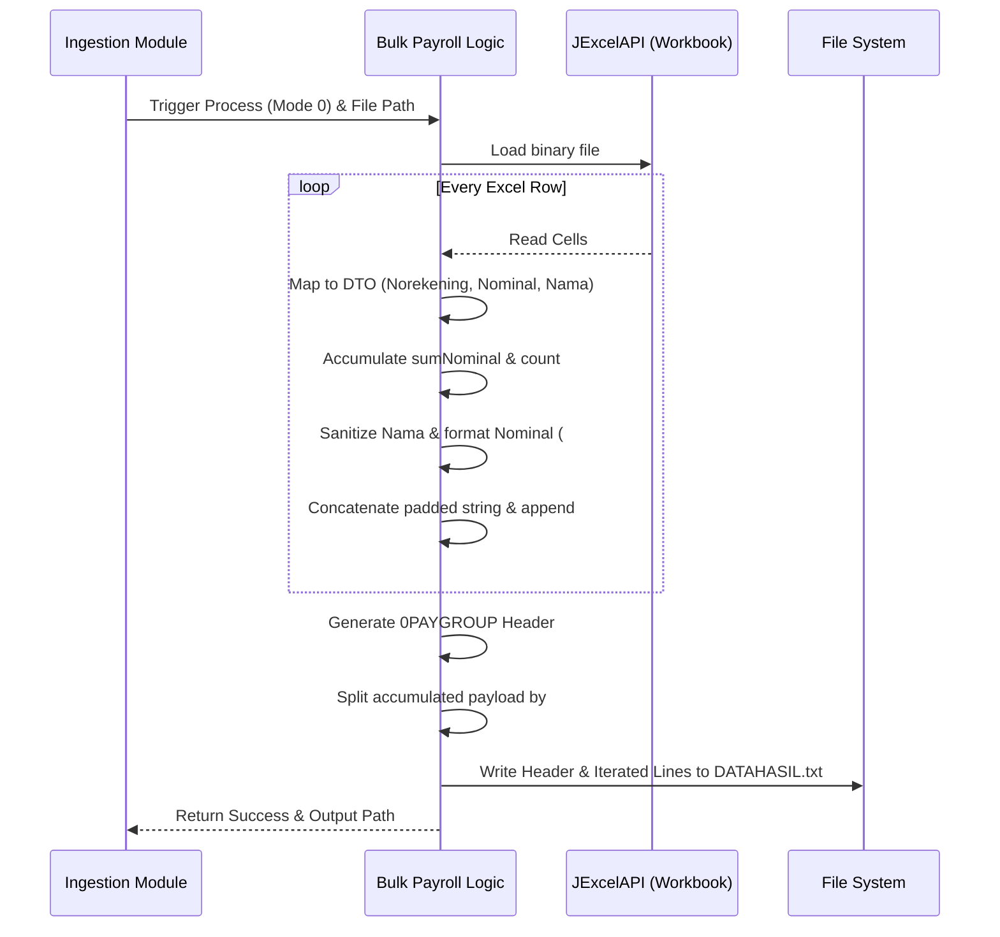

> **CHANGELOG - Clean Room Audit**
> * Added explicit `#` string splitting delimiter logic.
> * Documented hidden name sanitization `trim().replace("'", "")`.
> * Explicitly mapped the `0PAYGROUP` fixed header layout and string formats (`#.00` formatting, double nominals).
> * Corrected missing empty spacer fields and the dummy nominal field.

# Technical Specification: Bulk Payroll Processing Module

## 1. Module Overview
The **Bulk Payroll Processing Module** handles standard mass payroll disbursements (Payroll Nasabah). It is responsible for parsing valid Excel records, computing aggregate values, and transforming human-readable spreadsheet data into a highly constrained, fixed-width linear transfer payload (`DATAHASIL.txt`).

## 2. Local Functional Flows & Scenarios
*   **Standard Parsing:** Iterates through every record in the staged Excel sheet (skipping the header row).
*   **Metadata Accumulation:** Calculates the total number of records processed and the aggregate sum of all nominal transaction amounts.
*   **Linear Text Formatting:** Normalizes and pads data fields to meet strict core banking character constraints.
    *   *Hidden Logic:* Names are explicitly sanitized by trimming whitespace and removing single quotes: `shft.getNama().trim().replace("'", "")`.
*   **Memory Construction:** Accumulates the entire text payload in memory, separating each line with a `#` delimiter.
*   **Header Construction:** Generates the exact `0PAYGROUP` header, embedding the accumulated counts, timestamp (`yyyyMMddHHmmss`), formatted sums, and current date (`yyyyMMdd`).
*   **File Writing:** Splits the accumulated in-memory string by the `#` delimiter to write individual lines to the `DATAHASIL.txt` output file.

## 3. Local Technical Flows & Data Life Cycle
*   **Internal Components:** `PayrollNasabahViewModel.java` (processing logic), `PayrollNasabah.java` (Domain Data Transfer Object), JExcelAPI (`jxl.Workbook`).
*   **Data Parsing:** Opens the staging `.xls` file. Iterates over rows, creating a `PayrollNasabah` DTO and mapping specific cells (Index 0-5) to `Kode`, `Norekening`, `Nominal`, `Tanda`, `Noref`, and `Nama`.
*   **String Transformations:** Extensively relies on Apache Commons Lang `StringUtils`.
    *   *Details:* Padds string lengths (e.g. `StringUtils.rightPad(shft.getNorekening(), 19, " ")`). 
    *   *Decimal Format Constraint:* Standard payroll uses `DecimalFormat("#.00")` for currency amounts, left-padded to 21 characters with `"0"`.
    *   *Dummy Value Constraint:* Every record requires a second identical 21-character nominal field that is hardcoded to zero (`"0.00"` padded to 21 zeros).
*   **Memory Management:** Explicitly flushes accumulators (`jmlhrecord = 0`, `sumNominal = 0`, `kontenTxt = ""`) at execution start to prevent state leaks across consecutive runs. Writes the concatenated string payloads directly to the local disk using `PrintWriter(new File("DATAHASIL.txt"), "UTF-8")`.

### Payroll Processing Sequence

## 4. Interface & Dependencies
*   **Inbound Dependencies:**
    *   Requires a validated, staged `.xls` file existing on the local file system (provided by the *File Ingestion & Delivery Module*).
    *   Triggered only when the execution mode parameter is set to `0` (Payroll Nasabah).
*   **Outbound Dependencies:**
    *   Produces a strictly formatted, fixed-width `DATAHASIL.txt` file written to the local disk.
    *   Returns execution control and the target output file path back to the *File Ingestion & Delivery Module* for download delivery.
