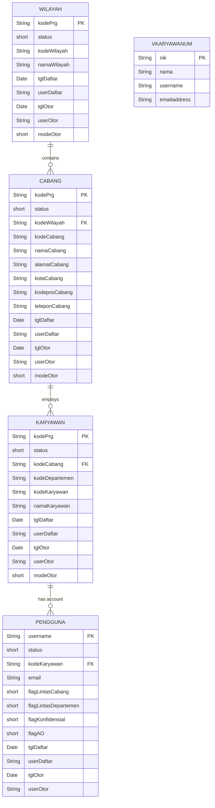

# Database Schemas

The application utilizes JPA `@Entity` classes to map to the underlying relational database. Based on the source code analysis, the following tables and relationships have been identified.

### Entities and Columns

**`Karyawan`** (Employees)
- `kodePrg` (String, Primary Key)
- `status` (short)
- `kodeCabang` (String) - *Foreign Key to Cabang*
- `kodeDepartemen` (String)
- `kodeKaryawan` (String)
- `namaKaryawan` (String)
- `tglDaftar` (Date)
- `userDaftar` (String)
- `tglOtor` (Date)
- `userOtor` (String)
- `modeOtor` (short)

**`Pengguna`** (Users)
- `username` (String, Primary Key)
- `status` (short)
- `kodeKaryawan` (String) - *Foreign Key to Karyawan*
- `email` (String)
- `flagLintasCabang` (short)
- `flagLintasDepartemen` (short)
- `flagKonfidensial` (short)
- `flagAO` (short)
- `tglDaftar` (Date)
- `userDaftar` (String)
- `tglOtor` (Date)
- `userOtor` (String)

**`Cabang`** (Branches)
- `kodePrg` (String, Primary Key)
- `status` (short)
- `kodeWilayah` (String) - *Foreign Key to Wilayah*
- `kodeCabang` (String)
- `namaCabang` (String)
- `alamatCabang` (String)
- `kotaCabang` (String)
- `kodeposCabang` (String)
- `teleponCabang` (String)
- `tglDaftar` (Date)
- `userDaftar` (String)
- `tglOtor` (Date)
- `userOtor` (String)
- `modeOtor` (short)

**`Wilayah`** (Regions)
- `kodePrg` (String, Primary Key)
- `status` (short)
- `kodeWilayah` (String)
- `namaWilayah` (String)
- `tglDaftar` (Date)
- `userDaftar` (String)
- `tglOtor` (Date)
- `userOtor` (String)
- `modeOtor` (short)

**`VKaryawanUM`** (View for Employee User Management)
- `nik` (String, Primary Key)
- `nama` (String)
- `username` (String)
- `emailaddress` (String)

**`PayrollNasabah`** (Temporary entity for processing Excel rows)
- `id` (String, Primary Key)
- `kode` (String)
- `norekening` (String)
- `nominal` (double)
- `tanda` (String)
- `noref` (String)
- `nama` (String)

### Entity-Relationship (ER) Diagram

