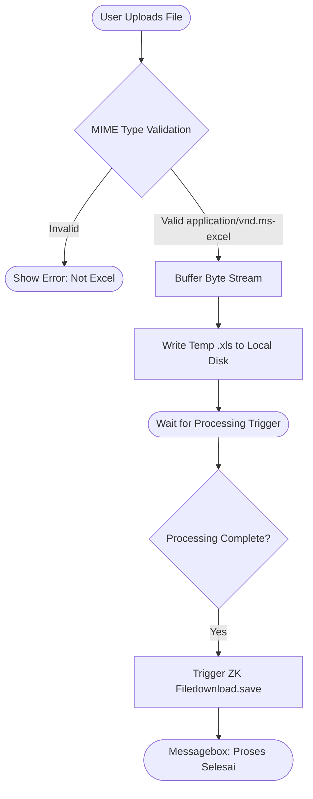

# Technical Specification: File Ingestion & Delivery Module

## 1. Module Overview
The **File Ingestion & Delivery Module** acts as the front-door gatekeeper and exit point for the Customer Payroll Handling System. Its primary business purpose is to securely capture, validate, and stage legacy Excel files (`.xls`) uploaded by Back Office staff, and subsequently manage the downstream delivery (downloading) of the successfully transformed text files.

## 2. Local Functional Flows & Scenarios
*   **File Selection & Validation:** The user browses for a local file. The module immediately checks the file's MIME type.
    *   *Scenario (Success):* If the file is `application/vnd.ms-excel`, it is accepted and temporarily staged.
    *   *Scenario (Failure):* If the user attempts to upload `.xlsx`, `.csv`, or `.pdf`, the module natively blocks it and shows: *"File Yang Diupload Bukan Format Excel."*
*   **Empty Upload Prevention:** If the user clicks "Upload" without a staged file, the module halts execution and prompts: *"Pilih File Terlebih Dahulu"*.
*   **File Delivery:** Upon receiving a success signal and a target file path from downstream processing modules, it triggers the browser to download the final fixed-width payload and alerts the user with *"Proses Selesai"*.

## 3. Local Technical Flows & Data Life Cycle
*   **Internal Components:** ZK Framework XML-based view (`prsPayrollNasabah.zul`), `PayrollNasabahViewModel.java` (controller).
*   **Local State Management:** Maintains the ephemeral UI state, such as `strFileName` (name of the uploaded file) and `strSelected` (the chosen processing mode: `0` or `1`).
*   **Staging File I/O:** 
    1. Intercepts the ZK `UploadEvent`.
    2. Reads the binary byte stream from `event.getMedia().getStreamData()`.
    3. Writes the stream to the local execution directory via `FileOutputStream` and `BufferedOutputStream`.
*   **Delivery I/O:** Uses ZK's `Filedownload.save(File)` wrapper to stream the generated `.txt` file back to the client, followed by `Messagebox.show("Proses Selesai")`.

### Ingestion & Delivery Flowchart

## 4. Interface & Dependencies
*   **Inbound Dependencies:**
    *   User HTTP Upload stream (binary Excel payload).
    *   User UI Interaction (`strSelected` mode selection parameter).
    *   Completion signals and local file paths (e.g., `DATAHASIL.txt`) passed back from the Processing Modules.
*   **Outbound Dependencies:**
    *   Passes the absolute path of the temporarily staged `.xls` file to the *Bulk Payroll Module* or *Many-to-Many Module*.
    *   Passes the selected processing mode variable (`strSelected`).
    *   Sends the final generated text file over HTTP back to the user's browser.
