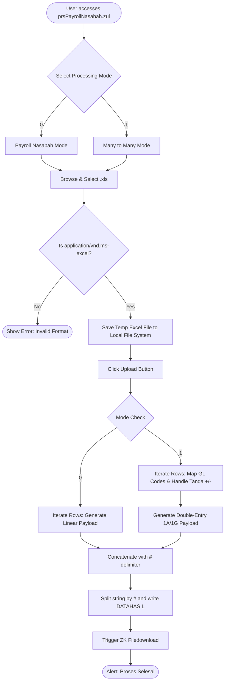
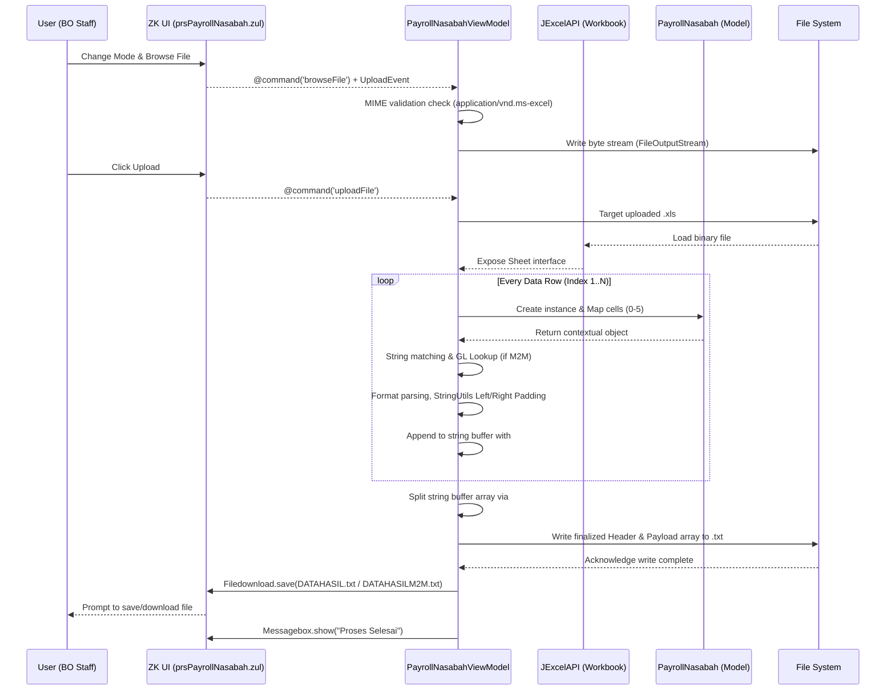

> **CHANGELOG - Clean Room Audit**
> * Updated technical sequence and architecture flow to note the `#` split string logic for payload construction.
> * Documented the exact dynamic Java classpath resolution used for staging local files `getClass().getProtectionDomain().getCodeSource().getLocation().getPath()`.

# Customer Payroll Handling System - Master Documentation

## 1. Executive Summary & High-Level Requirements

### Primary Business Purpose
This module serves as a critical translation layer for Back Office (BO) operations to process bulk financial transactions. Developed on the ZK Framework, it bridges human-readable Excel reports and the core banking/payment gateway systems by converting `.xls` batch grids into strict, fixed-width text formats (`DATAHASIL.txt` and `DATAHASILM2M.txt`). The system specifically caters to "Payroll Nasabah" (standard mass payroll disbursements) and complex "Many to Many" (M2M) clearing processes that map customer transactions to internal General Ledger (GL) accounts.

### Core High-Level Functional Requirements
1. **File Ingestion & Validation:** Securely upload and validate legacy Excel files (`.xls` / `application/vnd.ms-excel`), rejecting unsupported formats.
2. **Dual-Mode Processing:** 
   - **Payroll Nasabah (Mode 0):** Generate direct linear transfer payloads for standard mass payroll disbursements.
   - **Many-to-Many Mode (Mode 1):** Generate double-entry transaction payloads mapping source identifiers to specific internal GL accounts.
3. **Dynamic GL Mapping:** Interpret hardcoded institutional or product codes (e.g., `AXA`, `QRIS`, `JALI`, `LLG1`, `RTGS`) and route them to their corresponding 19-digit GL codes.
4. **Debit/Credit Reconciliation:** For M2M transactions, accurately reflect Credit (`+`) and Debit (`-`) mathematical flags on both user accounts and mapped GL accounts.
5. **Standardized Downstream Output:** Assemble output datasets into robust fixed-width text files with exact padding and string normalization, directly downloadable by the operating user.

---

## 2. User Scenarios & Personas

**Primary Persona:** Back Office (BO) Staff / Payroll Administrator

| Scenario | User Action | Expected System Outcome |
| :--- | :--- | :--- |
| **1. Standard Payroll Disbursement** | User selects "Payroll Nasabah" radio button, browses for a monthly employee `.xls` file, and clicks "Upload". | System parses row by row, computes total nominal amounts/rows, packages a `DATAHASIL.txt` with a `0PAYGROUP` header, and triggers a file download for the user. |
| **2. Partner Settlement (M2M)** | User selects "Many to Many" radio button and uploads a partner settlement sheet containing prefixes like `QRIS` or `AXA` and a `+`/`-` flag. | System evaluates the transaction `Kode`. It writes two rows per entry to `DATAHASILM2M.txt`: one representing the user's account operation (`1A`) and one representing the corresponding GL operation (`1G`), balancing credit/debit logic. |
| **3. Invalid File Format Upload** | User attempts to upload a `.xlsx`, `.csv`, or `.pdf` file. | The system natively blocks the file via ZK framework checks, intercepting the `UploadEvent` MIME type validation, and halts the operation with the prompt: *"File Yang Diupload Bukan Format Excel."* |
| **4. Empty Request Validation** | User clicks the "Upload" button before browsing for an Excel file. | System immediately halts execution and presents an error dialog: *"Pilih File Terlebih Dahulu"*. |

---

## 3. Functional Architecture & Workflows

The functional flow is driven by the ZK Framework's Model-View-ViewModel (MVVM) binding paradigm. Operations rely on ephemeral, in-memory transformations without persistent database storage logic at this processing step.

### Step-by-Step Business Logic
1. **Initialization:** The UI (`prsPayrollNasabah.zul`) loads, binding UI components to `PayrollNasabahViewModel`.
2. **Staging:** User triggers `@command('browseFile')`. The system catches the `UploadEvent`, verifies the MIME type, reads the byte stream, and temporarily writes the file to the local execution directory. 
3. **Execution Routing:** User clicks "Upload". The system checks `strSelected` bound to the radio buttons:
   - If `0` (Payroll), it routes to standard linear mapping logic.
   - If `1` (M2M), it routes to GL-aware double-entry logic.
4. **Data Iteration:** The JXL `Workbook` interprets the Excel file, bypassing the header (row 0), and creates a `PayrollNasabah` DTO for every row mapping columns `Kode`, `Norekening`, `Nominal`, `Tanda`, `Noref`, and `Nama`. 
5. **Report Generation:** For each mode, it aggregates mathematical totals, generates format-specific Headers, appends fixed-padding line items (using `StringUtils`). Every generated detail line is concatenated to a large string buffer, separated by a `#` character.
6. **Delivery:** The string buffer is split via the `#` character to execute a newline print loop to the local `DATAHASIL*.txt`. Finally, it dispatches the text file path into ZK's `Filedownload` response and alerts the user with "Proses Selesai".

### End-to-End Functional Journey Flowchart

---

## 4. Technical Architecture & Data Flow

### Technical Components
*   **Presentation Layer:** ZK Framework XML-based view definition (`prsPayrollNasabah.zul`) relying on `org.zkoss.bind.BindComposer`.
*   **Business/Binding Layer:** `PayrollNasabahViewModel.java`. This acts as an active controller using the `@NotifyChange` paradigm to react to UI events.
*   **Integration Utility:** JExcelAPI (`jxl.Workbook`) to parse binary `.xls` byte streams. Apache Commons Lang (`StringUtils`) is heavily relied upon for fixed-length formatting via padding operations.
*   **Domain Model:** `PayrollNasabah.java` serving as an ephemeral Data Transfer Object (DTO) capturing row data.

### Data Lifecycle & Mappings
The payload life cycle originates from an uploaded `.xls` file which is temporarily streamed to the server's disk. 
- In **M2M mode**, the system behaves as an API translation layer for downstream clearing. It utilizes string pattern matching (`contains`) on the `Kode` column to assign 19-digit General Ledger Identifiers. *E.g., "AXA" maps to `2130070000000005000`, "QRIS" maps to `5020190200000001000`.*
- Double-entry mapping is applied using the `Tanda` property:
  - **Sign `+`**: Account gets Credit (`C`), mapped GL gets Debit (`D`).
  - **Sign `-`**: Account gets Debit (`D`), mapped GL gets Credit (`C`).
- Once formatting is complete, data is written natively to a text file stream using `PrintWriter` and subsequently pushed back to the client via HTTP download wrappers in ZK.

### Technical Sequence Diagram

---

## 5. State Management & Constraints

### State Management
*   **Session & Execution State:** Application states (`strFileName`, `strSelected`, `jmlhrecord`, `sumNominal`) are stored safely in prototype memory scoped exclusively to the ViewModel's Active BindContext.
*   **Multi-execution resilience:** Upon processing a new file, variables like accumulators (`jmlhrecord = 0`, `sumNominal = 0`) and accumulative string builders (`kontenTxt = ""`) are explicitly flushed and reset, preventing cumulative state leaking across consecutive executions.

### Technical Constraints & Security Validations
1. **Format Lock-In:** The utilization of the `jxl` API explicitly restricts incoming documents to Microsoft Excel 97-2003 `.xls` format. The system actively blocks `.xlsx` files due to library constraints and MIME validation.
2. **Hardcoded Business Logic (Technical Debt):** General Ledger mappings exist as rigid `if-else if` blocks directly inside the ViewModel. Any business updates to clearing accounts currently require a source code modification and full environment deployment rather than simple externalized configuration mappings.
3. **Local Filesystem Dependency (Classpath Binding):** The application resolves the temp file writing path by invoking `getClass().getProtectionDomain().getCodeSource().getLocation().getPath()`. This means it binds explicitly to the deployed environment's executable base path (e.g., inside the application server's staging or classes directory) rather than an isolated temp or network drive. In modern auto-scaling infrastructures, relying on local OS file path I/O for staging operations may result in permissions issues or file access errors.
4. **Implicit Exception Vulnerabilities:** The application trusts the values natively interpreted from Excel columns via Strings. For example, `Double.parseDouble(sh.getCell(2, i).getContents())` possesses no `try/catch` wrappers. If the Excel cell contains non-numeric inputs for a nominal value, it will trigger an unhandled `NumberFormatException`, breaking the upload flow.
