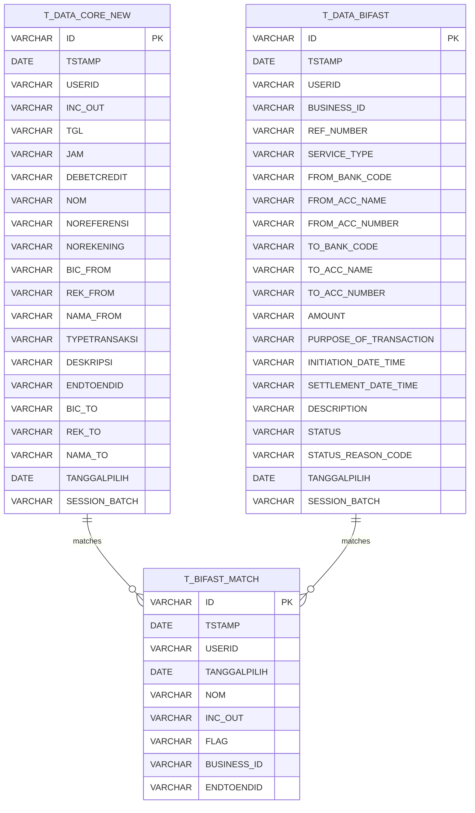

# Rekon BIFast Data Architecture

> **CHANGELOG:**
> - Removed legacy framework references (Hibernate, Java classes, Apache POI).
> - Abstracted file parsing rules and database interactions to focus on data contracts and business logic.
> - Formalized the configuration externalization strategy without Java-specific annotations.

## 1. Database Schemas

The application connects to the relational database and directly executes queries against the `bifast` schema. 

### Key Database Tables

| Table Name | Description / Entity Mapping |
| --- | --- |
| `bifast.t_data_core_new` | Stores core system transaction data (mapped to `DataCore` / `DataCoreNG`). |
| `bifast.t_data_bifast` | Stores BI Fast transaction data (mapped to `DataBiFast`). |
| `bifast.t_bifast_match` | Stores matched transactions between the core system and BI Fast (mapped to `BiFastMatch`). |
| `bifast.t_bifast_core_only` | Stores unmatched Core transactions (legacy). |
| `bifast.t_bifast_core_only_ng` | Stores unmatched Core transactions (mapped to `BiFastCoreOnlyNG`). |
| `bifast.t_bifast_only` | Stores unmatched BI Fast transactions (mapped to `BiFastOnly`). |

### Entity-Relationship Diagram



*Note: Match logic heavily depends on concatenating matching keys like `core.endtoendid || core.nom = bifast.business_id || bifast.amount`.*

## 2. File-Based Data Structures

Data ingestion happens manually through file uploads handled by the presentation layer.

### Core Data File (`.CSV`)
- **Format:** Comma-Separated Values.
- **Expected Naming Convention:** `BFAST{yyyyMMdd}.CSV`
- **Parsing Logic:** The parser reads the file line by line and maps the columns by index to the Core transaction entity. For example, column 0 maps to `inc_out`, column 17 to `endtoendid`. The ingestion process also includes data cleansing, such as comma replacement and stripping trailing decimals (e.g., `.00`).

### BI Fast Data File (`.XLSX`)
- **Format:** Excel Workbook.
- **Expected Naming Convention:** `TRANSACTIONENQUIRYREPORT_{ddMMyyyy}.XLSX`
- **Parsing Logic:** The system skips the first 18 rows (header/metadata) and processes the data rows up to a maximum of 50,000 records. Excel columns map sequentially to the BI-FAST transaction entity. For example, column 2 maps to `business_id`, column 10 to `amount`.

## 3. Master Data & Hardcoded Values

Several configuration rules and data transformations are hardcoded directly into the system:

- **File Naming Rules:** The system strictly expects `"BFAST" + date + ".CSV"` and `"TRANSACTIONENQUIRYREPORT_" + date + ".XLSX"`.
- **Excel Row Offset:** The start index for data in the BI-FAST report is hardcoded to offset 18.
- **Transaction Status Values:** Permitted statuses for BI-FAST transactions are hardcoded to `"Successful"`, `"Credit Transfer"`, and `"Credit Transfer with Proxy"`.
- **String Manipulations for Amount Values:** Hardcoded cleansing logic removes specific string sequences (`.00`), replaces separators (`,` with `.`), and falls back empty `endtoendid` fields to a default text if exactly 35 spaces are found.
- **Database Schema references:** The database schema prefix `bifast.` is explicitly hardcoded in all data access queries.

## 4. Configuration Externalization Strategy

To decouple business logic and data mappings from the compiled application code, the following configuration structure (e.g., `application.yml` or a database configuration table) is proposed:

```yaml
bifast:
  file:
    core:
      naming-pattern: "BFAST{yyyyMMdd}.CSV"
      delimiter: ","
    report:
      naming-pattern: "TRANSACTIONENQUIRYREPORT_{ddMMyyyy}.XLSX"
      start-row: 18
      max-rows: 50000

  transactions:
    valid-statuses:
      - "Successful"
    valid-service-types:
      - "Credit Transfer"
      - "Credit Transfer with Proxy"

  database:
    schema: "bifast"
```

**Implementation Strategy:**
1. Extract file naming conventions and row limits to external configuration files.
2. Abstract the file column mappings to avoid relying on hardcoded positional indices. A column-header mapping approach would be more resilient.
3. Replace hardcoded `bifast.` schema prefixes in queries with configurable schema bindings or let the ORM manage the default schema.
