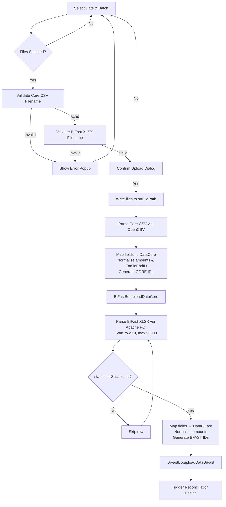

# Module: BIFast File Ingestion

> **CHANGELOG:**
> - Added missing logic for `EndToEndID` default fallback value (replacement of 35 spaces).
> - Corrected BI-FAST amount formatting logic (comma to dot replacement and trailing zero strip).
> - Documented dead code condition in BI-FAST service type filter.

> **Sub-program**: Rekon BIFast  
> **Module ID**: `bifast-ingestion`  
> **Owner Component**: `BiFastViewModel.java` (upload + parse methods)  
> **Backend Service**: `BiFastBo.uploadDataCore()`, `BiFastBo.uploadDataBiFast()`

---

## 1. Module Overview

This module is responsible for the entire lifecycle of getting raw settlement data into the system — from user-initiated file upload through validation, parsing, and database persistence. It handles two distinct file sources:

- **Core Banking CSV** (`BFASTyyyyMMdd.CSV`) — the bank's own record of BI-FAST transactions.
- **BI-FAST Transaction Enquiry Report** (`TransactionEnquiryReport_ddMMyyyy.xlsx`) — the external settlement report from Bank Indonesia's BI-FAST network.

The module enforces strict filename validation tied to the selected reconciliation date, performs format-specific parsing (CSV vs. XLSX), applies data transformation rules (amount normalisation, status filtering), generates composite IDs, and persists parsed records to the database via SOAP web service calls.

### Scope Boundaries
- **IN scope**: File browse, filename validation, file-to-disk save, CSV/XLSX parsing, data transformation, ID generation, DB persistence calls.
- **OUT of scope**: Matching logic (→ `mod_reconciliation_engine`), result viewing (→ `mod_reporting_export`), authentication (→ Portal system).

---

## 2. Local Functional Flows & Scenarios

### 2.1 Core Banking CSV Ingestion

**Trigger**: User selects date + batch, browses for CSV file, confirms upload.

**Steps**:
1. User selects reconciliation date via `datTanggal` datebox.
2. User selects batch number (Batch 1–9) via `batch` dropdown.
3. User triggers `browseFile()` → ZK `UploadEvent` fires.
4. **Filename validation**: uploaded name must exactly match `BFAST{yyyyMMdd}.CSV` (case-insensitive) for the selected date.
   - Invalid → `Messagebox.show("File Core yang Diupload Tidak Sesuai Format")`, file rejected.
5. Valid file is written to `strFilePath` on server filesystem.
6. On upload confirmation, CSV is read via OpenCSV.
7. For each row, fields are mapped to `DataCore`:
    - `inc_out`, `tgl`, `jam`, `debetcredit`, `nom`, `noreferensi`, `norekening`
    - `bic_from`, `bic_to`, `nama_from`, `nama_to`
    - `typetransaksi`, `deskripsi`, `endtoendid`
8. **Amount normalisation**: trailing `.X0` patterns stripped (`.10`→`.1`, `.00`→ removed).
9. **EndToEndID fallback**: If `endtoendid` is exactly 35 spaces, it is replaced with `"Kosong Karena Tidak ada EndtoEndID"`.
10. **Composite ID generated**: `CORE{yyyyMMdd}{seq9}{batch}` — zero-padded 9-digit sequence.
11. Batch of `List<DataCore>` sent to `BiFastBo.uploadDataCore()`.
12. Service persists to `t_data_core` table.

### 2.2 BI-FAST XLSX Ingestion

**Trigger**: Same as above, second file upload slot.

**Steps**:
1. User triggers `browseFile()` for XLSX slot.
2. **Filename validation**: must match `TransactionEnquiryReport_{ddMMyyyy}.XLSX` (case-insensitive).
3. Valid file saved to `strFilePath`.
4. XLSX read via Apache POI, starting from **row 19** (0-indexed row 18) — rows 1–18 are header/metadata.
5. Loop iterates up to 50,000 rows; exits on first empty `business_id`.
6. **Status filter**: Only rows where `status == "Successful"` are kept. (Note: The implementation contains a dead logic condition attempting to include specific service types, but it is unsatisfiable).
7. **Amount normalisation**: Commas are replaced with dots (`,00`→`.00`). If the amount ends in a comma followed by a digit and a zero (e.g. `,X0`), the trailing zero is stripped.
8. **Composite ID**: `BFAST{yyyyMMdd}{seq9}{batch}`.
9. Batch of `List<DataBiFast>` sent to `BiFastBo.uploadDataBiFast()`.
10. Service persists to `t_data_bifast` table.

### 2.3 Error Scenarios

| Scenario | Behaviour |
|---|---|
| Date or batch not selected | `Messagebox.show("Pilih Tanggal dan Batch...")` — upload blocked |
| Core CSV filename mismatch | File rejected, error popup, no data persisted |
| BIFast XLSX filename mismatch | File rejected, error popup, no data persisted |
| User declines confirmation dialog | No action taken (`Messagebox.ON_NO` branch) |
| Empty XLSX row encountered | `break` — graceful loop termination |
| File directory missing | Auto-created via `file.mkdir()` on `@Init` |

### 2.4 Functional Flowchart

---

## 3. Local Technical Flows & Data Life Cycle

### 3.1 Key Methods

| Method | Location | Purpose |
|---|---|---|
| `browseFile()` | `BiFastViewModel` | ZK `@Command` — handles `UploadEvent`, validates filename, saves to disk |
| `uploadFileBiFast()` | `BiFastViewModel` | Orchestrates: parse Core CSV → parse BIFast XLSX → call service → trigger matching |
| `uploadDataCore(List<DataCore>)` | `BiFastBo` (WS) | Persists Core records to `t_data_core` |
| `uploadDataBiFast(List<DataBiFast>)` | `BiFastBo` (WS) | Persists BIFast records to `t_data_bifast` |
| `resetFile()` | `BiFastViewModel` | Clears all `strFile*` state variables |

### 3.2 Data Models

| Entity | Fields | Table |
|---|---|---|
| `DataCore` | `id` (CORE+date+seq+batch), `inc_out`, `tgl`, `jam`, `debetcredit`, `nom`, `noreferensi`, `norekening`, `bic_from`, `bic_to`, `nama_from`, `nama_to`, `typetransaksi`, `deskripsi`, `endtoendid`, `tanggalpilih`, `userid`, `tstamp` | `t_data_core` |
| `DataBiFast` | `id` (BFAST+date+seq+batch), `business_id`, `status`, `amount`, `sender_bic`, `receiver_bic`, `sender_name`, `receiver_name`, `endtoendid`, `tanggalpilih`, `userid`, `tstamp` | `t_data_bifast` |

### 3.3 State Variables (Local to this Module)

| Variable | Type | Description |
|---|---|---|
| `datTanggal` | `Date` | Selected reconciliation date |
| `batch` | `String` | Selected batch ("Batch 1" → extracted as "1" via `substring(6,7)`) |
| `strFileCore` | `String` | Core CSV filename after validation |
| `strFileBfast` | `String` | BIFast XLSX filename after validation |
| `strFilePath` | `String` | Server filesystem path (class-path derived + "/BiFast/") |
| `strUserName` | `String` | Current user (for `userid` field on records) |

### 3.4 ID Generation Rules

| Source | Pattern | Example |
|---|---|---|
| Core CSV | `CORE{yyyyMMdd}{seq9zero-padded}{batch}` | `CORE20241003000000011` |
| BIFast XLSX | `BFAST{yyyyMMdd}{seq9zero-padded}{batch}` | `BFAST20241003000000011` |

---

## 4. Interface & Dependencies

### 4.1 Inbound Dependencies

| Source | Data / Trigger | Description |
|---|---|---|
| **Portal System** | `sessionId`, `username` (URL params) | Authentication context — required for `userid` on every record |
| **ZK Framework** | `UploadEvent` | Browser file upload event with `getMedia()` for file bytes |
| **User Input** | `datTanggal`, `batch` selection | Determines filename validation pattern and record tagging |

### 4.2 Outbound Dependencies

| Target | Data / Trigger | Description |
|---|---|---|
| **BiFastBo (SOAP WS)** | `uploadDataCore(List<DataCore>)` | Persists parsed Core records to DB |
| **BiFastBo (SOAP WS)** | `uploadDataBiFast(List<DataBiFast>)` | Persists parsed BIFast records to DB |
| **Reconciliation Engine Module** | Sequential trigger after both uploads complete | After ingestion, `InsBiFastCoreOnly()`, `InsBiFastOnly()`, `InsBiFastSinkronMatch()` are called (see `mod_reconciliation_engine.md`) |
| **Server Filesystem** | File write to `strFilePath` | Temporary storage of uploaded files |
