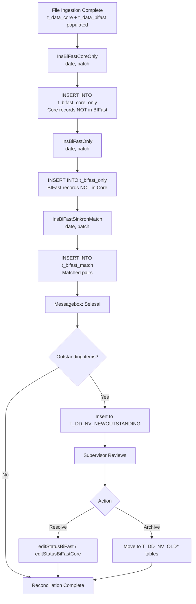
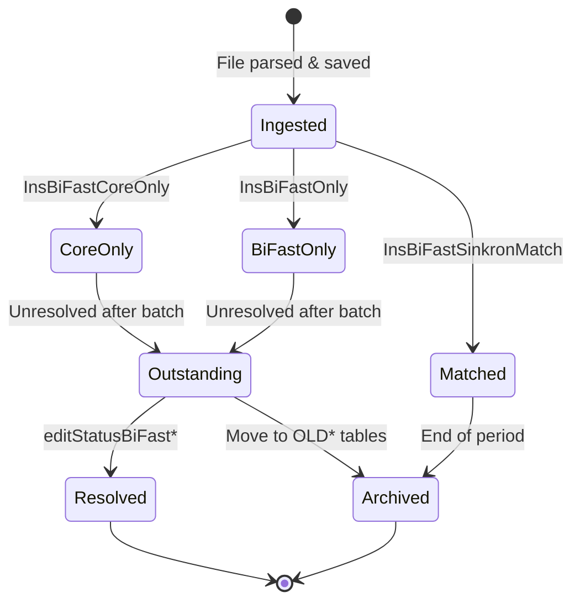

# Module: BIFast Reconciliation Engine

> **CHANGELOG:**
> - Updated Matching Key Logic to reflect the actual SQL string concatenation (`endtoendid||nom = business_id||amount`).
> - Clarified that matching is strictly scoped to the exact same `session_batch`.

> **Sub-program**: Rekon BIFast  
> **Module ID**: `bifast-reconciliation-engine`  
> **Owner Component**: `BiFastBo` (service layer — stored procedures / matching logic)  
> **Trigger**: Called by `BiFastViewModel` after file ingestion completes

---

## 1. Module Overview

This module implements the core matching logic that compares ingested Core Banking records (`t_data_core`) against BI-FAST settlement records (`t_data_bifast`) and produces three reconciliation result sets:

1. **Match** (`t_bifast_match`) — Transactions found in both Core Banking and BI-FAST.
2. **BIFast-Only** (`t_bifast_only`) — Transactions in the BI-FAST report but absent from Core Banking.
3. **Core-Only** (`t_bifast_core_only`) — Transactions in Core Banking but absent from the BI-FAST report.

Additionally, this module manages **outstanding items** (`T_DD_NV_NEWOUTSTANDING`) — unmatched records carried forward from previous reconciliation runs — and allows supervisors to manually override statuses on discrepancies.

### Scope Boundaries
- **IN scope**: Matching execution, result set generation, outstanding item lifecycle, manual status override.
- **OUT of scope**: File parsing (→ `mod_file_ingestion`), result display/export (→ `mod_reporting_export`).

---

## 2. Local Functional Flows & Scenarios

### 2.1 Automated Matching (Happy Path)

**Trigger**: Immediately after `mod_file_ingestion` completes both Core and BIFast uploads for a given `(date, batch)`.

**Execution sequence** (all three run sequentially, in order):

1. **`InsBiFastCoreOnly(date, batch)`**
   - Scans `t_data_core` for records on `date`+`batch` that have no matching counterpart in `t_data_bifast`.
   - Matching key: based on `noreferensi` / `endtoendid` and amount.
   - Result: INSERT INTO `t_bifast_core_only`.

2. **`InsBiFastOnly(date, batch)`**
   - Scans `t_data_bifast` for records on `date`+`batch` that have no matching counterpart in `t_data_core`.
   - Result: INSERT INTO `t_bifast_only`.

3. **`InsBiFastSinkronMatch(date, batch)`**
   - Produces the matched result set — pairs of Core + BIFast records that align on the matching key.
   - Result: INSERT INTO `t_bifast_match`.

4. On success: `Messagebox.show("Selesai")` displayed to the user.

### 2.2 Outstanding Item Management

**Context**: Items that remain in Core-Only or BIFast-Only after repeated reconciliation runs are tracked as outstanding.

| Step | Action |
|---|---|
| 1 | Unmatched items from today's run are inserted into `T_DD_NV_NEWOUTSTANDING` |
| 2 | Operator browses outstanding items filtered by date range |
| 3 | When resolved, supervisor calls `editTempAktif()` to set `aktif` flag |
| 4 | Archived items move to `T_DD_NV_OLDMATCH` / `T_DD_NV_OLDCOREONLY` / `T_DD_NV_OLDNPGONLY` |

### 2.3 Manual Status Override

**Personas**: Back-Office Supervisor

| Scenario | Method | Effect |
|---|---|---|
| Override BIFast-Only item | `editStatusBiFast(item)` | Mark as "Resolved" / "Investigated" |
| Override Core-Only item | `editStatusBiFastCore(item)` | Mark as "Resolved" |
| Override Core-Only NG item | `editStatusBiFastCoreNG(item)` | Mark as "No Good" (confirmed error) |

### 2.4 Batch Re-processing

- Each batch within the same date is **isolated** by the batch identifier appended to record IDs.
- Re-processing Batch 2 does **not** overwrite Batch 1 data.
- The matching engine re-runs for the specified `(date, batch)` tuple only.

### 2.5 Reconciliation Engine Flowchart

---

## 3. Local Technical Flows & Data Life Cycle

### 3.1 Key Service Methods

| Method | Interface | Purpose |
|---|---|---|
| `InsBiFastCoreOnly(Date, String batch)` | `BiFastBo` | Identify Core records absent from BIFast; INSERT results |
| `InsBiFastOnly(Date, String batch)` | `BiFastBo` | Identify BIFast records absent from Core; INSERT results |
| `InsBiFastSinkronMatch(Date, String batch)` | `BiFastBo` | Produce matched pairs; INSERT results |
| `editStatusBiFast(item)` | `BiFastBo` | Update status flag on a BIFast-Only record |
| `editStatusBiFastCore(item)` | `BiFastBo` | Update status flag on a Core-Only record |
| `editStatusBiFastCoreNG(item)` | `BiFastBo` | Mark Core-Only record as "No Good" |
| `editTempAktif(T_DD_NV_NEWOUTSTANDING)` | `BiFastBo` | Toggle outstanding item active flag |

### 3.2 Result Data Models

| Entity | Table | Description |
|---|---|---|
| `BiFastMatch` | `t_bifast_match` | Matched pairs: joined Core + BIFast record |
| `BiFastOnly` | `t_bifast_only` | BIFast records with no Core counterpart |
| `BiFastCoreOnlyNG` | `t_bifast_core_only` | Core records with no BIFast counterpart |
| `T_DD_NV_NEWOUTSTANDING` | `t_dd_nv_newoutstanding` | Open/unresolved items pending action |
| `T_DD_NV_NEWMATCH` | `t_dd_nv_newmatch` | Current period matched archive |
| `T_DD_NV_OLDMATCH` | `t_dd_nv_oldmatch` | Historical match archive |

### 3.3 Matching Key Logic

The matching algorithm (implemented server-side) uses a composite string concatenation to pair records. Specifically, the SQL condition is:
`core.endtoendid || core.nom = bifast.business_id || bifast.amount`

Additionally, records are strictly scoped to the exact same `session_batch` during matching.

| Core Banking Field | BIFast Report Field | Match Criterion |
|---|---|---|
| `endtoendid` | `business_id` | Mapped as the primary identifier |
| `nom` (normalised amount) | `amount` (normalised) | Appended to the identifier |
| `session_batch` | `session_batch` | Exact string match |

### 3.4 Data State Transitions

---

## 4. Interface & Dependencies

### 4.1 Inbound Dependencies

| Source | Data / Trigger | Description |
|---|---|---|
| **File Ingestion Module** | `t_data_core` populated, `t_data_bifast` populated | Prerequisites — both tables must have records for the target `(date, batch)` before matching runs |
| **BiFastViewModel** | `(datTanggal, batch)` parameters | Date and batch identifiers passed to all three matching methods |
| **Supervisor (UI)** | Status override request | `editStatusBiFast*()` calls with item reference |

### 4.2 Outbound Dependencies

| Target | Data / Trigger | Description |
|---|---|---|
| **Database** | INSERT into `t_bifast_match`, `t_bifast_only`, `t_bifast_core_only` | Result sets written for downstream consumption |
| **Database** | INSERT/UPDATE `t_dd_nv_newoutstanding` | Outstanding items for carry-forward |
| **Reporting & Export Module** | Result tables populated | `mod_reporting_export` queries these tables to render grids and generate Excel |
| **BiFastViewModel** | Void return + success notification | UI displays "Selesai" message on completion |
