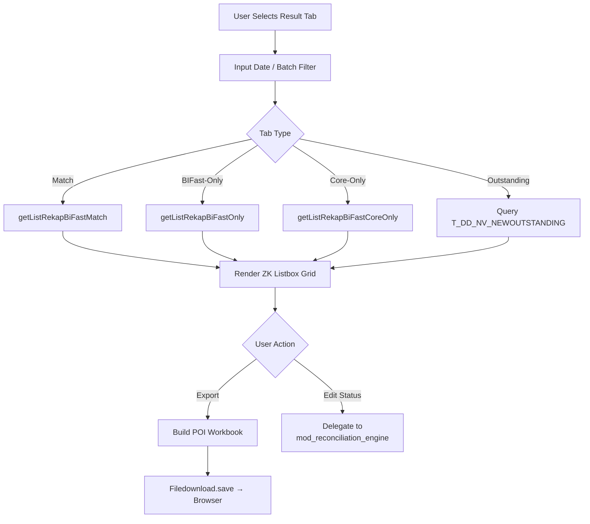

# Module: BIFast Reporting & Export

> **CHANGELOG:**
> - Updated Excel Export documentation to reflect the actual sheet names (`MATCH`, `CORE ONLY`, `BIFAST ONLY`) and their order.

> **Sub-program**: Rekon BIFast  
> **Module ID**: `bifast-reporting-export`  
> **Owner Component**: `BiFastViewModel.java` (query + export methods)  
> **Backend Service**: `BiFastBo.getListRekap*()` methods

---

## 1. Module Overview

This module handles the presentation and export of reconciliation results to end users. After the Reconciliation Engine populates the match/discrepancy result tables, this module provides:

1. **Tabbed result viewing** — Match, BIFast-Only, Core-Only, and Outstanding tabs rendered in ZK `Listbox` grids.
2. **Date-based filtering** — Users filter results by reconciliation date and/or batch.
3. **Excel export** — Generates `.xls` / `.xlsx` workbooks via Apache POI (HSSF/XSSF) and streams them to the browser.

### Scope Boundaries
- **IN scope**: Querying result sets from DB, rendering in UI grids, applying filters, building Excel workbooks, triggering browser download.
- **OUT of scope**: Data ingestion (→ `mod_file_ingestion`), matching logic (→ `mod_reconciliation_engine`).

---

## 2. Local Functional Flows & Scenarios

### 2.1 Viewing Reconciliation Results

**Trigger**: User navigates to a result tab after reconciliation is complete.

**Steps**:
1. User selects a result tab: **Match**, **BIFast-Only**, **Core-Only**, or **Outstanding**.
2. User inputs a date (or date range) and optionally a batch filter.
3. ViewModel calls the corresponding `BiFastBo` query method:
   - `getListRekapBiFastMatch(date, batch)` → `List<BiFastMatch>`
   - `getListRekapBiFastOnly(date, batch)` → `List<BiFastOnly>`
   - `getListRekapBiFastCoreOnly(date, batch)` → `List<BiFastCoreOnlyNG>`
   - Outstanding tab uses `T_DD_NV_NEWOUTSTANDING` query with date range.
4. ZK `Listbox` renders the result set as a scrollable grid.
5. `@NotifyChange` propagates data updates reactively to the UI.

### 2.2 Excel Export

**Trigger**: User clicks "Export to Excel" button.

**Steps**:
1. ViewModel retrieves the current result set(s) from the service layer (if not already cached).
2. Apache POI builds an `HSSFWorkbook` or `XSSFWorkbook`:
   - Sheet 1: "MATCH" results
   - Sheet 2: "CORE ONLY" results
   - Sheet 3: "BIFAST ONLY" results
3. Column headers, cell styles, and data rows are written programmatically.
4. Workbook saved to a temporary file in `strFilePath`.
5. `Filedownload.save()` streams the file to the user's browser.
6. Temporary file is available for subsequent downloads within the same session.

### 2.3 User Scenarios

#### Scenario A — View Match Tab and Export
1. Officer selects date 2024-10-03, Batch 1.
2. Opens **Match** tab → grid displays all matched records.
3. Clicks **Export** → downloads `BiFast_Match_20241003.xls`.

#### Scenario B — Filter Outstanding by Date Range
1. Supervisor selects `datTanggalAwal` = Oct 1, `datTanggalAkhir` = Oct 7.
2. Outstanding tab refreshes → shows all unresolved items for the week.
3. Supervisor selects an item → navigates to status edit (→ handled by `mod_reconciliation_engine`).

#### Scenario C — Empty Result Set
1. Officer selects a date with no reconciliation data.
2. Grid renders empty.
3. Export produces an Excel file with headers only (no data rows).

### 2.4 Reporting Flowchart

---

## 3. Local Technical Flows & Data Life Cycle

### 3.1 Key Methods

| Method | Location | Purpose |
|---|---|---|
| `getListRekapBiFastMatch(date, batch)` | `BiFastBo` (WS) | Query matched result set |
| `getListRekapBiFastOnly(date, batch)` | `BiFastBo` (WS) | Query BIFast-only result set |
| `getListRekapBiFastCoreOnly(date, batch)` | `BiFastBo` (WS) | Query Core-only result set |
| `exportToExcel()` | `BiFastViewModel` | ZK `@Command` — builds workbook and triggers download |
| `Filedownload.save()` | ZK Framework | Streams file to browser |

### 3.2 Excel Generation Details

| Aspect | Detail |
|---|---|
| **Library** | Apache POI — HSSF (`.xls`) and XSSF (`.xlsx`) |
| **Sheet Structure** | One sheet per result type (Match, Only, CoreOnly) |
| **Styling** | Header row with bold font (`HSSFFont`), column auto-sizing |
| **Cell Types** | String cells for text fields, numeric cells for amounts |
| **File Naming** | Pattern: `BiFast_{ResultType}_{yyyyMMdd}.xls` |
| **Delivery** | `Filedownload.save(file, contentType)` — direct browser download |

### 3.3 State Variables (Local to this Module)

| Variable | Type | Description |
|---|---|---|
| `datTanggal` | `Date` | Filter: selected reconciliation date |
| `batch` | `String` | Filter: selected batch number |
| `listMatch` | `List<BiFastMatch>` | Cached match result set |
| `listOnly` | `List<BiFastOnly>` | Cached BIFast-only result set |
| `listCoreOnly` | `List<BiFastCoreOnlyNG>` | Cached Core-only result set |
| `listOutstandingEdit` | `List<T_DD_NV_NEWOUTSTANDING>` | Outstanding items for display/edit |
| `selected` | `Object` | Currently selected row in grid |

---

## 4. Interface & Dependencies

### 4.1 Inbound Dependencies

| Source | Data / Trigger | Description |
|---|---|---|
| **Reconciliation Engine Module** | Populated result tables (`t_bifast_match`, `t_bifast_only`, `t_bifast_core_only`) | Query source for all result sets |
| **User Input** | `datTanggal`, `batch`, date range | Filter parameters for queries |
| **ZK Framework** | `@NotifyChange` bindings | Reactive UI refresh on data change |

### 4.2 Outbound Dependencies

| Target | Data / Trigger | Description |
|---|---|---|
| **BiFastBo (SOAP WS)** | `getListRekap*()` calls | Retrieves result data from service layer |
| **Browser (User)** | `.xls` / `.xlsx` file download | Excel report delivered via `Filedownload.save()` |
| **Reconciliation Engine Module** | Status edit delegation | When user clicks "Edit Status" on a discrepancy row, the action is handled by `mod_reconciliation_engine` |
| **Server Filesystem** | Temporary Excel file | POI workbook saved to `strFilePath` before streaming |
