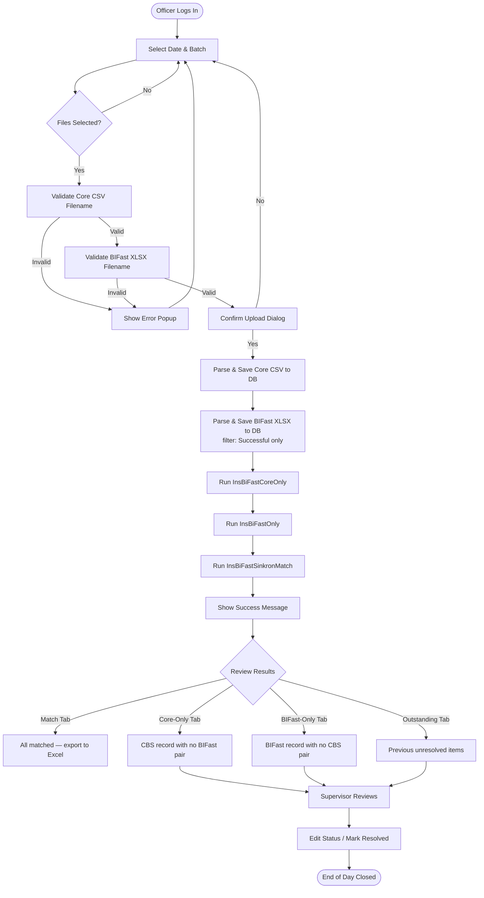
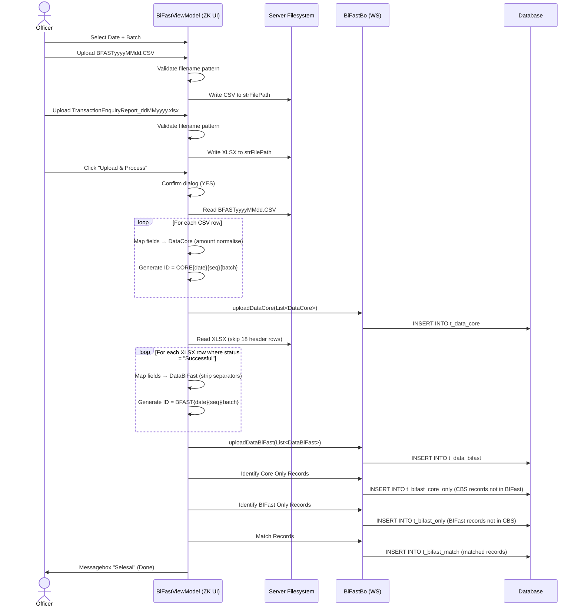

# Rekon BIFast — System Documentation

> **CHANGELOG:**
> - Abstracted system architecture to remove legacy framework references (Java EE, ZK Framework, Apache Tomcat, Apache POI).
> - Updated module descriptions to focus on system behaviours and data contracts rather than specific code implementations.

> **Source of Truth** for developers and AI coding agents  
> **Module path**: `reconcile-system/Rekon BIFast`  
> **Last updated**: 2026-06-07

---

## 1. Executive Summary & High-Level Requirements

### 1.1 Business Purpose
**Rekon BIFast** is the reconciliation module responsible for cross-checking real-time fund-transfer transactions processed through **Bank Indonesia's BI-FAST payment network** against the bank's own **Core Banking System (CBS)**. Its primary goal is to detect and categorise discrepancies that arise when a transaction is recorded in one system but not the other, ensuring the bank's books are always balanced at the end of each processing batch.

The system operates inside Bank Maspion Indonesia's intranet as a web-based portal.

### 1.2 Core High-Level Functional Requirements

| # | Requirement | Derived From |
|---|---|---|
| FR-01 | Accept daily upload of a **Core Banking CSV file** (naming format: `BFASTyyyyMMdd.CSV`) | Strict file name validation prior to upload |
| FR-02 | Accept daily upload of a **BI-FAST Transaction Enquiry Report XLSX** (naming: `TransactionEnquiryReport_ddMMyyyy.xlsx`) | Strict file name validation prior to upload |
| FR-03 | Validate file names match the selected reconciliation date before upload | Date-based filename validation check |
| FR-04 | Parse and persist Core Banking transaction records to the DB | Core file ingestion service |
| FR-05 | Parse and persist BI-FAST transaction records; filter to only `Successful` status transactions | BI-FAST file ingestion service |
| FR-06 | Execute automated matching: produce **Match**, **BIFast-Only** (not in Core), and **Core-Only** (not in BIFast) result sets | Matching engine execution |
| FR-07 | Support batch-level processing (Batch 1–9) within the same calendar date | Batch scope isolation during ingestion and matching |
| FR-08 | Allow operators to view and filter reconciliation results by date range | Result presentation layer |
| FR-09 | Allow manual status override of outstanding/unmatched items | Exception handling and resolution workflows |
| FR-10 | Export reconciliation results to Excel (XLS/XLSX) for reporting | Export generation service |
| FR-11 | Manage a Direct Debit (DD) master data table alongside BI-FAST reconciliation | Master data management module |
| FR-12 | Maintain session-based authentication via a parent Portal system | Single Sign-On and session management |

---

## 2. User Scenarios & Personas

### 2.1 Personas

| Persona | Role | System Access |
|---|---|---|
| **Settlement Officer** | Daily operator who runs reconciliation | Upload files, trigger matching, view results |
| **Back-Office Supervisor** | Reviews exceptions and overrides statuses | View all result sets, edit outstanding items |
| **IT / System Admin** | Maintains master data tables | CRUD on `MstDD`, merchant codes, rekening |

### 2.2 End-to-End User Scenarios

#### Scenario A — Happy Path: Full Daily Reconciliation
1. Officer logs in via parent portal; session ID is injected as URL parameter.
2. Selects **reconciliation date** and **batch number** (e.g., Batch 1).
3. Browses and selects `BFAST20241003.CSV` (Core file) — system validates filename.
4. Browses and selects `TransactionEnquiryReport_03102024.xlsx` (BI-FAST file) — system validates filename.
5. Clicks **Upload Files** → confirmation dialog appears.
6. Confirms upload → system parses both files, persists to DB, then auto-runs 3 matching procedures.
7. Views results on the **Match** tab — all transactions aligned.
8. Exports result to `.xls` for archival.

#### Scenario B — Discrepancy Found: Core-Only
1. After Step 6 above, items appear in the **Core-Only** tab (transaction in CBS but not in BI-FAST report).
2. Supervisor filters by date/reference number.
3. Investigates root cause (e.g., BI-FAST submission timed out).
4. Manually sets status to "Resolved" via the status-edit dialog.

#### Scenario C — Discrepancy Found: BIFast-Only
1. BI-FAST report contains a successful transfer not recorded in Core Banking.
2. Appears in the **BIFast-Only** tab.
3. Supervisor raises a manual journal entry and marks the item as reconciled.

#### Scenario D — Wrong File Uploaded
1. Officer selects wrong date or misnamed file.
2. System shows popup: `"File BI FAST yang Diupload Tidak Sesuai Format"`.
3. File is rejected; no data is persisted.

#### Scenario E — Outstanding from Previous Day
1. Prior day items remain unmatched (in `T_DD_NV_NEWOUTSTANDING`).
2. Operator browses the Outstanding tab with date filter.
3. Edits active status to close the item once resolved.

#### Scenario F — Batch Re-processing
1. Data issue discovered after Batch 1 upload.
2. Officer re-selects Batch 2 for the same date.
3. System tags data with batch identifier; previous batch data is not overwritten.

---

## 3. Functional Architecture & Workflows

### 3.1 Step-by-Step Business Logic

### 3.1 Step-by-Step Business Logic

1. **Initialisation** — Session state and user authentication context are established from the portal URL parameters. A temporary file storage directory is created if it does not exist.
2. **File Selection** — User picks a date and batch, then uploads the two mandatory files. File names are strictly validated against expected patterns before saving.
3. **Data Ingestion (Core Banking File)** — The CSV is parsed row-by-row. Extracted fields: `inc_out`, `tgl`, `jam`, `debetcredit`, `nom`, `noreferensi`, `norekening`, `bic_from/to`, `nama_from/to`, `typetransaksi`, `deskripsi`, `endtoendid`. A composite ID (`CORE{yyyyMMdd}{seq9}{batch}`) is generated. Amount normalisation cleans up trailing `.X0` string patterns.
4. **Data Ingestion (BI-FAST Report File)** — The XLSX is parsed starting from row 19 (skipping 18 header rows). Only records with `status == "Successful"` are captured. Amount string formatting strips thousands separators. A composite ID (`BFAST{yyyyMMdd}{seq9}{batch}`) is generated.
5. **Automated Matching** — Three logical matching operations execute sequentially:
   - Identify and persist CBS transactions absent from BI-FAST data.
   - Identify and persist BI-FAST transactions absent from CBS data.
   - Pair matching transactions across both data sets and persist as reconciled results.
6. **Viewing Results** — Operators can query the result lists filtered by date and batch. Result sets are rendered in data grids.
7. **Manual Correction** — Supervisors can update the status of outstanding items manually.
8. **Export** — Result sets are constructed into multi-sheet Excel workbooks and streamed back to the user for download.

### 3.2 Functional Flowchart



---

## 4. Technical Architecture & Data Flow

### 4.1 Component Interaction

```
Frontend Web Application
  └── Presentation Layer (Views & ViewModels)
        ├── Ingestion Handler  → Communicates with backend via API
        ├── Reporting Handler  → Fetches result grids via API
        └── Portal Integration → Validates session token
        
Backend Service Application
  └── Core Processing Engine
        ├── Data Importer (CSV/XLSX Parser)
        ├── Reconciliation Engine (Match Logic)
        └── Persistence Layer (Relational DB)
```

### 4.3 Key Data Models

| Entity | Purpose |
|---|---|
| `DataCore` | Raw parsed Core Banking CSV row |
| `DataBiFast` | Raw parsed BI-FAST XLSX row (Successful only) |
| `BiFastMatch` | Matched pairs (Core + BIFast) |
| `BiFastOnly` | Transactions in BIFast not found in Core |
| `BiFastCoreOnlyNG` | Transactions in Core not found in BIFast |
| `T_DD_NV_NEWOUTSTANDING` | Open/outstanding items pending resolution |
| `T_DD_NV_OLDMATCH / NEWMATCH` | Historical match archive |
| `MstDD` | Direct Debit merchant master data |
| `RekonDD` | DD reconciliation staging records |
| `ApplicationSession` | Session token model from Portal |

### 4.4 Data Flow: File Upload to DB



---

## 5. State Management & Constraints

### 5.1 Application State

| State Variable | Type | Scope | Description |
|---|---|---|---|
| `datTanggal` | `Date` | ViewModel instance | Selected reconciliation date |
| `batch` | `String` | ViewModel instance | Selected batch (substring index 6, e.g., "Batch 1" → "1") |
| `strFileCore` | `String` | ViewModel instance | Filename of uploaded Core CSV |
| `strFileBfast` | `String` | ViewModel instance | Filename of uploaded BIFast XLSX |
| `strFilePath` | `String` | ViewModel (derived) | Filesystem path for temp files (derived from class location) |
| `strSessionId` | `String` | ViewModel instance | Portal session ID from URL param |
| `strUserName` | `String` | ViewModel instance | Authenticated user name |
| `listOutstandingEdit` | `List<T_DD_NV_NEWOUTSTANDING>` | ViewModel instance | Items being edited |

State is managed per-session. The presentation layer propagates state changes to the UI reactively.

### 5.2 Technical Constraints

| Constraint | Detail |
|---|---|
| **File Naming** | Core CSV must be `BFASTyyyyMMdd.CSV`; BIFast XLSX must be `TransactionEnquiryReport_ddMMyyyy.XLSX` (case-insensitive check) |
| **XLSX Row Offset** | BIFast XLSX data starts at Excel row 19 (0-indexed row 18); rows 1–18 are header/metadata |
| **Status Filter** | Only BIFast records with `status == "Successful"` are ingested |
| **Amount Normalisation** | Trailing `.X0` (e.g., `.10`, `.20`) are stripped to single decimal; `.00` is removed entirely |
| **Batch Isolation** | Batch character is extracted via `getBatch().substring(6, 7)` — assumes format "Batch X" |
| **Sequence ID** | DB IDs are zero-padded 9-digit sequences; uniqueness guaranteed within date+batch |
| **Max XLSX Rows** | Loop iterates up to 50,000 rows; exits on first empty `business_id` |

### 5.3 Security & Authentication

- Authentication is **delegated to the parent Portal system**. The session ID is passed as a URL query parameter `?sessionId=xxx&username=yyy`.
- Secure communications employ appropriate security tokens to authenticate requests between internal system components.
- No client-side password is stored; the system uses a secure callback mechanism to resolve internal credentials at runtime.

### 5.4 Error Handling

| Scenario | Mechanism |
|---|---|
| Missing date/batch before upload | `Messagebox.show("Pilih Tanggal dan Batch...")` — upload blocked |
| Wrong filename | `Messagebox.show("File ... Tidak Sesuai Format")` — file rejected, not saved |
| Upload confirmation declined | `Messagebox.ON_NO` branch — no action taken |
| Service/DB exception | Uncaught exceptions propagate to display user-friendly error notification |
| Empty XLSX row detected | Process gracefully terminates file parsing loop on the first empty `business_id` |
| File directory missing | Automatically creates the temporary file directory on initialisation |
