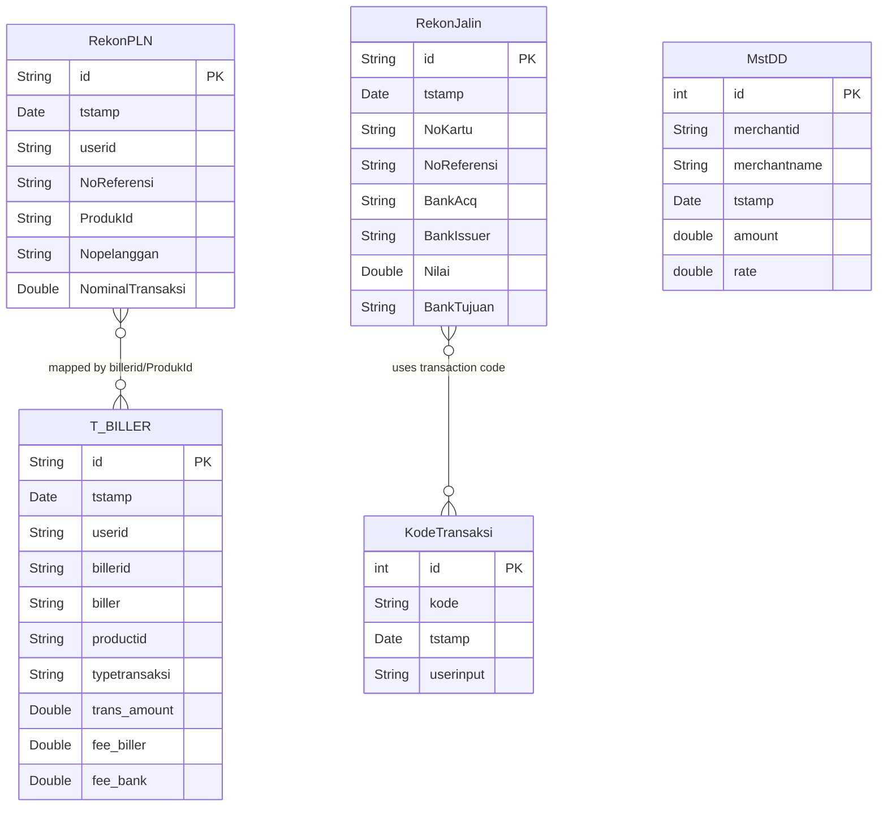

# Changelog
- Abstracted legacy framework references (removed ZK ViewModels, Java specifics).
- Documented implicit constraints and hidden logic around file parsing fallbacks (e.g., primary vs. fallback reference number).
- Preserved data contracts and core structural architecture.

# Data Architecture: Rekon PAC JALIN PLN

## 1. Database Schemas & Entities

The sub-program interacts with an Oracle Database primarily using the `REKONMEB` schema. The domain models represent the core reconciliation data structures. Key entities include:

### Core Tables
* **`TBiller` (`T_BILLER`)**: Stores biller mapping data.
  * Columns: `id` (PK), `tstamp`, `userid`, `billerid`, `biller`, `productid`, `product`, `flagtagihan`, `typetransaksi`, `trans_amount`, `fee_biller`, `fee_bank`.
* **`MstDD`**: Master data for DD transactions.
  * Columns: `id` (PK), `merchantid`, `merchantname`, `tstamp`, `userid`, `rate`, `amount`.
* **`RekonPLN`**: Stores reconciliation data for PLN.
  * Columns: `id` (PK), `tstamp`, `userid`, `JamTransaksi`, `TglTransaksi`, `TypeChannel`, `NoReferensi`, `ProdukId`, `Nopelanggan`, `NominalTransaksi`.
* **`RekonJalin`**: Stores reconciliation data for Jalin.
  * Columns: `id` (PK), `tstamp`, `userid`, `NoKartu`, `NoReferensi`, `BankAcq`, `BankIssuer`, `Lokasi`, `TglTransaksi`, `JamTransaksi`, `Nilai`, `Device`, `BankTujuan`, `NoRekeningTujuan`, `NRefMatch`, `TanggalPilih`.
* **`KodeTransaksi`**: Reference table for transaction codes.
  * Columns: `id` (PK), `kode`, `tstamp`, `userinput`.

### Entity-Relationship Diagram



## 2. File-Based Data Structures

The system relies heavily on text file parsing (CSV and Fixed-Width) and XLS export for reconciliation processes. 

### Inbound Files

**1. PLN Core Text Files (Fixed-Width Format)**
* **Type**: Fixed-width text format.
* **Parsing Data Contract**:
  * `0-19`: Account No (`Norekening`)
  * `19-59`: Account Name (`Namarekening`)
  * `59-84`: Primary Reference Number (`Noreferensi-primary`)
  * `189-209`: Fallback Reference Number (`Noreferensi-fallback`) - Used if populated, overriding the primary reference. This is a critical undocumented edge case.
  * `84-104`: Nominal Transaction amount (whole part)
  * `105-107`: Nominal Transaction amount (decimal part - concatenated with `.`)
  * `107-110`: Currency (`Matauang`)
  * `112-120`: Transaction Date (`Tgltransaksi`)
  * `121-130`: Transaction Time (`Jamtransaksi`)
  * `142-148`: Transaction Type (`Typetransaksi`)
  * `148-188`: Description (`Deskripsi`)

**2. PLN/Jalin Subsystem Files (CSV Format)**
* **Type**: Comma Separated Values (CSV).
* **Parsing Data Contract**: 
  * Split by `,` delimiter.
  * Index `1`: Jam Transaksi
  * Index `2`: Tgl Transaksi
  * Index `4`: Type Channel
  * Index `6`: Produk ID
  * Index `7`: No Pelanggan
  * Index `8`: Nominal Transaksi
  * Index `9`: No Referensi

### Outbound Files (Export)
* **Type**: Standard Excel (XLS) exports.
* **Format**: Generates sheets like "MATCH", "CORE ONLY", and "SYB ONLY".
* **Naming Convention**: `REKAPPLN.XLS`, `REKAPHARIANDD.XLS`.

## 3. Master Data & Hardcoded Values

Several pieces of master data and configuration variables are hardcoded directly within the system logic.

* **Hardcoded Users**: 
  * Jalin processes default to user: `effendy_liwang`.
  * PLN processes default to user: `TEST`.
* **File Names & Paths**:
  * "REKAPPLN.XLS" and "REKAPHARIANDD.XLS" checks are hardcoded to skip deletion or enforce generation.
  * File format validation heavily relies on explicit patterns: `"REKONPLN" + {yyyyMMdd}`.
* **String Padding Values**: Various fixed-length padding constraints (e.g., padding reference IDs to 12 zeros) are scattered across processing components.
* **Database Credentials**: Found in property files, though values are AES-encrypted or masked.

## 4. Configuration Externalization Strategy

To decouple the data structure and hardcoded business logic from the application code, the following configuration structure is proposed (e.g., as `application-rekon.yml` or `application-rekon.json`):

```yaml
rekon:
  # Database configuration
  datasource:
    driver-class-name: oracle.jdbc.OracleDriver
    url: ${DB_URL}
    username: ${DB_USERNAME}
    password: ${DB_PASSWORD}

  # File processing properties
  files:
    pln:
      expected-prefix: "REKONPLN"
      date-format: "yyyyMMdd"
      output:
        rekap-name: "REKAPPLN.XLS"
        daily-name: "REKAPHARIANDD.XLS"
      format:
        core:
          type: "FIXED_WIDTH"
          fields:
            norekening: [0, 19]
            namarekening: [19, 59]
            noreferensi-primary: [59, 84]
            noreferensi-fallback: [189, 209]
            nominal-whole: [84, 104]
            nominal-decimal: [105, 107]
            matauang: [107, 110]
            tgltransaksi: [112, 120]
            jamtransaksi: [121, 130]
            typetransaksi: [142, 148]
            deskripsi: [148, 188]
        subsystem:
          type: "CSV"
          delimiter: ","
          fields:
            jam-transaksi: 1
            tgl-transaksi: 2
            type-channel: 4
            produk-id: 6
            no-pelanggan: 7
            nominal: 8
            no-referensi: 9

  # Default System Users
  defaults:
    jalin-user: "effendy_liwang"
    pln-user: "TEST"
```

**Implementation Steps:**
1. **Property Injection**: Load this configuration file dynamically.
2. **Dynamic Parsers**: Replace hardcoded indices with a dynamic parser that loops over the `fields` defined in the configuration.
3. **Environment Variables**: Inject database credentials via secure environment variables instead of storing encrypted strings in application properties.
