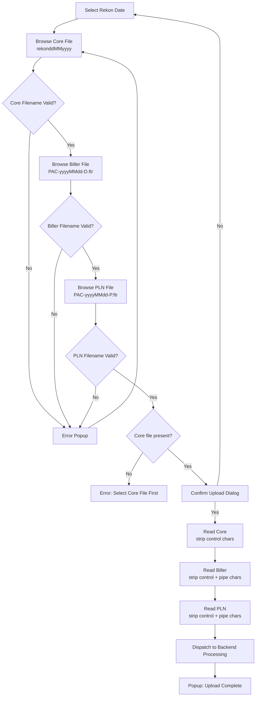

# Changelog
- Removed legacy UI framework (ZK) and specific Java method references.
- Clarified system boundaries, isolating UI actions from the abstract backend service actions.
- Documented file parsing specifics, including missing mandatory parameters blocking the process.

# Module: JALIN/PLN File Ingestion
> **Sub-program**: Rekon PAC JALIN PLN  
> **Module ID**: `jalin-pln-file-ingestion`  
> **Owner Component**: File Ingestion UI / Client Layer  
> **Backend Service**: Central Reconciliation Dispatch Service

---

## 1. Module Overview

This module handles the upload, validation, sanitisation, and server-side dispatch of three settlement file types:

1. **Core Banking Rekon File** (`rekonddMMyyyy`) — Fixed-width text from the bank's CBS. Mandatory.
2. **PAC Biller Debit File** (`PAC-yyyyMMdd-D.ftr`) — Pipe-delimited text from the JALIN/PAC clearinghouse. Optional (but at least one of Biller or PLN required).
3. **PAC PLN File** (`PAC-yyyyMMdd-P.ftr`) — Pipe-delimited text from the PLN (electricity) settlement channel. Optional.

This module does **not** parse files client-side into domain objects. Instead, it reads raw text lines, sanitises control characters, and sends the full line arrays to the backend service which handles parsing, DB insertion, and matching in a single server-side call.

### Scope Boundaries
- **IN scope**: File browse, filename validation, file-to-disk save, text file reading, control/pipe character stripping, dispatch to backend service.
- **OUT of scope**: Server-side parsing/matching (→ `mod_reconciliation_engine`), result display (→ `mod_reporting_export`), PLN monthly reports (→ `mod_pln_monthly`).

---

## 2. Local Functional Flows & Scenarios

### 2.1 File Upload Flow

**Steps**:
1. User selects reconciliation date.
2. User browses for each file type:
   - Core file → validates name = `rekon{ddMMyyyy}` (case-insensitive).
   - Biller file → validates name = `PAC-{yyyyMMdd}-D.ftr`.
   - PLN file → validates name = `PAC-{yyyyMMdd}-P.ftr`.
3. Invalid filename → Alert indicating format mismatch.
4. Valid file securely passed to temporary backend storage.

### 2.2 Text File Reading & Sanitisation

The client-side ingestion logic:
1. Reads the file line-by-line.
2. Applies regex to strip control characters: `[\x00-\x09\x11\x12\x14-\x1F\x7F]`.
3. For Biller/PLN files: additionally strips pipe `|` characters.
4. Accumulates clean lines into dedicated arrays.

### 2.3 Upload Confirmation & Dispatch

1. User triggers "Upload" action.
2. System verifies Core file is present (mandatory).
3. If Core is missing → Blocks upload with an error message.
4. If valid, dispatches date, Core array, Biller array, and PLN array to backend service.
5. Backend processes everything atomically server-side.
6. On return: Completion notification.

### 2.4 Error Scenarios

| Scenario | Behaviour |
|---|---|
| Date not selected | Error: Select Reconciliation Date First |
| Core filename mismatch | File rejected, error alert |
| Biller/PLN filename mismatch | File rejected, error alert |
| Core file missing on confirm | Error: Select Core File First |
| Neither Biller nor PLN uploaded | Allowed — empty lists passed to processing service |

### 2.5 Functional Flowchart

---

## 3. Local Technical Flows & Data Life Cycle

### 3.1 Key Operations

| Operation | Purpose |
|---|---|
| File Selection | Validates filename against selected date, stages file |
| Text Reading | Reads lines, strips control chars and pipes |
| Orchestration | Verifies mandatory inputs, triggers processing API |

### 3.2 State Variables

| Variable | Description |
|---|---|
| `Reconciliation Date` | Selected reconciliation date |
| `Core Filename` | Core file name after validation |
| `Biller Filename` | Biller file name after validation |
| `PLN Filename` | PLN file name after validation |
| `Core Lines` | Sanitised Core text lines |
| `Biller Lines` | Sanitised Biller text lines (pipes stripped) |
| `PLN Lines` | Sanitised PLN text lines (pipes stripped) |

### 3.3 File Format Reference

| File | Format | Naming | Sanitisation |
|---|---|---|---|
| Core | Fixed-width text | `rekonddMMyyyy` (no extension) | Strip control chars |
| Biller | Pipe-delimited `.ftr` | `PAC-yyyyMMdd-D.ftr` | Strip control chars + pipe `\|` |
| PLN | Pipe-delimited `.ftr` | `PAC-yyyyMMdd-P.ftr` | Strip control chars + pipe `\|` |

---

## 4. Interface & Dependencies

### 4.1 Inbound Dependencies

| Source | Data / Trigger | Description |
|---|---|---|
| **Auth System** | `userId` / `sessionId` | Auth context parameter |
| **User Input** | Target Date | Determines filename validation pattern |

### 4.2 Outbound Dependencies

| Target | Data / Trigger | Description |
|---|---|---|
| **Processing API** | `processFiles(date, coreLines, billerLines, plnLines, userId)` | Dispatches all raw text to backend for processing |
| **Reconciliation Engine Module** | Implicit | Backend handles matching natively during the process step |
