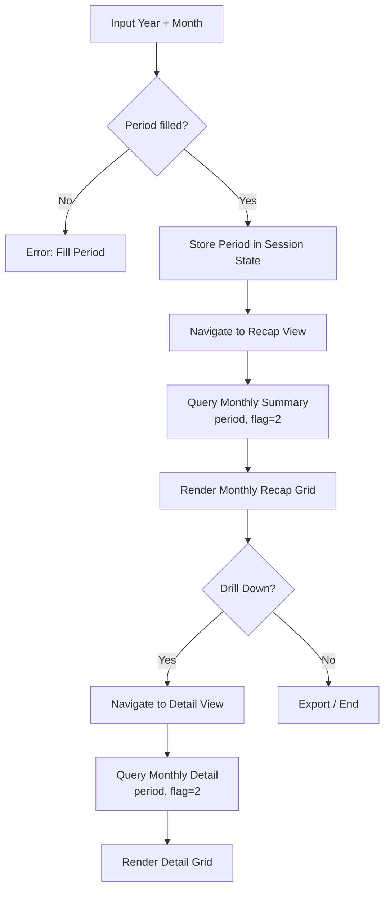

# Changelog
- Abstracted legacy UI navigation framework (removed ZK-specific `Executions.sendRedirect` and session scope syntax).
- Generalized component responsibilities (frontend routing, backend data retrieval).

# Module: PLN Monthly Reporting
> **Sub-program**: Rekon PAC JALIN PLN  
> **Module ID**: `jalin-pln-monthly`  
> **Owner Component**: PLN Monthly UI Views  
> **Backend Service**: Monthly Reconciliation Query APIs

---

## 1. Module Overview

This module provides a specialised monthly reconciliation view for PLN (State Electricity Company) bill-payment transactions. While daily JALIN/PLN reconciliation is handled by the standard reporting module, PLN requires a dedicated monthly aggregation for billing settlement and fee analysis.

The module consists of two primary views:
1. **PLN Monthly Recap** — Aggregated monthly summary.
2. **PLN Monthly Detail** — Line-item detail for a given month.

### Scope Boundaries
- **IN scope**: Monthly period selection (year + month), PLN monthly summary query, PLN monthly detail query, date navigation.
- **OUT of scope**: Daily reconciliation (→ `mod_reporting_export`), file ingestion (→ `mod_file_ingestion`).

---

## 2. Local Functional Flows & Scenarios

### 2.1 PLN Monthly Report Navigation

1. Finance Analyst opens the PLN report filter on the main page.
2. Inputs **year** (e.g., "2024") and **month** (e.g., "10").
3. System validates: if either field is empty → Alert: "Fill Period First".
4. Constructs period string: `YYYYMM` → e.g., `"202410"`.
5. Persists selection in UI session state.
6. Redirects to the Recap View.

### 2.2 PLN Monthly Recap

- Page loads → retrieves period from session state.
- Queries backend for aggregated PLN monthly data (`flag = 2` for PLN/PPOB).
- Renders aggregated monthly summary: biller totals, fee summaries, transaction counts.

### 2.3 PLN Monthly Detail

- Accessible from recap page (drill-down).
- Queries backend for individual PLN transactions for the month.
- Shows granular line-item detail.

### 2.4 Scenarios

#### Scenario A — Monthly PLN Report
1. Analyst inputs year "2024", month "10".
2. Redirected to monthly recap page.
3. Views aggregated PLN settlement for October 2024.
4. Clicks drill-down → detail page shows individual transactions.

#### Scenario B — Missing Period
1. Analyst clicks redirect without entering year/month.
2. Alert triggered: "Fill Period First".
3. Redirect blocked.

### 2.5 PLN Monthly Flowchart

---

## 3. Local Technical Flows & Data Life Cycle

### 3.1 Key Operations

| Operation | Purpose |
|---|---|
| Fetch Monthly Summary | Queries DB for grouped PLN totals over a given month |
| Fetch Monthly Detail | Queries DB for raw PLN records over a given month |

### 3.2 Data Models

| Entity | Description |
|---|---|
| `MonthlySummaryPLN` | Monthly aggregated PLN summary (biller, count, total, fees) |
| `MonthlyDetailPLN` | Individual PLN transaction for a given month |

### 3.3 State Variables

| Variable | Scope | Description |
|---|---|---|
| `Input Year` | UI | Year selection (e.g., "2024") |
| `Input Month` | UI | Month selection (e.g., "10") |
| `Period Token` | Session State | Concatenated `yyyyMM` string passed between views |

---

## 4. Interface & Dependencies

### 4.1 Inbound Dependencies

| Source | Data / Trigger | Description |
|---|---|---|
| **Reconciliation Engine** | Historical matched data | Monthly queries aggregate across all daily reconciliation runs |
| **User Input** | Period Selection | Determines the queried month/year |
| **Fee Master Tables** | Fee configurations | PLN fee data for monthly summary aggregation |

### 4.2 Outbound Dependencies

| Target | Data / Trigger | Description |
|---|---|---|
| **Query APIs** | Summary/Detail requests | Monthly data queries routed to the backend |
| **Session State** | Period token | Cross-page navigation state maintained in memory |
