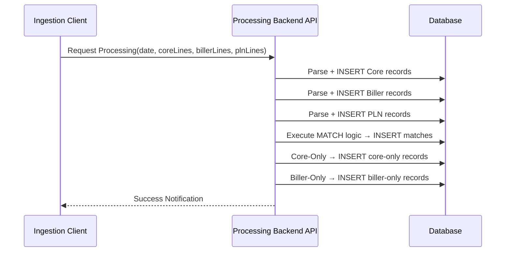

# Changelog
- Abstracted legacy server-side constraints (removed specific SOAP call syntax).
- Clarified matching keys and logic, converting explicit framework mentions into general architectural language.

# Module: JALIN/PLN Reconciliation Engine
> **Sub-program**: Rekon PAC JALIN PLN  
> **Module ID**: `jalin-pln-reconciliation-engine`  
> **Owner Component**: Core Backend Processing Service  
> **Trigger**: Initiated by `mod_file_ingestion`

---

## 1. Module Overview

This module encapsulates the **server-side** reconciliation logic. The engine performs all parsing, insertion, and matching in a single atomic operation.

It produces three reconciliation result sets:
1. **Match** — Transactions found in both Core and Biller/PLN.
2. **Core-Only (Biller Failed)** — Core transactions not found in Biller.
3. **Biller-Only (Core Failed)** — Biller/PLN transactions not found in Core.

### Scope Boundaries
- **IN scope**: Server-side parsing of raw text line arrays, DB staging insertion, execution of match rules, generation of the three result sets.
- **OUT of scope**: File upload/validation (→ `mod_file_ingestion`), result viewing/export (→ `mod_reporting_export`), PLN monthly logic (→ `mod_pln_monthly`).

---

## 2. Local Functional Flows & Scenarios

### 2.1 Server-Side Processing Pipeline

**Input**: Execution payload containing date, Core lines array, Biller lines array, PLN lines array, user context.

**Execution Flow**:
1. **Parse Core lines** → extract fields from fixed-width payload → INSERT into staging Core table.
2. **Parse Biller lines** → extract fields from delimited payload → INSERT into staging Biller table.
3. **Parse PLN lines** → extract fields from delimited payload → INSERT into staging PLN table.
4. **Execute Match logic** → JOIN Core vs Biller/PLN on matching keys → INSERT into matching result table.
5. **Identify Core-Only** → Core records with no Biller/PLN pair → INSERT into core-only results.
6. **Identify Biller-Only** → Biller/PLN records with no Core pair → INSERT into biller-only results.
7. End transaction.

### 2.2 Matching Key Logic

| Core Field | Biller/PLN Field | Criterion |
|---|---|---|
| Transaction reference | PAC reference | Exact string match |
| Amount | Settlement amount | Numeric equality |
| Transaction date | Settlement date | Date equality |
| Flag Tagihan: "1" | Debit | Identifier for JALIN debit transactions |
| Flag Tagihan: "2" | PLN/PPOB | Identifier for PLN electricity payments |

### 2.3 Reconciliation Sequence Diagram

---

## 3. Local Technical Flows & Data Life Cycle

### 3.1 Key Service Operations

| Operation | Purpose |
|---|---|
| Main Processing Routine | Single-call processing: parse + insert + match |
| Query Matches | Retrieve matched results by date range |
| Query Core-Only | Retrieve Core-only results by date range |
| Query Biller-Only | Retrieve Biller-only results by date range |

### 3.2 Result Data Models

| Entity | Description |
|---|---|
| `RekonMatch` | Matched pair: Core + Biller confirmed |
| `RekonBillerOnly` | Biller record with no Core match |
| `RekonJalinStaging` | JALIN transaction staging record |
| `RekonJalinCoreStaging`| JALIN-side Core Banking staging record |
| `RekonPLNStaging` | PLN staging record |

### 3.3 Flag Tagihan Categorization Logic

| Flag | Meaning | Usage |
|---|---|---|
| `"1"` | Debit (JALIN) | Filters result queries to return JALIN-only matches |
| `"2"` | PLN/PPOB | Filters result queries to return PLN-only matches |

---

## 4. Interface & Dependencies

### 4.1 Inbound Dependencies

| Source | Data / Trigger | Description |
|---|---|---|
| **File Ingestion Module** | Sanitised line arrays | Raw text payload sent from client |
| **File Ingestion Module** | Execution context | Process date and user metadata |

### 4.2 Outbound Dependencies

| Target | Data / Trigger | Description |
|---|---|---|
| **Database Tables** | `INSERT` statements | Stages temporary data and persists results |
| **Reporting Module** | Populated result sets | Acts as the data foundation for all downstream views |
