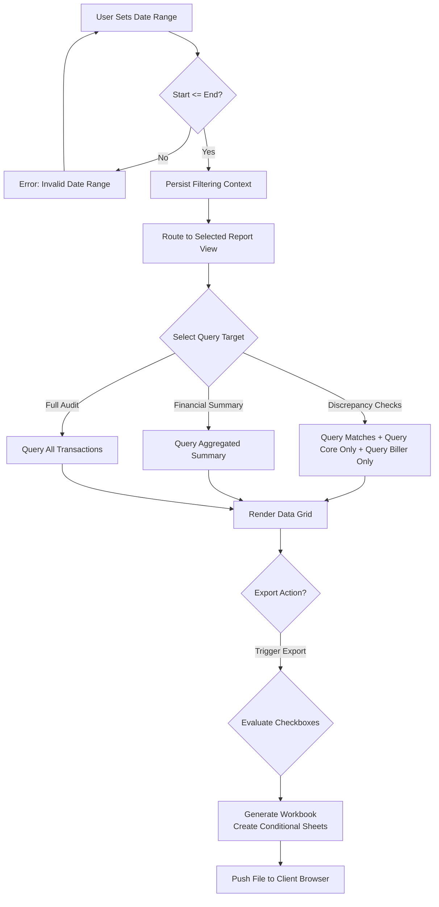

# Changelog
- Removed UI framework-specific legacy references (ZK, ZUL, JXL, etc.).
- Generalized Excel sheet generation rules.
- Clarified navigation context parameters.

# Module: JALIN/PLN Reporting & Export
> **Sub-program**: Rekon PAC JALIN PLN  
> **Module ID**: `jalin-pln-reporting-export`  
> **Owner Component**: Report UI & Export Engine  
> **Backend Service**: Data Query APIs

---

## 1. Module Overview

This module provides the user-facing report viewing and Excel export capabilities for JALIN and PLN daily reconciliation results. It covers five report types:

1. **Match (Sukses)** — Transactions matched between Core and Biller.
2. **Core-Only (Biller Failed)** — Core records without a Biller/PLN counterpart.
3. **Biller-Only (Core Failed)** — Biller/PLN records without a Core counterpart.
4. **Transaction Summary (Payment Summary)** — Aggregated view with fee breakdown per biller/product.
5. **All Transactions** — Combined flat view of all records.

Each report is accessed via its own dedicated view, with date-range navigation carried through shared session attributes.

### Scope Boundaries
- **IN scope**: Report view navigation, date-range filtering, data querying, multi-sheet Excel export logic.
- **OUT of scope**: File ingestion (→ `mod_file_ingestion`), matching (→ `mod_reconciliation_engine`), PLN monthly logic (→ `mod_pln_monthly`).

---

## 2. Local Functional Flows & Scenarios

### 2.1 Report Navigation

1. User specifies a start date and an end date.
2. **Date validation**: if start > end → Alert error message.
3. Filtering context is persisted to the application session state.
4. UI router navigates to the requested report view.
5. On load, the view queries the backend utilizing the shared session state.

### 2.2 Report Types & Data Queries

| Report | Display Target | Backend Data Target | Description |
|---|---|---|---|
| Match | Match Results View | `Matched Query` | Verified transactions |
| Core-Only | Core Results View | `Core-Only Query` | Unmatched Core items |
| Biller-Only | Biller Results View | `Biller-Only Query` | Unmatched Biller items |
| Payment Summary | Payment Summary View | `Transaction Summary Query` | Fee breakdown |
| All Transactions | Consolidated View | `All Records Query` | Combined list |

### 2.3 Excel Export (Multi-Sheet)

1. User toggles checkboxes indicating which datasets to include in the export: Match, Biller-Only, Core-Only.
2. User initiates export action.
3. Export Engine constructs a spreadsheet workbook:
   - Evaluates "Include Match" flag → creates "Match" sheet if true.
   - Evaluates "Include Core-Only" flag → creates "Core Only" sheet if true.
   - Evaluates "Include Biller-Only" flag → creates "Biller Only" sheet if true.
4. Spreadsheet saved as `RekonMEB_{yyyyMMdd}.xls`.
5. Browser downloads file automatically.

### 2.4 Transaction Summary Report Specifics

- Presents aggregated data grouped by `billerid` and `product`.
- Metrics columns: transaction count, subtotal, biller fee, bank fee, net total.
- Configuration for fee splits is retrieved from master mapping tables.

### 2.5 Reporting Flowchart

---

## 3. Local Technical Flows & Data Life Cycle

### 3.1 Key Operations

| Operation | Purpose |
|---|---|
| Query Match Data | Retrieves matched dataset within date range |
| Query Failed Core Data | Retrieves Core-only data within date range |
| Query Failed Biller Data | Retrieves Biller-only data within date range |
| Query Summary Data | Retrieves aggregated payment stats and fees |
| Generate Excel Workbook | Composes sheets and triggers file download |

### 3.2 Report Data Models

| Entity | Description |
|---|---|
| `RekonMatchModel` | Matched record (Core & Biller success) |
| `RekonBillerFailedModel` | Biller record without Core equivalent |
| `RekonTransactionSummary` | Grouped payment summary attributes (biller, count, fees) |
| `RekonConsolidated` | Flattened all-transaction view |

### 3.3 State Variables

| Variable | Scope | Description |
|---|---|---|
| `Start Date` / `End Date` | Session | Shared report date range context |
| `Include Match Flag` | UI | Toggle for including "Match" sheet |
| `Include Biller Failed Flag` | UI | Toggle for including "Biller Only" sheet |
| `Include Core Failed Flag` | UI | Toggle for including "Core Only" sheet |
| `Tagihan Identifier` | UI | Specifies type (e.g., "1" for Debit, "2" for PPOB) |

---

## 4. Interface & Dependencies

### 4.1 Inbound Dependencies

| Source | Data / Trigger | Description |
|---|---|---|
| **Reconciliation Result Tables** | Persisted Match Data | Foundation of all queries |
| **User Input** | Toggles and Filters | Determines resulting report structure |
| **Session Context** | Shared Navigation Tokens | Maintains view context across routing |
| **Fee Configurations** | Master Map Tables | Dictates values for financial summaries |

### 4.2 Outbound Dependencies

| Target | Data / Trigger | Description |
|---|---|---|
| **Query APIs** | Aggregation endpoints | Requests routed to database layer |
| **Client Browser** | `.xls` download | Generated spreadsheet payload |
| **Session Context** | Updated Navigation Tokens | Passed during cross-view redirect |
