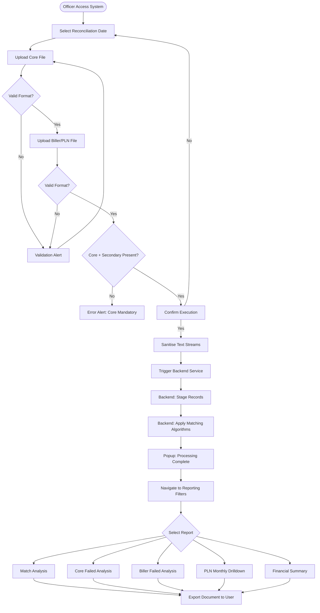
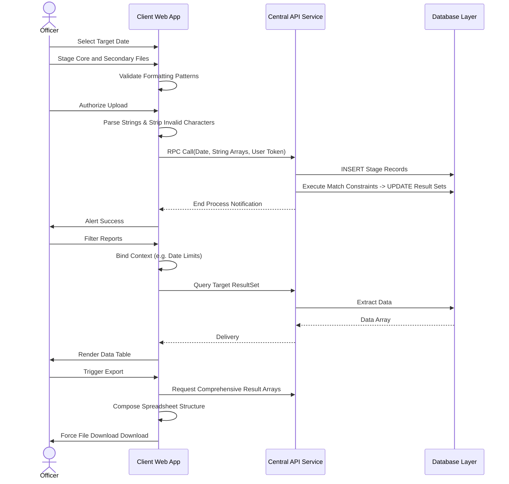

# Changelog
- Abstracted UI framework details and legacy references.
- Generalised system components into Frontend App, API Service, and Storage layers.

# Rekon PAC JALIN PLN — System Documentation
> **Source of Truth** for developers and AI coding agents  
> Module path: `reconcile-system/Rekon PAC JALIN PLN`  
> Last reverse-engineered: 2026-06-07

---

## 1. Executive Summary & High-Level Requirements

### 1.1 Business Purpose
**Rekon PAC JALIN PLN** (also known internally as **Rekon MEB**) is the reconciliation module that handles two distinct payment channel types:

1. **JALIN (Interbank ATM/Debit Network)** — Reconciles debit-card and interbank transactions processed through the JALIN/ATM Bersama network. The Core Banking System file is matched against JALIN's PAC (Payment Aggregator/Clearinghouse) biller file.
2. **PLN (State Electricity Company)** — Reconciles bill-payment transactions for PLN electricity bills processed via PPOB (Payment Point Online Bank), cross-checking Core Banking records against PAC-PLN settlement files.

The system is a multi-tier web application consisting of a frontend client interface and a centralized backend API processing service.

### 1.2 Core High-Level Functional Requirements

| # | Requirement |
|---|---|
| FR-01 | Upload daily **Core Banking reconciliation file** (`rekonddMMyyyy`) — fixed-width text format |
| FR-02 | Upload daily **PAC Biller Debit file** (`PAC-yyyyMMdd-D.ftr`) — pipe-delimited text |
| FR-03 | Upload daily **PAC PLN file** (`PAC-yyyyMMdd-P.ftr`) — pipe-delimited text |
| FR-04 | Validate all uploaded file names against the selected reconciliation date |
| FR-05 | Parse files and strip invalid control characters prior to API submission |
| FR-06 | Trigger backend service to perform unified processing and matching |
| FR-07 | View **Match** results — transactions that succeeded in both Core and Biller |
| FR-08 | View **Core-Only** results — transactions that succeeded in Core but failed in Biller |
| FR-09 | View **Biller-Only** results — transactions that succeeded in Biller but failed in Core |
| FR-10 | View full **Transaction Summary** report (with fee breakdown by Biller/Product) |
| FR-11 | View combined **All Transactions** report |
| FR-12 | View **PLN Monthly Recap** and **PLN Monthly Detail** reports filtered by year+month |
| FR-13 | Export all report types to formatted Excel spreadsheets |
| FR-14 | Filter queries via shared date-range or month/year context tokens |
| FR-15 | Apply dynamic conditionals to Excel export (generating separate sheets per selected dataset) |

---

## 2. User Scenarios & Personas

### 2.1 Personas

| Persona | Role | Key Actions |
|---|---|---|
| **JALIN Settlement Officer** | Daily reconciliation operator | Upload files, trigger processing, view Match/Discrepancy tabs |
| **PLN Billing Officer** | Monthly PLN billing reconciliation | View PLN Monthly reports, export to Excel |
| **Back-Office Supervisor** | Exception management and reporting | Filter all report types, export consolidated Excel |
| **Finance Analyst** | Fee and revenue analysis | View Transaction Summary with fee breakdown |

### 2.2 End-to-End User Scenarios

#### Scenario A — Full Daily JALIN Reconciliation (Happy Path)
1. JALIN Officer accesses portal.
2. Selects target reconciliation date.
3. Uploads Core file (`rekon{ddMMyyyy}`).
4. Uploads PAC Biller Debit file (`PAC-{yyyyMMdd}-D.ftr`).
5. Clicks "Upload" to confirm submission.
6. System dispatches data payload; backend inserts records and applies match rules.
7. System notifies user upon success.
8. Officer queries Match Results via report UI and exports to Excel.

#### Scenario B — PLN-Only Upload
1. Officer selects date.
2. Uploads Core file + PAC PLN file.
3. Does **not** upload a Biller Debit file.
4. System proceeds since minimum conditions (Core + at least one secondary file) are met.
5. PLN-specific matching runs.

#### Scenario C — Missing Core File
1. Officer tries to upload only the secondary files.
2. UI validation halts execution, prompting user to upload the mandatory Core file first.

#### Scenario D — Monthly PLN Report
1. Finance Analyst views PLN report dashboard.
2. Selects a specific Month and Year.
3. System routes to Monthly Recap view, executing an aggregation query against PLN matches.
4. Analyst drills down to detail rows, downloading full history.

#### Scenario E — Discrepancy: Biller Failed (Core-Only)
1. Recon run shows items in the **Core-Only** tab.
2. Supervisor investigates — transaction succeeded in CBS but PAC rejected it.
3. Manual follow-up required with JALIN network.

#### Scenario F — Discrepancy: Core Failed (Biller-Only)
1. Items appear in the **Biller-Only** tab.
2. PAC recorded a successful debit, but CBS has no matching record.
3. Supervisor initiates debit reversal or manual journal.

---

## 3. Functional Architecture & Workflows

### 3.1 Step-by-Step Business Logic

1. **Authentication** — Identity parameters are collected from entry-point URL variables.
2. **File Selection** — UI validates the file naming convention against the targeted processing date. Invalid formats are rejected immediately.
3. **Data Sanitization** — Client side reads raw bytes, filtering control characters and stripping pipe delimiters for structured data.
4. **Trigger Processing** — Cleaned text arrays are transmitted to the Backend Processing API.
5. **Backend Processing** — Service atomically parses fields, stages database inserts, joins tables based on reconciliation keys, and separates matches from exceptions.
6. **Report Generation** — Using shared date/month navigation contexts, specialized queries extract relevant result sets.
7. **Excel Compilation** — Results are conditionally aggregated into a multi-sheet spreadsheet file and delivered to the user.

### 3.2 Report Types and Their Data Sources

| Report | Display Component | Query Focus | Excel Format |
|---|---|---|---|
| Match (Sukses) | Match Results View | Confirmed Pairs | "Match" Sheet |
| Core Only | Discrepancy View | Core Unmatched | "Core Only" Sheet |
| Biller Only | Discrepancy View | Biller Unmatched | "Biller Only" Sheet |
| Payment Summary | Summary View | Aggregated Fees | Single "Laporan Pembayaran Harian" |
| All Transactions | Consolidated View | Full History | Flattened Sheet |
| PLN Monthly | Monthly Recap | Period Grouping | - |
| PLN Monthly Detail | Monthly Detail | Period Transactions | - |

### 3.3 Functional Flowchart

---

## 4. Technical Architecture & Data Flow

### 4.1 Technology Layout

| Layer | Implementation Component |
|---|---|
| Frontend Client | Web App UI providing views and localized file sanitization |
| Integration API | Service proxy interface handling RPC execution |
| Backend Engine | Isolated processor interpreting inputs and executing SQL transactions |
| Export Generator | Spreadsheet builder utility |

### 4.2 Key Data Models

| Entity | Description |
|---|---|
| `RekonMatchModel` | Matched transaction record |
| `RekonDiscrepancyModel` | Transaction missing counterpart |
| `RekonTransactionSum` | Payment summary with fee split fields |
| `RekonPLNMonthlySum` | Monthly PLN reconciliation aggregation |
| `TBillerContext` | Master biller mapping data |
| `FeeConfiguration` | Master fee data |

### 4.3 Architecture Diagram

---

## 5. Constraints and Business Rules

### 5.1 Validation Rules
- **Core file naming**: Rigid pattern strictly aligned with execution date parameter.
- **Secondary file naming**: Rigid prefix pattern checking.
- **Input Mandatory Requirement**: Processing fails without the primary Core payload.
- **Payload Sanitization**: Pipes `|` must be stripped to prevent backend parsing errors.

### 5.2 Date Logics
- Date boundaries for queries cannot be inverted (Start must precede End).
- Monthly reports use YYYYMM concatenated lookup strings.

### 5.3 Exception Handling
- Immediate feedback popups block execution on bad format or missing mandatory fields.
- Date inversion triggers UI blocking.
- Backend faults generate system exception stack alerts via the client.
