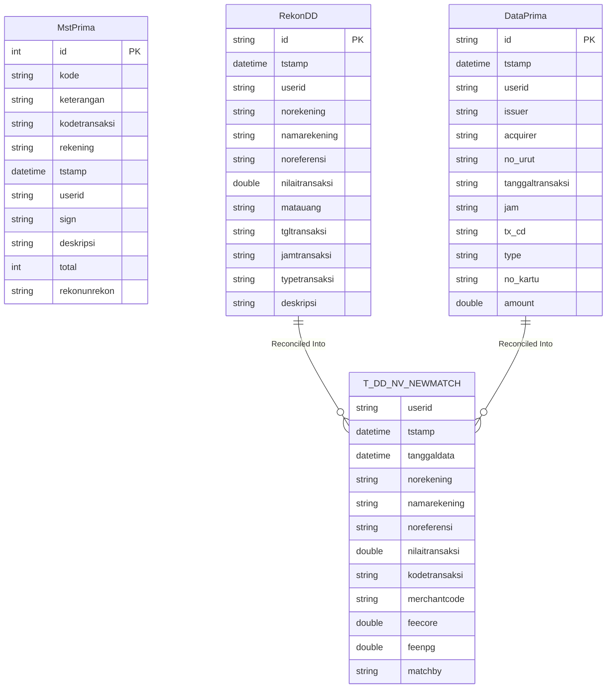

# Data Architecture - Rekon Prima QRIS

> **CHANGELOG**
> - Abstracted legacy framework and language specifics to focus on system behaviour.
> - Verified data contracts and documented hidden logic/edge cases found during Clean Room audit (e.g., regex cleansing, decimal normalisation).

## 1. Database Schemas

The application is built using standard application frameworks and ORM for relational database mapping. The application maps data models to database tables for Master Data, Transaction Data, and Reconciliation processes.

### Key Database Tables / Entities

**Master Data & Configuration Tables:**
- `MstPrima`: Prima Master Data
- `MstDD`, `MstDD2`, `MstDDMJT`: Direct Debit Master Data
- `MstBiayaPrima`, `MstBiayaBillerPrima`: Prima fee configurations
- `MstMCode`, `MstMCodeQRIS`: Merchant codes
- `Rekening`, `KodeTransaksi`: Account and Transaction Codes

**Reconciliation & Transaction Tables:**
- `RekonDD`, `RekonDD2`, `DataNPG`: Direct Debit and NPG transaction data
- `DataPrima`, `DataPrimaQRIS`, `DataPacQRIS`: Prima core data
- `PrimaJurnal`: Prima Journals
- **Matching/Output Tables**: 
  - `T_DD_NV_OLDMATCH`, `T_DD_NV_OLDCOREONLY`, `T_DD_NV_OLDNPGONLY`
  - `T_DD_NV_NEWMATCH`, `T_DD_NV_NEWCOREONLY`, `T_DD_NV_NEWNPGONLY`
  - `T_DD_NV_NEWOUTSTANDING`
  - `RekapPrimaMatch`, `RekapPrimaCoreOnly`, `RekapPrimaDecline`, `RekapPrimaOnlyQRISCorePac`, etc.

### Entity-Relationship (ER) Diagram



## 2. File-Based Data Structures

The system handles multiple fixed-width text files for reconciliation. Parsing logic relies on strictly hardcoded string substring indexes (e.g., `line.substring(a, b)`). These files include:

*   **Core/DD Transaction Files (`REKONPRM<yyyyMMdd>` / `REKONDD<yyyyMMdd>`)**:
    *   `norekening`: chars 0-19
    *   `namarekening`: chars 19-59
    *   `noreferensi`: chars 59-84
    *   `nilaitransaksi`: chars 84-107 (with comma normalization)
    *   `matauang`: chars 107-110
    *   `tgltransaksi`: chars 112-120
    *   `jamtransaksi`: chars 121-130
*   **Prima Transaction Files (`*B1-RAW.TXT`, `*R1-RAW.TXT`, etc.)**:
    *   Contains identifiers like `B24-XB01` and specific layout: `issuer` (0-32), `acquirer` (33-65), `no_urut` (72-81), `tanggaltransaksi` (81-87), `amount` (119-133).
*   **NPG Files (`*D1_NPG.TXT`)**:
    *   Dynamic parsing that identifies blocks starting with "ACQUIRER: " and reads subsequent transaction lines.

## 3. Master Data & Hardcoded Values

Currently, business logic, environmental variables, and file metadata are tightly coupled with the Java codebase.

### Identified Hardcoded Values & Locations:
1.  **Database Credentials (Security Risk)**:
    *   *File*: `Security Configuration / Credentials Provider`
    *   *Values*: `oracle1.url` = `jdbc:oracle:thin:@172.16.32.23:1521/freepdb1`, `oracle1.username` = `rekonprima`, `oracle1.password` = `rekonpr!m4`. (Decryption mechanism was bypassed).
2.  **Web Service URL**:
    *   *File*: `Application Environment Configuration`
    *   *Value*: `https://10.161.70.202/portalservice/services/applicationsessionbo`
3.  **Administrator Passwords**:
    *   *File*: `Global Properties Configuration`
    *   *Value*: `auth.manager.password=password`
4.  **"Magic Strings" for File Validation & Filtering**:
    *   *File*: `Reconciliation UI Controller`
    *   *Values*: Filtering out specific lines if headers match `"B24-XB01"` or `"B24-AI01"`, skipping declined transactions if status block is `"D/F"`, or checking string equalities against `"MP-BANK MASPION INDONESIA"` to skip internal routing.
5.  **Hardcoded Data Transformations**:
    *   *Values*: Normalising amounts by replacing `","` with `"."`.
    *   *Values*: Regex cleansing for descriptions to remove invalid characters: `[^\u0009\r\n\u0020-\uD7FF\uE000-\uFFFD\uD800\uDC00-\uDBFF\uDFFF]`.

## 4. Configuration Externalization Strategy

To decouple the data architecture from the application runtime and enable dynamic deployments, it is proposed to externalize all hardcoded properties into a unified YAML file (e.g., `application.yml`).

### Proposed `application.yml` Structure

```yaml
app:
  rekonprima:
    security:
      auth-manager-password: "${AUTH_MANAGER_PASSWORD:password}"
      
    datasource:
      driver-class-name: oracle.jdbc.OracleDriver
      url: "${DB_URL:jdbc:oracle:thin:@172.16.32.23:1521/freepdb1}"
      username: "${DB_USERNAME:rekonprima}"
      password: "${DB_PASSWORD:rekonpr!m4}"
      
    webservice:
      portal-session-url: "${PORTAL_URL:https://10.161.70.202/portalservice/services/applicationsessionbo}"

    file-parsing:
      ignore-rules:
        - "B24-XB01"
        - "B24-AI01"
      skip-status:
        - "D/F"
      skip-institutions:
        - "MP-BANK MASPION INDONESIA"
      formats:
        prima-b1:
          issuer-start: 0
          issuer-end: 32
          acquirer-start: 33
          acquirer-end: 65
          amount-start: 119
          amount-end: 133
        core-dd:
          account-start: 0
          account-end: 19
          reference-start: 59
          reference-end: 84
```
*Note: Using environment variable injection (e.g. `${DB_URL}`) inside the configuration files is highly recommended to improve security and container readiness.*
