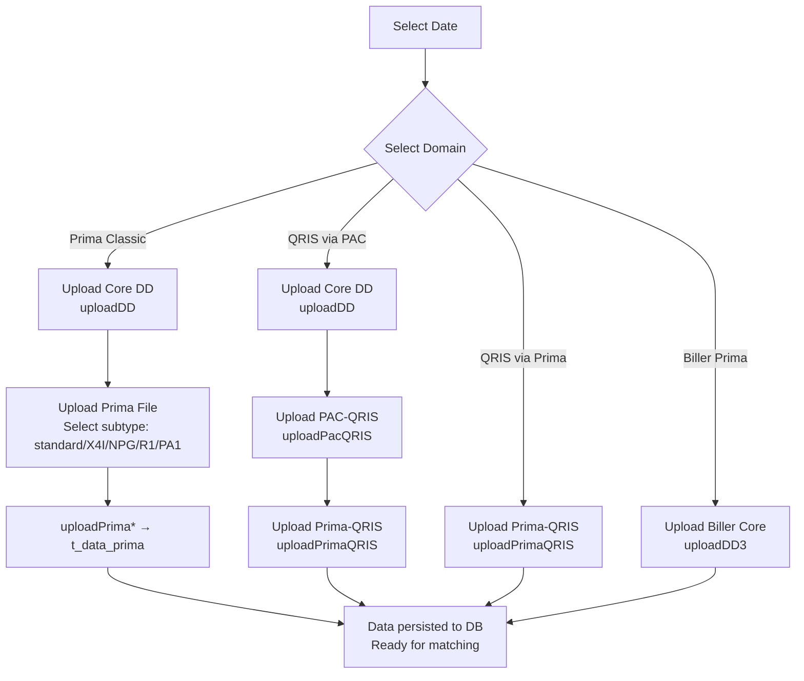

> **CHANGELOG**
> - Abstracted legacy framework and language specifics to focus on system behaviour.
> - Verified data contracts and documented hidden logic/edge cases found during Clean Room audit (e.g., regex cleansing, decimal normalisation).

# Module: Prima QRIS File Ingestion
> **Sub-program**: Rekon Prima QRIS  
> **Module ID**: `prima-qris-file-ingestion`  
> **Owner Component**: `Reconciliation UI Controller`, `Direct Debit UI Controller` — upload methods  
> **Backend Service**: `Reconciliation Backend Service.upload*()` methods

---

## 1. Module Overview

This module manages the upload, validation, and database persistence of settlement files for all four reconciliation domains within the Prima QRIS sub-program. It handles a significantly higher variety of file formats compared to other sub-programs, with **5+ Prima file subtypes**, multiple QRIS variants, and DD Core files.

### Upload Entry Points by Domain

| Domain | Upload Methods | File Types |
|---|---|---|
| **Prima Classic** | `uploadDD()` (Core) + `uploadPrima()`, `uploadPrimaX4I()`, `uploadPrimaNPG()`, `uploadPrimaR1()`, `uploadPrimaPA1()` | DD Core + 5 Prima variants |
| **QRIS via PAC** | `uploadPacQRIS()`, `uploadPacQRISNew()` | PAC-QRIS settlement files |
| **QRIS via Prima** | `uploadPrimaQRIS()` | Prima-QRIS settlement file |
| **Biller Prima** | `uploadDD2()`, `uploadDD3()`, `uploadDD2New()` | Biller Core file variants |

### Scope Boundaries
- **IN scope**: File browse, filename validation, file parsing (CSV/TXT/XLSX), text decoding, string slicing and sanitization, DB persistence via Remote Procedure Calls.
- **OUT of scope**: Matching logic (→ `mod_reconciliation_engine`), master data (→ `mod_master_data`), outstanding management (→ `mod_outstanding`), journals (→ `mod_journal`), reporting (→ `mod_reporting_export`).

---

## 2. Local Functional Flows & Scenarios

### 2.1 Prima Classic: Core + Prima Upload

1. Officer selects date.
2. Uploads Core DD file → `uploadDD(List<RekonDD>)` inserts into `t_rekon_dd`.
3. Uploads Prima file (selecting format subtype):
   - Standard: `uploadPrima(List<DataPrima>)`
   - X4I: `uploadPrimaX4I(List<DataPrima>)`
   - NPG: `uploadPrimaNPG(List<DataPrima>)`
   - R1: `uploadPrimaR1(List<DataPrima>)`
   - PA1: `uploadPrimaPA1(List<DataPrima>)`
4. Each variant has different column positions/naming conventions but produces the same `DataPrima` entity.
   - **Hidden Logic**: System hard-checks headers like "B24-XB01" / "B24-AI01" to skip them. Status codes of "D/F" are completely ignored. Rows mapped to the internal institution ("MP-BANK MASPION INDONESIA") are dropped. Commas are replaced by dots for numeric coercion, and regex cleansing `[^\u0009\r\n\u0020-\uD7FF\uE000-\uFFFD\uD800\uDC00-\uDBFF\uDFFF]` is applied to strip invisible unicode characters from descriptions.
5. Data persisted; ready for matching (→ `mod_reconciliation_engine`).

### 2.2 QRIS via PAC: Triple Upload

1. Upload Core DD file → `uploadDD()`.
2. Upload PAC-QRIS file → `uploadPacQRIS(List<DataPacQRIS>)` → inserts into `t_data_pac_qris`.
3. Upload Prima-QRIS file → `uploadPrimaQRIS(List<DataPrimaQRIS>)` → inserts into `t_data_prima_qris`.
4. New variant: `uploadPacQRISNew()` handles updated PAC format.

### 2.3 Biller Prima: Core Upload

1. Upload Biller Core file → `uploadDD3(List<RekonDD>)` — biller-specific DD format.
2. Also: `uploadDD2()` for alternate format, `uploadDD2New()` for updated version.

### 2.4 Error Scenarios

| Scenario | Behaviour |
|---|---|
| Date not selected | `Messagebox.show("Pilih Tanggal...")` — upload blocked |
| Wrong filename | Messagebox error, file not saved |
| File format mismatch to subtype | Parse errors bubble up as system exceptions |

---

## 3. Local Technical Flows & Data Life Cycle

### 3.1 All Upload Methods

| Method | Entity | Target Table | Domain |
|---|---|---|---|
| `uploadDD(List<RekonDD>)` | `RekonDD` | `t_rekon_dd` | Prima Classic (Core) |
| `uploadDD2(List<RekonDD>)` | `RekonDD` | `t_rekon_dd` | Biller variant 2 |
| `uploadDD2New(List<RekonDD>)` | `RekonDD` | `t_rekon_dd` | Biller variant 2 (new format) |
| `uploadDD3(List<RekonDD>)` | `RekonDD` | `t_rekon_dd` | Biller variant 3 |
| `uploadPrima(List<DataPrima>)` | `DataPrima` | `t_data_prima` | Prima Classic (standard) |
| `uploadPrimaX4I(List<DataPrima>)` | `DataPrima` | `t_data_prima` | Prima Classic (X4I format) |
| `uploadPrimaNPG(List<DataPrima>)` | `DataPrima` | `t_data_prima` | Prima Classic (NPG format) |
| `uploadPrimaR1(List<DataPrima>)` | `DataPrima` | `t_data_prima` | Prima Classic (R1 format) |
| `uploadPrimaPA1(List<DataPrima>)` | `DataPrima` | `t_data_prima` | Prima Classic (PA1 format) |
| `uploadPrimaQRIS(List<DataPrimaQRIS>)` | `DataPrimaQRIS` | `t_data_prima_qris` | QRIS via Prima |
| `uploadPacQRIS(List<DataPacQRIS>)` | `DataPacQRIS` | `t_data_pac_qris` | QRIS via PAC |
| `uploadPacQRISNew(List<DataPacQRIS>)` | `DataPacQRIS` | `t_data_pac_qris` | QRIS via PAC (new format) |

### 3.2 Data Models (Ingestion Stage)

| Entity | Key Fields |
|---|---|
| `RekonDD` | Core DD reconciliation record |
| `DataPrima` | Prima transaction (all 5 subtypes normalise into this) |
| `DataPrimaQRIS` | Prima-QRIS settlement record |
| `DataPacQRIS` | PAC-QRIS settlement record |
| `DataNPG` | NPG (National Payment Gateway) transaction |

### 3.3 Ingestion Flowchart

---

## 4. Interface & Dependencies

### 4.1 Inbound Dependencies

| Source | Data / Trigger | Description |
|---|---|---|
| **Portal System** | `sessionId`, `username` | Auth context |
| **Frontend Framework** | `UploadEvent` | File upload events |
| **User Input** | `datTanggal`, domain selection, file subtype | Controls which upload method is invoked |

### 4.2 Outbound Dependencies

| Target | Data / Trigger | Description |
|---|---|---|
| **Reconciliation Backend Service** | `upload*()` calls | Persists parsed records to DB via remote calls |
| **Reconciliation Engine Module** | Populated staging tables | Matching is triggered after ingestion completes |
| **Server Filesystem** | File write | Temporary storage of uploaded files |
