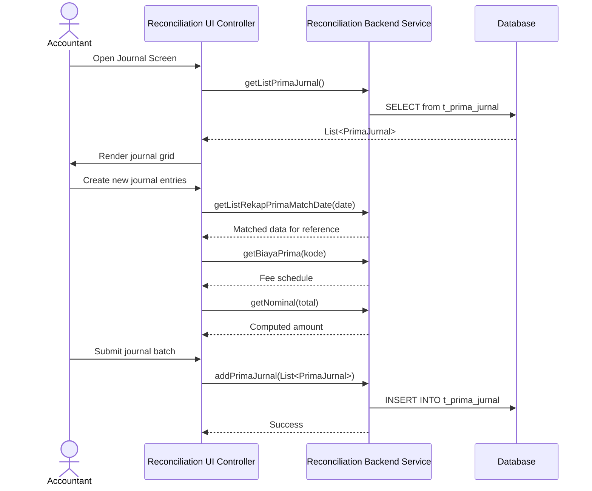

> **CHANGELOG**
> - Abstracted legacy framework and language specifics to focus on system behaviour.
> - Verified data contracts and documented hidden logic/edge cases found during Clean Room audit (e.g., regex cleansing, decimal normalisation).

# Module: Prima Journal Management
> **Sub-program**: Rekon Prima QRIS  
> **Module ID**: `prima-qris-journal`  
> **Owner Component**: `Reconciliation UI Controller` (journal UI), `Reconciliation Backend Service` (journal service)  
> **Entities**: `PrimaJurnal`, `MstPrima`, `MstBiayaPrima`

---

## 1. Module Overview

This module handles the **creation and management of Prima journal entries** (jurnal) for General Ledger (GL) integration. After reconciliation produces matched results, the accounting team generates journal entries that record the financial impact of Prima transactions — including fees, settlements, and inter-account transfers.

This is an **accounting output module** — it consumes reconciliation results and master data to produce structured GL-ready journal entries.

### Scope Boundaries
- **IN scope**: Journal entry creation, journal listing, journal data export, fee-based nominal calculation.
- **OUT of scope**: Matching logic (→ `mod_reconciliation_engine`), master data CRUD (→ `mod_master_data`), file ingestion (→ `mod_file_ingestion`).

---

## 2. Local Functional Flows & Scenarios

### 2.1 Journal Entry Generation

1. Accounting officer opens the Prima journal screen.
2. Views existing journal entries via `getListPrimaJurnal()`.
3. Optionally filters by code: `getListJurnalbyKode(kode)`.
4. Creates new journal entries:
   - References reconciliation match data for the period.
   - Computes nominal amounts based on transaction count: `getNominal(total)`.
   - Lookups fee schedules from `MstBiayaPrima`.
5. Submits batch: `addPrimaJurnal(List<PrimaJurnal>)`.
6. Entries persisted to DB for GL extraction.

### 2.2 Fee-Based Nominal Calculation

`getNominal(int total)` — given a transaction count, returns the corresponding nominal amount (likely a tiered fee schedule based on volume).

### 2.3 Supporting Data Queries

| Method | Purpose |
|---|---|
| `getBiayaPrima(kode)` | Get Prima fee schedule for a category |
| `getListMstPrima(kode)` | Get Prima merchant details |
| `getListMstPrimaAll()` | List all Prima merchants |
| `getListMstBiaya()` | List all fee schedules |

### 2.4 Reconciliation-to-Journal Data Flow

### 2.5 Scenarios

#### Scenario A — Generate Daily Prima Journal
1. Accountant views matched results for Oct 3, 2024.
2. Creates journal entries referencing the matched amounts.
3. `addPrimaJurnal()` batch-inserts.
4. Entries available for GL export.

#### Scenario B — Lookup by Code
1. Accountant filters journals by code "PRIMA-ATM".
2. `getListJurnalbyKode("PRIMA-ATM")` returns filtered list.

---

## 3. Local Technical Flows & Data Life Cycle

### 3.1 Journal Methods

| Method | Purpose |
|---|---|
| `addPrimaJurnal(List<PrimaJurnal>)` | Batch-insert journal entries |
| `getListPrimaJurnal()` | List all journal entries |
| `getListJurnalbyKode(kode)` | Filter journals by category code |
| `getNominal(total)` | Compute nominal amount from transaction count |

### 3.2 Supporting Reconciliation Queries

These methods provide the matched transaction data that journals reference:

| Method | Purpose |
|---|---|
| `getListRekapPrimaMatchDate(date)` | Daily Prima matches |
| `getListRekapPrimaX4I(date)` | X4I format matches |
| `getListRekapDDPrimaMatchDate(date)` | DD-Prima matches |
| `getListRekapBPrimaMatchDate(date)` | Biller-Prima daily matches |
| `getListRekapBPrimaMonthly(start, end)` | Biller-Prima monthly |
| `getListRekapQPrimaMatchDate(date)` | QRIS-Prima daily matches |
| `getListRekapQPrimaMonthly(start, end)` | QRIS-Prima monthly |

### 3.3 Data Model

| Entity | Key Fields |
|---|---|
| `PrimaJurnal` | Journal entry: code, description, debit/credit accounts, nominal amount, date, userid |

---

## 4. Interface & Dependencies

### 4.1 Inbound Dependencies

| Source | Data / Trigger | Description |
|---|---|---|
| **Reconciliation Engine** | `getListRekap*MatchDate()` queries | Matched data for journal reference |
| **Master Data Module** | `MstBiayaPrima`, `MstPrima` | Fee schedules and merchant data for journal computation |
| **Accountant (UI)** | Manual journal creation | User-initiated journal entries |

### 4.2 Outbound Dependencies

| Target | Data / Trigger | Description |
|---|---|---|
| **Database** | INSERT into `t_prima_jurnal` | Persisted journal entries |
| **GL System (External)** | Journal data export | Journal entries are extracted for General Ledger posting (external process) |
