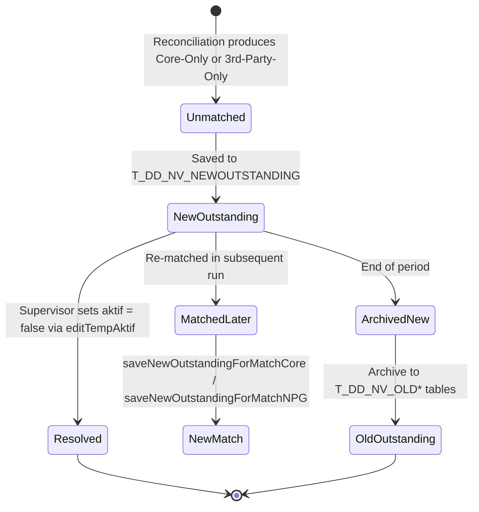

> **CHANGELOG**
> - Abstracted legacy framework and language specifics to focus on system behaviour.
> - Verified data contracts and documented hidden logic/edge cases found during Clean Room audit (e.g., regex cleansing, decimal normalisation).

# Module: Prima QRIS Outstanding Management
> **Sub-program**: Rekon Prima QRIS  
> **Module ID**: `prima-qris-outstanding`  
> **Owner Component**: `Reconciliation UI Controller`, `Reconciliation Backend Service`  
> **Entities**: `T_DD_NV_NEWOUTSTANDING`, `T_DD_NV_NEW*`, `T_DD_NV_OLD*`, `RekonPrimaTamp`, `RekonBillerPrimaTamp`, `RekonQPrimaCoreTamp`

---

## 1. Module Overview

This module manages the lifecycle of **unresolved/outstanding reconciliation items** — transactions that remain unmatched after the daily reconciliation run and require manual investigation or carry-forward to subsequent periods. It also handles **temporary (Tamp) staging records** for manual status overrides across all four reconciliation domains.

### Key Responsibilities
- Track outstanding items across periods (New vs. Old tables).
- Allow supervisors to filter, view, and edit outstanding items.
- Support manual status override on unmatched records per domain.
- Clear outstanding data by date for re-processing.
- Archive resolved items from New to Old period tables.

### Scope Boundaries
- **IN scope**: Outstanding item CRUD, Tamp record status editing, period archival (New→Old), date-based cleanup.
- **OUT of scope**: Initial matching (→ `mod_reconciliation_engine`), file ingestion (→ `mod_file_ingestion`), master data (→ `mod_master_data`).

---

## 2. Local Functional Flows & Scenarios

### 2.1 Outstanding Item Lifecycle

### 2.2 Period Table Structure

| Period | Match | Core-Only | NPG-Only |
|---|---|---|---|
| **New (Current)** | `T_DD_NV_NEWMATCH` | `T_DD_NV_NEWCOREONLY` | `T_DD_NV_NEWNPGONLY` |
| **Old (Archive)** | `T_DD_NV_OLDMATCH` | `T_DD_NV_OLDCOREONLY` | `T_DD_NV_OLDNPGONLY` |
| **Outstanding** | `T_DD_NV_NEWOUTSTANDING` | — | — |

### 2.3 Status Override: Tamp Records (Per Domain)

Each reconciliation domain has its own temporary staging tables for manual status editing:

| Domain | Tamp Entity | Query Method | Edit Method |
|---|---|---|---|
| Prima Classic | `RekonPrimaTamp` | `getRekonTampPrima(ref, tgl, status)` | `editStatusPrima(item)` |
| Prima Classic (Core) | `RekonPrimaCoreTamp` | `getRekonTampPrimaCore(ref, tgl, status)` | `editStatusPrimaCore(item)` |
| Biller Prima | `RekonBillerPrimaTamp` | `getRekonTampPrimaBiller(ref, tgl, status)` | `editStatusPrimaBiller(item)` |
| Biller Prima (Core) | `RekonBillerPrimaCoreTamp` | `getRekonTampPrimaCoreBiller(ref, tgl, status)` | `editStatusPrimaCoreBiller(item)` |
| QRIS (Prima source) | `RekapPrimaOnlyQRISCorePrima` | `getRekonTampPrimaQRIS(ref, tgl, status)` | `editStatusPrimaQRIS(item)` |
| QRIS (PAC source) | `RekapPrimaOnlyQRISCorePac` | `getRekonTampPacQRIS(ref, tgl, status)` | `editStatusPacQRIS(item)` |
| QRIS (Core) | `RekonQPrimaCoreTamp` | `getRekonTampPrimaCoreQRIS(ref, tgl, status)` | `editStatusPrimaCoreQRIS(item)` |
| QRIS (Core PAC) | `RekonQPrimaCoreTamp` | `getRekonTampPrimaCoreQRISPAC(ref, tgl, status)` | `editStatusPrimaCoreQRISPAC(item)` |

### 2.4 Scenarios

#### Scenario A — Outstanding Item Resolution
1. Supervisor filters outstanding list by date range.
2. Identifies a previously unmatched item now resolved offline.
3. Calls `editTempAktif(item)` to set `aktif = false`.
4. Item no longer appears in active outstanding list.

#### Scenario B — Re-Processing and Cleanup
1. Officer needs to re-run matching for a date.
2. `delnvbytglpilih(date)` clears all outstanding records for that date.
3. Fresh matching run populates new results.

#### Scenario C — Cross-Period Match
1. An item outstanding from Day 1 matches on Day 3.
2. `saveNewOutstandingForMatchCore(list, date)` moves it from outstanding to matched.
3. Item archived to `T_DD_NV_NEWMATCH`.

---

## 3. Local Technical Flows & Data Life Cycle

### 3.1 Outstanding CRUD Methods

| Method | Purpose |
|---|---|
| `getLISTNVNEWOUTSTANDING()` | List all outstanding items |
| `getLISTNVNEWOUTSTANDINGbytgl(dateStart, dateEnd)` | Filter outstanding by date range |
| `editTempAktif(T_DD_NV_NEWOUTSTANDING)` | Toggle active status |
| `delnvbytglpilih(date)` | Delete all outstanding for a date (re-processing prep) |
| `saveNewOutstandingForCore(list)` | Save new outstanding items (Core side) |
| `saveNewOutstandingForNPG(list)` | Save new outstanding items (NPG side) |
| `saveNewOutstandingForMatchCore(list, date)` | Move outstanding to matched (Core) |
| `saveNewOutstandingForMatchNPG(list, date)` | Move outstanding to matched (NPG) |
| `getStarNPGfromOutCore(ref, tgl, nominal)` | Lookup an outstanding item by ref/date/amount |
| `getFeeNPGfromOut(ref, tgl, nominal)` | Get fee for an outstanding NPG item |

### 3.2 Period Archive Methods

| Method | Purpose |
|---|---|
| `saveOldMatch(list)` | Archive current match to OLD |
| `saveOldCoreOnly(list)` | Archive Core-Only to OLD |
| `saveOldNPGOnly(list)` | Archive NPG-Only to OLD |
| `saveNewMatch(list)` | Save new period match |
| `saveNewCoreOnly(list)` | Save new period Core-Only |
| `saveNewNPGOnly(list)` | Save new period NPG-Only |
| `getLISTNVOLDMATCH(date)` | Query archived matches |
| `getLISTNVOLDCOREONLY(date)` | Query archived Core-Only |
| `getLISTNVOLDNPGONLY(date)` | Query archived NPG-Only |

---

## 4. Interface & Dependencies

### 4.1 Inbound Dependencies

| Source | Data / Trigger | Description |
|---|---|---|
| **Reconciliation Engine** | Unmatched items | Items that fail to match feed into outstanding tables |
| **Supervisor (UI)** | Status edit request | Manual override via Tamp record editing |
| **Date Selection** | `datTanggal`, date range | Filter scope for outstanding queries |

### 4.2 Outbound Dependencies

| Target | Data / Trigger | Description |
|---|---|---|
| **Database** | INSERT/UPDATE/DELETE on outstanding and Tamp tables | All outstanding lifecycle operations |
| **Reconciliation Engine** | `countItemCoreOnly()`, `countItemNPGOnly()` | Dedup check before inserting new outstanding |
| **Reporting Module** | Outstanding data queries | Reports may display outstanding items |
