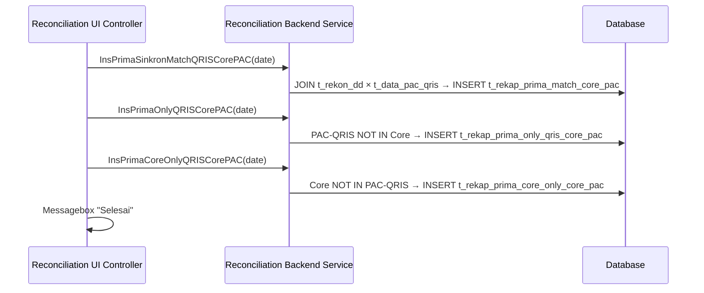

> **CHANGELOG**
> - Abstracted legacy framework and language specifics to focus on system behaviour.
> - Verified data contracts and documented hidden logic/edge cases found during Clean Room audit (e.g., regex cleansing, decimal normalisation).

# Module: Prima QRIS Reconciliation Engine
> **Sub-program**: Rekon Prima QRIS  
> **Module ID**: `prima-qris-reconciliation-engine`  
> **Owner Component**: `Reconciliation Backend Service` — `Ins*SinkronMatch()`, `Ins*Only()`, `Ins*CoreOnly()` methods  
> **Trigger**: Called from UI Controller after file ingestion

---

## 1. Module Overview

This is the matching core of the Prima QRIS sub-program. It implements **four parallel reconciliation domains**, each with its own triad of matching methods (SinkronMatch, Only, CoreOnly). It also includes fee computation logic and deduplication guards.

### Domain Matrix

| Domain | Match Method | 3rd-Party-Only | Core-Only |
|---|---|---|---|
| **Prima Classic** | `InsPrimaSinkronMatch(date)` | `InsPrimaOnly(date)` | `InsPrimaCoreOnly(date)` |
| **QRIS via PAC** | `InsPrimaSinkronMatchQRISCorePAC(date)` | `InsPrimaOnlyQRISCorePAC(date)` | `InsPrimaCoreOnlyQRISCorePAC(date)` |
| **QRIS via Prima** | `InsPrimaSinkronMatchQRISCorePrima(date)` | `InsPrimaOnlyQRISCorePrima(date)` | `InsPrimaCoreOnlyQRISCorePrima(date)` |
| **Biller Prima** | `InsPrimaSinkronMatchBiller(date)` | `InsPrimaOnlyBiller(date)` | `InsPrimaCoreOnlyBiller(date)` |

Additionally, newer format variants exist: `*New()` suffixed methods for QRIS via PAC (e.g., `InsPrimaSinkronMatchQRISCorePACNew()`).

### Scope Boundaries
- **IN scope**: Matching execution, result set generation, fee computation, deduplication guards.
- **OUT of scope**: File ingestion (→ `mod_file_ingestion`), outstanding management (→ `mod_outstanding`), master data CRUD (→ `mod_master_data`), journal entries (→ `mod_journal`), reporting (→ `mod_reporting_export`).

---

## 2. Local Functional Flows & Scenarios

### 2.1 Matching Execution Pattern (All Domains)

For each domain, three methods execute sequentially:

1. **`Ins*SinkronMatch(date)`** — JOIN Core vs. 3rd-party on matching key → INSERT matched pairs.
2. **`Ins*Only(date)`** — 3rd-party records not found in Core → INSERT into "Only" result table.
3. **`Ins*CoreOnly(date)`** — Core records not found in 3rd party → INSERT into "CoreOnly" result table.

### 2.2 Fee Computation

During or after matching, fee amounts are computed for each transaction:

| Method | Domain | Returns |
|---|---|---|
| `getFeeCorePrima(mcode)` | Prima Classic | Fee per merchant code |
| `getFeeBiller(billercode)` | Biller Prima | Base fee |
| `getPpnBiller(billercode)` | Biller Prima | PPN (tax) on fee |
| `getFeePrmBiller(billercode)` | Biller Prima | Prima's fee share |
| `getFeeQRIS(merchantname)` | QRIS | Base QRIS fee |
| `getFeeQRISIssuer(merchantname)` | QRIS | Issuer-side fee |
| `getFeeQRISAcquirer(merchantname)` | QRIS | Acquirer-side fee |
| `getRoundFee(fee)` | All | Banker's rounding for IDR |

### 2.3 Deduplication Guards

| Method | Purpose |
|---|---|
| `countItemCoreOnly(date, ref, amount, tglTransaksi)` | Check if Core-Only record already exists before insert |
| `countItemNPGOnly(date, ref, amount, tglTransaksi)` | Check if NPG-Only record already exists before insert |
| `deleteDataMin30()` | Purge staging data older than 30 days |

### 2.4 Reconciliation Sequence (QRIS via PAC Example)

---

## 3. Local Technical Flows & Data Life Cycle

### 3.1 All Matching Methods (12 core + 3 new variants)

| Method | Result Table |
|---|---|
| `InsPrimaSinkronMatch(date)` | `t_rekap_prima_match` |
| `InsPrimaOnly(date)` | `t_rekap_prima_only` |
| `InsPrimaCoreOnly(date)` | `t_rekap_prima_core_only` |
| `InsPrimaSinkronMatchQRISCorePAC(date)` | `t_rekap_prima_match_core_pac` |
| `InsPrimaOnlyQRISCorePAC(date)` | `t_rekap_prima_only_qris_core_pac` |
| `InsPrimaCoreOnlyQRISCorePAC(date)` | `t_rekap_prima_core_only_core_pac` |
| `InsPrimaSinkronMatchQRISCorePACNew(date)` | `t_rekap_prima_match_core_pac` (new format) |
| `InsPrimaOnlyQRISCorePACNew(date)` | `t_rekap_prima_only_qris_core_pac` (new format) |
| `InsPrimaCoreOnlyQRISCorePACNew(date)` | `t_rekap_prima_core_only_core_pac` (new format) |
| `InsPrimaSinkronMatchQRISCorePrima(date)` | `t_rekap_prima_match_core_prima` |
| `InsPrimaOnlyQRISCorePrima(date)` | `t_rekap_prima_only_qris_core_prima` |
| `InsPrimaCoreOnlyQRISCorePrima(date)` | `t_rekap_prima_core_only_core_prima` |
| `InsPrimaSinkronMatchBiller(date)` | `t_rekap_prima_match` (biller variant) |
| `InsPrimaOnlyBiller(date)` | `t_rekap_prima_only_biller` |
| `InsPrimaCoreOnlyBiller(date)` | `t_rekap_prima_core_only` (biller variant) |

### 3.2 Result Data Models

| Entity | Description |
|---|---|
| `RekapPrimaMatch` | Classic Prima / Biller match |
| `RekapPrimaMatchCorePAC` | QRIS-PAC match |
| `RekapPrimaMatchCorePrima` | QRIS-Prima match |
| `RekapPrimaMatchQ` | QRIS match (query model) |
| `RekapPrimaOnly` | Prima record not in Core |
| `RekapPrimaOnlyBiller` | Biller record not in Core |
| `RekapPrimaOnlyQRISCorePac` | PAC-QRIS not in Core |
| `RekapPrimaOnlyQRISCorePrima` | Prima-QRIS not in Core |
| `RekapPrimaCoreOnly` | Core record not in 3rd party |
| `RekapPrimaDecline` | Declined Prima transactions |

---

## 4. Interface & Dependencies

### 4.1 Inbound Dependencies

| Source | Data / Trigger | Description |
|---|---|---|
| **File Ingestion Module** | Populated staging tables (`t_rekon_dd`, `t_data_prima`, `t_data_pac_qris`, `t_data_prima_qris`) | Prerequisites for matching |
| **Master Data Module** | Fee master tables (`MstMCode`, `MstBiayaPrima`, `MstBiayaBillerPrima`, `MstMCodeQRIS`) | Fee lookup during matching |
| **UI Controller** | `datTanggal` (date) | Matching scope |

### 4.2 Outbound Dependencies

| Target | Data / Trigger | Description |
|---|---|---|
| **Database** | INSERT into 15+ result tables | Result sets for all domains |
| **Reporting & Export Module** | Populated result tables | `mod_reporting_export` queries these |
| **Outstanding Module** | Unmatched items | May feed into outstanding tracking |
