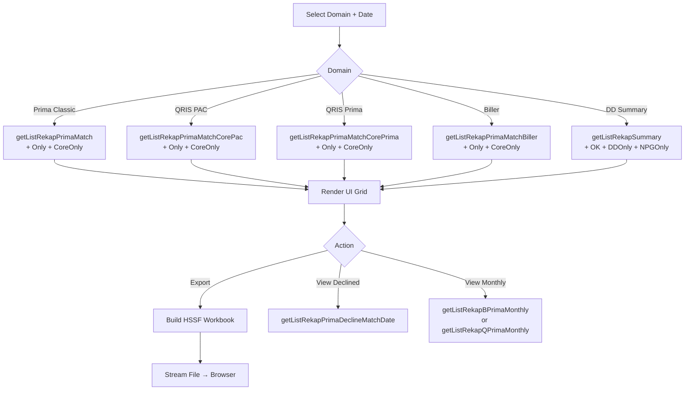

> **CHANGELOG**
> - Abstracted legacy framework and language specifics to focus on system behaviour.
> - Verified data contracts and documented hidden logic/edge cases found during Clean Room audit (e.g., regex cleansing, decimal normalisation).

# Module: Prima QRIS Reporting & Export
> **Sub-program**: Rekon Prima QRIS  
> **Module ID**: `prima-qris-reporting-export`  
> **Owner Component**: `Reconciliation UI Controller` — result queries + Excel export  
> **Backend Service**: `Reconciliation Backend Service.getListRekap*()` methods

---

## 1. Module Overview

This module provides the user-facing reporting and Excel export capabilities for all four Prima QRIS reconciliation domains. It queries the result tables populated by the Reconciliation Engine and renders them in UI grids, with full Excel download support.

### Report Categories by Domain

| Domain | Match Report | Only Report | Core-Only Report |
|---|---|---|---|
| **Prima Classic** | `getListRekapPrimaMatch(date)` | `getListRekapPrimaOnly(date)` | `getListRekapPrimaCoreOnly(date)` |
| **QRIS via PAC** | `getListRekapPrimaMatchCorePac(date)` | `getListRekapPrimaOnlyCorePac(date)` | `getListRekapPrimaCoreOnlyCorePac(date)` |
| **QRIS via Prima** | `getListRekapPrimaMatchCorePrima(date)` | `getListRekapPrimaOnlyCorePrima(date)` | `getListRekapPrimaCoreOnlyCorePrima(date)` |
| **Biller Prima** | `getListRekapPrimaMatchBiller(date)` | `getListRekapPrimaOnlyBiller(date)` | `getListRekapPrimaCoreOnlyBiller(date)` |

Additional reports:
- **Declined transactions**: `getListRekapPrimaDeclineMatchDate(date)`
- **Biller monthly**: `getListRekapBPrimaMonthly(start, end)`
- **QRIS monthly**: `getListRekapQPrimaMonthly(start, end)`
- **DD summary**: `getListRekapSummary()`, `getListRekapOK(date)`, `getListRekapDDOnly(date)`, `getListRekapNPGOnly(date)`
- **DD daily**: `getListRekapHarianDD()`

### Scope Boundaries
- **IN scope**: Querying all result sets, rendering grids, Excel workbook generation, browser download.
- **OUT of scope**: Matching (→ `mod_reconciliation_engine`), master data (→ `mod_master_data`), outstanding (→ `mod_outstanding`), journals (→ `mod_journal`).

---

## 2. Local Functional Flows & Scenarios

### 2.1 Viewing Results

1. User selects reconciliation domain (Prima Classic, QRIS-PAC, QRIS-Prima, Biller).
2. Inputs date or date range.
3. Selects result tab: Match, Only, Core-Only, or Declined.
4. UI Controller calls `getListRekap*()` via remote calls to the Backend Service.
5. The UI framework renders the result.

### 2.2 Excel Export

1. User clicks **Export/Download**.
2. Controller builds Apache POI HSSF workbook (`.xls`).
3. One or more sheets created per result type.
4. File streamed to browser.

### 2.3 DD Summary Reports

| Report | Method | Description |
|---|---|---|
| Summary | `getListRekapSummary()` | Aggregate DD summary |
| OK (Matched) | `getListRekapOK(date)` | Matched DD transactions |
| DD-Only | `getListRekapDDOnly(date)` | DD records not in NPG |
| NPG-Only | `getListRekapNPGOnly(date)` | NPG records not in DD |
| Daily | `getListRekapHarianDD()` | Daily DD recap |

### 2.4 Fee-Related Queries in Reports

| Method | Usage |
|---|---|
| `getSumNominal(date)` | Sum of transaction amounts for a date |
| `getSumFee(date)` | Sum of fees for a date |
| `getFeeNPG(noref, tanggal)` | Individual NPG transaction fee |
| `getFeeNPGMacthBy1(noref, tanggal)` | NPG fee for matched item |
| `updateNilaiBiayaBiller(tampungan, nilai, date)` | Update computed biller fee in report |

### 2.5 Reporting Flowchart

---

## 3. Local Technical Flows & Data Life Cycle

### 3.1 Result Data Models

| Entity | Domain | Description |
|---|---|---|
| `RekapPrimaMatch` | Prima Classic, Biller | Matched pair result |
| `RekapPrimaMatchCorePAC` | QRIS PAC | QRIS-PAC match |
| `RekapPrimaMatchCorePrima` | QRIS Prima | QRIS-Prima match |
| `RekapPrimaMatchQ` | QRIS (query) | QRIS match query model |
| `RekapPrimaOnly` | Prima Classic | 3rd-party only |
| `RekapPrimaOnlyBiller` | Biller | Biller only |
| `RekapPrimaOnlyQRISCorePac` | QRIS PAC | PAC-QRIS only |
| `RekapPrimaOnlyQRISCorePrima` | QRIS Prima | Prima-QRIS only |
| `RekapPrimaCoreOnly` | All | Core only |
| `RekapPrimaDecline` | Prima Classic | Declined items |
| `RekapSummaryDD` | DD | DD aggregate summary |
| `RekonDD` / `RekonDD2` | DD | DD line items |
| `DDLap1` | DD | DD report type 1 |

### 3.2 State Variables

| Variable | Description |
|---|---|
| `datTanggal` | Reconciliation date filter |
| `datTanggalAwal / Akhir` | Date range for monthly/summary |
| Various `listRekap*` | Cached result lists per domain |
| `selected` | Selected grid row |

---

## 4. Interface & Dependencies

### 4.1 Inbound Dependencies

| Source | Data / Trigger | Description |
|---|---|---|
| **Reconciliation Engine** | Populated result tables (15+ tables) | Data source for all reports |
| **User Input** | Date, domain selection | Report scope |
| **Master Data Module** | Merchant/fee data | Enrichment in report display |

### 4.2 Outbound Dependencies

| Target | Data / Trigger | Description |
|---|---|---|
| **Reconciliation Backend Service** | `getListRekap*()` calls | Data retrieval |
| **Browser** | `.xls` file | Excel download |
| **Outstanding Module** | Navigation from report grid to outstanding edit | User drills into unmatched item |
