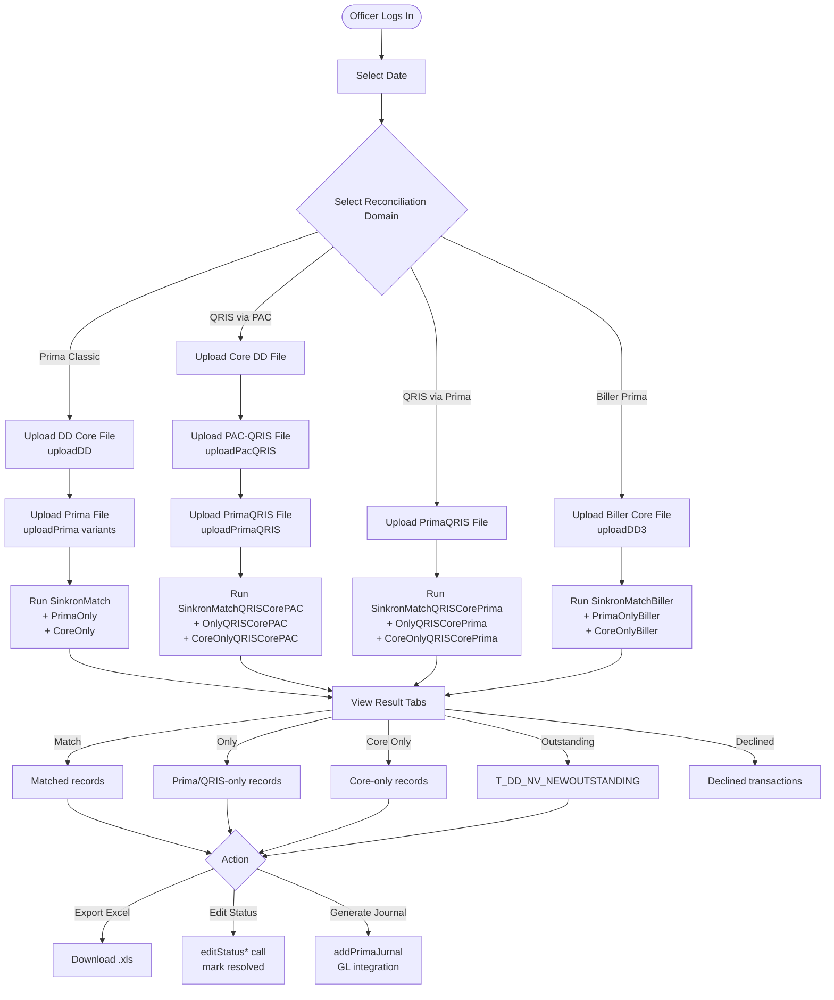
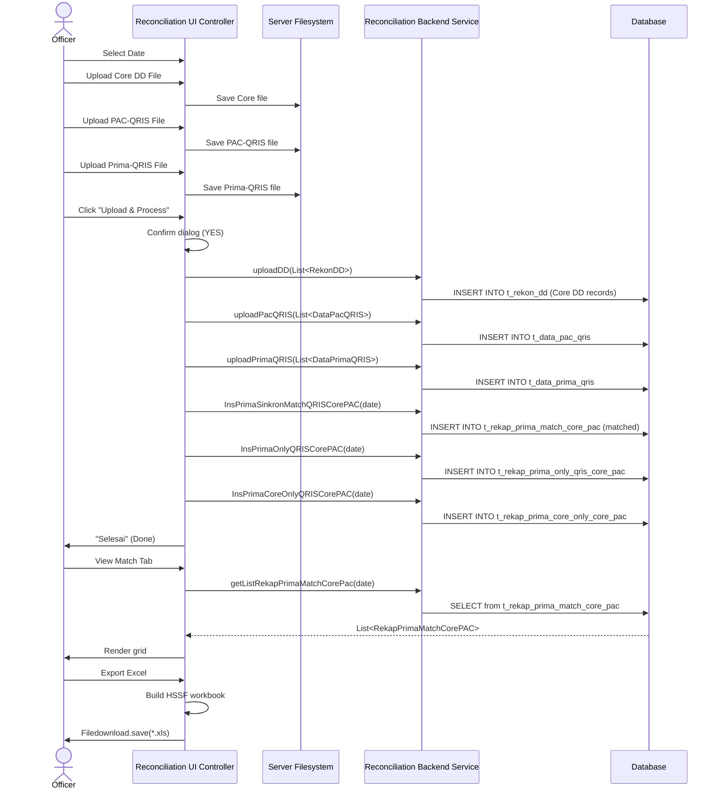

> **CHANGELOG**
> - Abstracted legacy framework and language specifics to focus on system behaviour.
> - Verified data contracts and documented hidden logic/edge cases found during Clean Room audit (e.g., regex cleansing, decimal normalisation).

# Rekon Prima QRIS — System Documentation
> **Source of Truth** for developers and AI coding agents  
> Module path: `reconcile-system/Rekon Prima QRIS`  
> Last reverse-engineered: 2026-06-07

---

## 1. Executive Summary & High-Level Requirements

### 1.1 Business Purpose
**Rekon Prima QRIS** is the most complex of the four reconciliation modules. It handles four distinct reconciliation domains, all involving Prima (Indonesia's national payment switching network operated by BI) as the intermediary:

1. **Prima Classic** — Standard Prima debit/ATM transactions: Core Banking vs. Prima file.
2. **QRIS via PAC** — QRIS (Quick Response Code Indonesian Standard) QR-code payments where the settlement file comes from the PAC (PAC-QRIS files). Core Banking is matched against PAC-QRIS data.
3. **QRIS via Prima** — QRIS payments where settlement data comes directly from Prima.
4. **Biller Prima** — Transactions via the Prima network for specific biller categories (bill payments), reconciled with a dedicated Biller-side file.

Additionally, the module manages:
- **Direct Debit (DD) reconciliation** — matching DD transactions from Core against NPG (National Payment Gateway) or JALIN-sourced data.
- **Master data management** — for Merchant Codes (MCode), Prima merchants, QRIS merchant codes, DD merchants, fee schedules, rekening (account) mappings, and transaction codes.
- **Journal generation** — Prima jurnal (journal entry) creation for GL/accounting integration.
- **Outstanding item management** — tracking and resolving unmatched items across batches.

### 1.2 Core High-Level Functional Requirements

| # | Requirement | Notes |
|---|---|---|
| FR-01 | Upload Core Banking file for Direct Debit reconciliation | `uploadDD()` |
| FR-02 | Upload Prima transaction data files (multiple subtypes: standard, X4I, NPG, R1, PA1) | `uploadPrima*()` variants |
| FR-03 | Upload PAC-QRIS data files | `uploadPacQRIS()`, `uploadPacQRISNew()` |
| FR-04 | Upload Prima-QRIS data files | `uploadPrimaQRIS()` |
| FR-05 | Execute matching: Prima–Core (Classic) | `InsPrimaSinkronMatch()`, `InsPrimaOnly()`, `InsPrimaCoreOnly()` |
| FR-06 | Execute matching: QRIS via PAC | `InsPrimaSinkronMatchQRISCorePAC()`, etc. |
| FR-07 | Execute matching: QRIS via Prima | `InsPrimaSinkronMatchQRISCorePrima()`, etc. |
| FR-08 | Execute matching: Biller Prima | `InsPrimaSinkronMatchBiller()`, `InsPrimaOnlyBiller()`, `InsPrimaCoreOnlyBiller()` |
| FR-09 | View and download Match / Core-Only / Prima-Only result sets for each domain | `getListRekap*` methods |
| FR-10 | Manual status edit for outstanding/unmatched records | `editStatus*()` variants per domain |
| FR-11 | CRUD for Merchant Code master (Prima, Biller, QRIS variants) | `addMstMCode*()`, `editMstMCode*()`, `deleteMstMCode*()` |
| FR-12 | CRUD for Prima merchant master | `addMstPrima()`, `editMstPrima()`, `deleteMstPrima()` |
| FR-13 | CRUD for QRIS merchant code with fee settings (Fee, Issuer fee, Acquirer fee) | `MstMCodeQRIS`, `getFeeQRIS*()` |
| FR-14 | CRUD for Biller fee master | `MstBiayaBillerPrima` |
| FR-15 | CRUD for DD merchant master (`MstDD`, `MstDD2`, `MstDDMJT`) | `addMstDD()`, etc. |
| FR-16 | CRUD for account (Rekening) master | `addMstRekening()`, etc. |
| FR-17 | CRUD for transaction code master | `addMstKodeTransaksi()`, etc. |
| FR-18 | Generate and manage Prima journals for GL | `addPrimaJurnal()`, `getListPrimaJurnal()` |
| FR-19 | Export all report types to Excel (HSSF `.xls`) | `downloadExcel*()` commands |
| FR-20 | Fee calculation and rounding for Prima, Biller, QRIS, NPG | `getFeeCorePrima()`, `getFeeBiller()`, `getFeeQRIS()`, `getRoundFee()` |

---

## 2. User Scenarios & Personas

### 2.1 Personas

| Persona | Role | Key Domain |
|---|---|---|
| **Prima Settlement Officer** | Daily Prima reconciliation operator | Prima Classic, DD |
| **QRIS Officer** | QRIS reconciliation and dispute | QRIS PAC, QRIS Prima |
| **Biller Prima Officer** | Bill payment reconciliation | Biller Prima |
| **Master Data Admin** | Maintains merchant/fee master tables | MCode, QRIS MCode, Biller fee, Rekening |
| **Accounting Officer** | Journal entry and GL integration | Prima Jurnal management |
| **Supervisor** | Oversight and exception resolution | All result sets, status overrides |

### 2.2 End-to-End User Scenarios

#### Scenario A — Classic Prima Reconciliation (Happy Path)
1. Officer logs in; session ID propagated via URL.
2. Selects date.
3. Uploads Core Banking DD file → `uploadDD()`.
4. Uploads Prima file (e.g., `uploadPrima()` for standard format).
5. Triggers match: `InsPrimaSinkronMatch()` → `InsPrimaOnly()` → `InsPrimaCoreOnly()`.
6. Views Match result tab, downloads `.xls` report.

#### Scenario B — QRIS via PAC Reconciliation
1. Officer uploads Core file + PAC-QRIS file.
2. System calls `uploadPacQRIS()` and `uploadPrimaQRIS()`.
3. `InsPrimaSinkronMatchQRISCorePAC()` runs matching.
4. Officer views `getListRekapPrimaMatchCorePac()` — matched QRIS transactions.
5. Items in `getListRekapPrimaOnlyCorePac()` = QRIS in PAC not matched to Core.
6. Items in `getListRekapPrimaCoreOnlyCorePac()` = Core records not in PAC-QRIS.

#### Scenario C — Biller Prima Monthly Reconciliation
1. Officer selects date range (monthly).
2. Uploads Biller Core file via `uploadDD3()`.
3. Runs `InsPrimaSinkronMatchBiller()`.
4. Reviews `getListRekapBPrimaMonthly(startDate, endDate)`.
5. Fee breakdown per biller is retrieved from `MstBiayaBillerPrima`.

#### Scenario D — Outstanding Item Resolution
1. Prior-day item in `T_DD_NV_NEWOUTSTANDING` remains unmatched.
2. Supervisor filters outstanding list by date range.
3. Edits `aktif` status flag via `editTempAktif()`.
4. Item is deactivated/resolved.

#### Scenario E — Master Data CRUD: QRIS Merchant Code
1. Admin opens QRIS MCode master screen.
2. Searches by merchant code or name.
3. Adds new entry with 3 fee types: base fee, issuer fee, acquirer fee.
4. `addMstMCodeQRIS()` called → persisted to DB.
5. Fee is later retrieved by `getFeeQRISIssuer()` during reconciliation.

#### Scenario F — Prima Journal Entry Generation
1. Accounting officer opens journal screen.
2. Selects existing journal lines or adds new journal entries.
3. `addPrimaJurnal(List<PrimaJurnal>)` persists entries.
4. Journal data exported for GL upload.

#### Scenario G — Declined Transaction Handling
1. Prima reports a `Decline` status on a transaction.
2. `getListRekapPrimaDeclineMatchDate()` shows declined items for the date.
3. Officer investigates and notates manually.

---

## 3. Functional Architecture & Workflows

### 3.1 Step-by-Step Business Logic

1. **Initialisation** — Session ID and username resolved from URL. File directory auto-created.
2. **File Upload** — Multiple upload entry points depending on file type (Prima, QRIS-PAC, QRIS-Prima, Biller, DD). Each validated by filename and stored to filesystem.
3. **Upload Methods by Domain**:
   - `uploadDD()` / `uploadDD2()` / `uploadDD3()` — DD data variants.
   - `uploadPrima()` / `uploadPrimaX4I()` / `uploadPrimaNPG()` / `uploadPrimaR1()` / `uploadPrimaPA1()` — Prima transaction variants.
   - `uploadPrimaQRIS()` — Prima-QRIS settlement file.
   - `uploadPacQRIS()` / `uploadPacQRISNew()` — PAC-QRIS file variants.
4. **Matching Execution** — For each domain, three service calls:
   - `Ins*SinkronMatch()` → Matched pairs.
   - `Ins*Only()` → Third-party-only records (no Core counterpart).
   - `Ins*CoreOnly()` → Core-only records (no Prima/PAC counterpart).
5. **Fee Computation** — Service methods `getFeeCoreP*()`, `getFeeBiller()`, `getFeeQRIS*()` look up the master fee tables. `getRoundFee()` applies rounding logic.
6. **Outstanding Management** — Items in `T_DD_NV_NEWOUTSTANDING` are carried forward. `delnvbytglpilih()` clears them by date. `editTempAktif()` closes individual items.
7. **Export** — Apache POI HSSF workbooks generated, streamed via `Filedownload.save()`.

### 3.2 Matching Domain Matrix

| Domain | Upload Methods | Match Method | Only (3rd Party) | Core-Only | Result Model |
|---|---|---|---|---|---|
| Prima Classic | `uploadPrima*()` + `uploadDD()` | `InsPrimaSinkronMatch()` | `InsPrimaOnly()` | `InsPrimaCoreOnly()` | `RekapPrimaMatch`, `RekapPrimaOnly`, `RekapPrimaCoreOnly` |
| QRIS via PAC | `uploadPacQRIS()` + `uploadPrimaQRIS()` | `InsPrimaSinkronMatchQRISCorePAC()` | `InsPrimaOnlyQRISCorePAC()` | `InsPrimaCoreOnlyQRISCorePAC()` | `RekapPrimaMatchCorePAC`, `RekapPrimaOnlyQRISCorePac` |
| QRIS via Prima | `uploadPrimaQRIS()` | `InsPrimaSinkronMatchQRISCorePrima()` | `InsPrimaOnlyQRISCorePrima()` | `InsPrimaCoreOnlyQRISCorePrima()` | `RekapPrimaMatchCorePrima`, `RekapPrimaOnlyQRISCorePrima` |
| Biller Prima | `uploadDD3()` | `InsPrimaSinkronMatchBiller()` | `InsPrimaOnlyBiller()` | `InsPrimaCoreOnlyBiller()` | `RekapPrimaMatch`, `RekapPrimaOnlyBiller`, `RekapPrimaCoreOnly` |

### 3.3 Functional Flowchart



---

## 4. Technical Architecture & Data Flow

### 4.1 Technology Stack

| Layer | Technology |
|---|---|
| Frontend | Frontend Framework (MVVM), UI pages, multiple sub-modules |
| ViewModel | `Reconciliation UI Controller` (primary), `Direct Debit UI Controller` (DD sub-module) |
| Service Interface | Remote Service Interface — `Reconciliation Backend Interface` |
| Service Implementation | Deployed in `Backend Deployment Artifact` |
| File Formats | CSV, fixed-width TXT, pipe-delimited `.ftr` |
| Excel Export | Apache POI HSSF (`.xls`) |
| Security | WS-Security, Portal session token |
| Build | Build Tool, IDE Build Tool |

### 4.2 Component Architecture

```
Frontend Deployment Artifact (Frontend)
  └── Reconciliation UI Controller (Prima Classic, QRIS, Biller)
  └── Direct Debit UI Controller (Direct Debit sub-module)
        ├── @WireVariable RekonPrimaBo  → Remote Service Proxy → Backend Deployment Artifact
        ├── @WireVariable RekonDDBo     → Remote Service Proxy → Backend Deployment Artifact
        ├── @WireVariable BiFastBo      → Remote Service Proxy (shared)
        └── @WireVariable PortalUMBo   → Portal (auth)

Backend Deployment Artifact (Backend)
  └── Reconciliation Backend Service (manages all 4 domains + master data + journals)
```

### 4.3 Key Data Models

| Entity | Purpose |
|---|---|
| `DataPrima` | Parsed Prima transaction (multiple upload variants) |
| `DataPrimaQRIS` | Parsed Prima-QRIS transaction |
| `DataPacQRIS` | Parsed PAC-QRIS settlement record |
| `DataNPG` | NPG (National Payment Gateway) transaction |
| `RekapPrimaMatch` | Classic Prima match result |
| `RekapPrimaMatchCorePAC` | QRIS-PAC match result |
| `RekapPrimaMatchCorePrima` | QRIS-Prima match result |
| `RekapPrimaOnly` | Prima record not in Core |
| `RekapPrimaCoreOnly` | Core record not in Prima |
| `RekapPrimaDecline` | Declined Prima transactions |
| `RekapPrimaMatchQ` | QRIS match result (query model) |
| `RekonDD` / `RekonDD2` | DD reconciliation data |
| `T_DD_NV_NEWMATCH` / `NEWCOREONLY` / `NEWNPGONLY` | New period result tables |
| `T_DD_NV_OLDMATCH` / `OLDCOREONLY` / `OLDNPGONLY` | Previous period archive |
| `T_DD_NV_NEWOUTSTANDING` | Outstanding unresolved items |
| `MstMCode` | Prima merchant code master |
| `MstMCodeQRIS` | QRIS merchant code master (with 3 fee types) |
| `MstBiayaPrima` | Prima fee schedule |
| `MstBiayaBillerPrima` | Biller-Prima fee schedule |
| `MstPrima` | Prima merchant master |
| `MstDD` / `MstDD2` / `MstDDMJT` | DD merchant masters |
| `KodeTransaksi` | Transaction code master |
| `Rekening` | Account number master |
| `PrimaJurnal` | Journal entries for GL integration |

### 4.4 Data Flow: QRIS via PAC Reconciliation



---

## 5. State Management & Constraints

### 5.1 Application State

| State Variable | Description |
|---|---|
| `datTanggal` | Selected reconciliation date |
| `datTanggalAwal / Akhir` | Report date range filter |
| `strFileCore`, `strFilePrima`, `strFileQRIS`, etc. | Uploaded filenames per domain |
| `strFilePath` | Filesystem path (class-path derived) |
| `strSessionId / strUserName` | Auth state |
| `listOutstandingEdit` | Selected outstanding items being edited |
| Various `listRekap*` | In-memory result lists per domain |

### 5.2 Technical Constraints

| Constraint | Detail |
|---|---|
| **Multiple Upload Variants** | Prima file has 5+ format subtypes (standard, X4I, NPG, R1, PA1). Each calls a distinct `uploadPrima*()` method — the formats differ in column positions and naming conventions |
| **Fee Rounding** | `getRoundFee(double fee)` — fee amounts are subject to banker's rounding rules for IDR currency precision |
| **Outstanding Data Lifecycle** | `delnvbytglpilih(date)` clears all outstanding records for a date before re-processing; prevents duplication on re-runs |
| **Old vs. New Period Tables** | Match data is archived into `T_DD_NV_OLD*` tables; current period uses `T_DD_NV_NEW*` tables; ensures historical traceability |
| **QRIS Dual-Source** | QRIS reconciliation can use either PAC data or Prima data as the 3rd-party source; each has a separate code path and result tables |
| **Biller Fee Lookup** | Biller fee includes 3 components: base `getFeeBiller()`, PPN `getPpnBiller()`, and Premia `getFeePrmBiller()` |
| **Count-Before-Insert Guards** | `countItemCoreOnly()` and `countItemNPGOnly()` prevent duplicate inserts into result tables |

### 5.3 Security & Authentication

- Session delegated from parent portal.
- Remote Service Security secures all remote service calls.
- No user passwords stored in application; retrieved from security config at runtime.

### 5.4 Error Handling

| Scenario | Response |
|---|---|
| Date not selected | `Messagebox.show("Pilih Tanggal...")` |
| Wrong file format/name | Messagebox error, file not saved |
| Re-processing same date | `delnvbytglpilih()` clears old data first |
| Service/DB exception | System `Exception` bubble up; UI renders error |
| Missing fee master entry | `getFee*()` returns 0.0 — downstream must handle null/zero fee case |
| Outstanding edit conflict | Status flag update via `editTempAktif()` — no optimistic locking observed |
