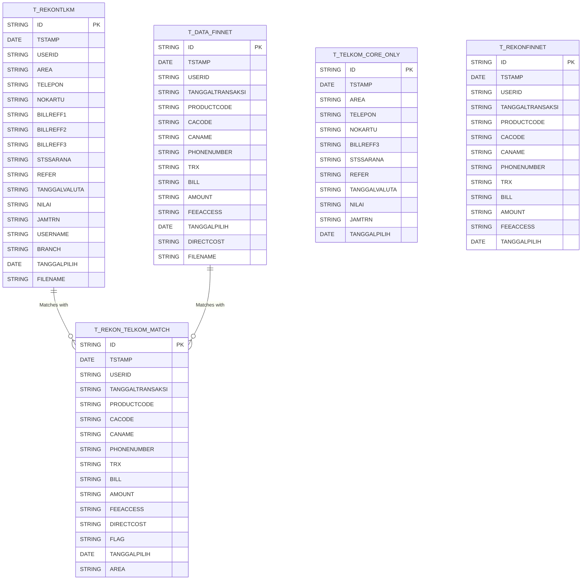

# Data Architecture: Rekon Telkom

**CHANGELOG**
- Added explicit data contract mapping based on legacy code audit (e.g. Area code prefixing rules, phone number trimming rules, hardcoded exception numbers).
- Abstracted legacy Java-specific syntax into language-agnostic data models.

## 1. Database Schemas

The sub-program interacts with several database tables to manage the reconciliation of Core Telkom and Finnet data.

### Entity-Relationship (ER) Diagram



### Table Definitions
*   **`T_REKONTLKM`**: Stores the raw Core Telkom transactions parsed from the daily text files.
*   **`T_DATA_FINNET`**: Stores the raw Finnet transactions parsed from the settlement files.
*   **`T_REKON_TELKOM_MATCH`**: Stores reconciled items where Core Telkom data and Finnet data successfully match.
*   **`T_TELKOM_CORE_ONLY`**: Stores unmatched Core Telkom transactions (outstanding in Core but not in Finnet).
*   **`T_REKONFINNET`**: Stores unmatched Finnet transactions (outstanding in Finnet but not in Core).

---

## 2. File-Based Data Structures

### Core Telkom Files (Fixed-Width Text Files)
*   **Format**: Plain text (e.g., `*REKONTELKOM-050003.TXT`, `*REKONTELKOM-050004.TXT`)
*   **Structure**: Fixed-width positional records.
*   **Parsing Logic**:
    *   Iterates line by line.
    *   **Filters**: Skips lines starting with specific headers or separators (`"00"`, `"20"`, `"Al"`, `"="`, `"=="`, `"A"`, `"BA"`, or empty strings).
    *   **Extraction**: Fields are extracted based on character coordinates.
    *   **Hidden Logic / Data Transformations**:
        *   **Area Code Dynamic Mapping**: Area codes starting with `0341`, `0361`, `0411`, `0343`, `0321`, `0711`, `0271`, `0298`, `0281`, `0315` span positions 0-4. All other records shift the start position to index 2 (spanning 2-4).
        *   **Phone Number Trimming**: The phone number field undergoes explicit trimming of leading zeros: `000` starting at position 6 shifts the number to start at 9; `00` shifts to 8; `0` shifts to 7.

### Finnet Files (Tabular Data)
*   **Format**: Tabular structure (e.g., `*FINNET-01.XLS`, `*FINNET-02.XLS`)
*   **Parsing Logic**: Iterates over rows and maps specific columns to attributes like `productCode`, `CAcode`, `CAname`, `phonenumber`, `trx`, `bill`, `amount`, `feeaccess`, and `directcost`.

---

## 3. Master Data & Hardcoded Values

Several pieces of master data and business logic are statically defined within the data processing layer:

1.  **Expected File Names**:
    *   Strict suffix checks for file uploads such as `REKONTELKOM-050003.TXT`, `FINNET-01.XLS`, etc.
2.  **Reconciliation Ignoring Rules (Exception Phone Numbers)**:
    *   **Silent Deletion Rule**: Matches where `BILL = '2.0'` and `FLAG = 'MATCH'` are silently deleted if they belong to specific dummy or invalid phone numbers: `302220640`, `3520528`, `3538679`, `3810357`, `5017836`, `5030867`, `5033326`, `5941232`, `5963677`, `5995713`, `5997707`, `7318863`, `7321449`, `7323319`, `7480696`, `7481718`, `7482200`, `7495129`, `8911367`, `8914179`, `8914247`, `8965941`, `99534887`, and `352117146`.

---

## 4. Configuration Externalization Strategy

To decouple the data ingestion logic from constant changes in Telkom and Finnet file structures, we propose externalizing this hardcoded data into a centralized `rekon_telkom_config.json` or YAML file. 

### Proposed `rekon_telkom_config.json`

```json
{
  "system": "RekonTelkom",
  "data_sources": {
    "core_telkom": {
      "expected_files": [
        "REKONTELKOM-010001.TXT",
        "REKONTELKOM-030001.TXT",
        "REKONTELKOM-050003.TXT",
        "REKONTELKOM-050004.TXT",
        "REKONTELKOM-070005.TXT"
      ],
      "parsing_rules": {
        "ignored_line_prefixes": ["00", "20", "Al", "=", "==", "A", "BA", ""],
        "known_area_codes": [
          "0341", "0361", "0411", "0343", "0321", 
          "0711", "0271", "0298", "0281", "0315"
        ],
        "substring_mapping": {
          "area": [0, 5],
          "telepon": [6, 15],
          "nokartu": [17, 33],
          "billreff1": [34, 45],
          "billreff2": [47, 57],
          "billreff3": [58, 62],
          "stssarana": [74, 77],
          "refer": [85, 92],
          "tglvaluta": [93, 103],
          "nilai": [104, 120],
          "jamtrn": [123, 131]
        }
      }
    },
    "finnet": {
      "expected_files": [
        "FINNET-01.XLS",
        "FINNET-02.XLS",
        "FINNET-03.XLS",
        "FINNET-04.XLS",
        "FINNET-05.XLS",
        "FINNET-07.XLS"
      ]
    }
  },
  "reconciliation_rules": {
    "ignored_matches": {
      "conditions": [
        {
          "field": "BILL",
          "value": "2.0"
        },
        {
          "field": "FLAG",
          "value": "MATCH"
        }
      ],
      "target_phone_numbers": [
        "302220640", "3520528", "3538679", "3810357", "5017836",
        "5030867", "5033326", "5941232", "5963677", "5995713",
        "5997707", "7318863", "7321449", "7323319", "7480696",
        "7481718", "7482200", "7495129", "8911367", "8914179",
        "8914247", "8965941", "99534887", "352117146"
      ]
    }
  }
}
```

### Benefits of Strategy:
1. **Zero Code Deployment for Changes**: Adding a new ignored phone number or supporting a new area code will no longer require a system redeployment.
2. **Flexible File Adjustments**: If Core Telkom updates their layout and shifts coordinates, updates can be applied strictly via configuration.
