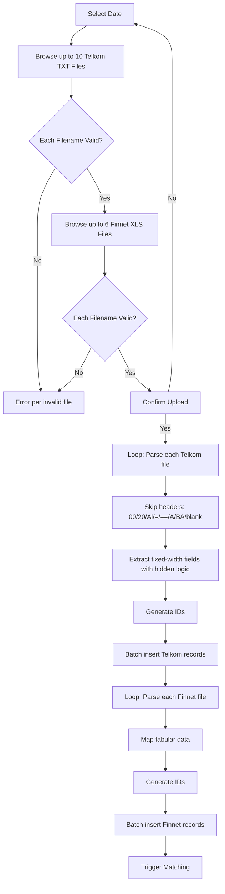

# Module: Telkom File Ingestion
> **Sub-program**: Rekon Telkom  
> **Module ID**: `telkom-file-ingestion`  

**CHANGELOG**
- Abstracted file reading logic and removed legacy framework-specific syntax (e.g., `BufferedReader`, Apache POI references).
- Documented implicit data transformation rules, such as variable Area Code indexing and Phone number leading zero stripping.

---

## 1. Module Overview

This is the most complex file ingestion module in the reconciliation system, handling **up to 16 distinct file uploads per reconciliation date** — 10 Telkom fixed-width text files and 6 Finnet tabular settlement files. Each file type has its own slot, strict filename validation, and format-specific parsing logic.

### File Inventory

| Category | Count | Format | Naming Pattern |
|---|---|---|---|
| Telkom Core | 10 files | Fixed-width text | `{yyMMdd}REKONTELKOM-{code}.TXT` |
| Finnet Settlement | 6 files | Tabular format | `{yyMMdd}FINNET-{num}.XLS` |

### Scope Boundaries
- **IN scope**: 16-slot file management, filename validation, fixed-width Telkom parsing, tabular Finnet parsing, DB persistence, reset/clear operations.
- **OUT of scope**: Matching (→ `mod_reconciliation_engine`), result display (→ `mod_reporting_export`).

---

## 2. Local Functional Flows & Scenarios

### 2.1 File Upload & Validation

Each file slot maps to a unique identifier. Validation ensures an exact case-insensitive match against the expected filename pattern.

| Identifier | File Type | Expected Name |
|---|---|---|
| 1 | Telkom 050003 | `{yyMMdd}REKONTELKOM-050003.TXT` |
| 2 | Telkom 050004 | `{yyMMdd}REKONTELKOM-050004.TXT` |
| 3 | Telkom 050001 | `{yyMMdd}REKONTELKOM-050001.TXT` |
| 4 | Telkom 050007 | `{yyMMdd}REKONTELKOM-050007.TXT` |
| 5 | Telkom 030002 | `{yyMMdd}REKONTELKOM-030002.TXT` |
| 6 | Telkom 030001 | `{yyMMdd}REKONTELKOM-030001.TXT` |
| 7 | Telkom 010001 | `{yyMMdd}REKONTELKOM-010001.TXT` |
| 8 | Telkom 010003 | `{yyMMdd}REKONTELKOM-010003.TXT` |
| 9 | Telkom 070005 | `{yyMMdd}REKONTELKOM-070005.TXT` |
| 10 | Telkom 020001 | `{yyMMdd}REKONTELKOM-020001.TXT` |
| 11 | Finnet-01 | `{yyMMdd}FINNET-01.XLS` |
| 12 | Finnet-02 | `{yyMMdd}FINNET-02.XLS` |
| 13 | Finnet-03 | `{yyMMdd}FINNET-03.XLS` |
| 14 | Finnet-04 | `{yyMMdd}FINNET-04.XLS` |
| 15 | Finnet-05 | `{yyMMdd}FINNET-05.XLS` |
| 16 | Finnet-07 | `{yyMMdd}FINNET-07.XLS` |

> **Note**: Finnet-06 does not exist; numbering skips from 05 to 07.

### 2.2 Telkom Fixed-Width Parsing

For each non-empty Telkom file slot:
1. Read file line-by-line.
2. **Skip header/footer lines**: any line where the first 2 characters match `00`, `20`, `Al`, `=`, `==`, `A`, `BA`, or blank.
3. For valid data lines, extract fields by fixed character positions:

| Field | Position logic | Notes |
|---|---|---|
| `area` | Pos 0–4 or 2–4 | Known area codes (`0341`, `0361`, `0411`, `0343`, `0321`, `0711`, `0271`, `0298`, `0281`, `0315`) use positions 0–4; all others use positions 2–4 |
| `telepon` | Pos 6–15 | Leading zeros are explicitly stripped during parsing: `000` offsets to pos 9, `00` offsets to 8, `0` offsets to 7 |
| `nokartu` | Pos 17–32 | Card number |
| `billreff1` | Pos 34–44 | Bill reference 1 |
| `billreff2` | Pos 47–56 | Bill reference 2 |
| `billreff3` | Pos 58–61 | Bill reference 3 |
| `stssarana` | Pos 74–76 | Status sarana |
| `refer` | Pos 85–91 | Reference number |
| `tglvaluta` | Pos 93–102 | Value date |
| `nilai` | Pos 104–119 | Amount (commas removed) |
| `jamtrn` | Pos 123–130 | Transaction time |

4. Generate a composite ID for each record.
5. Batch insert records to the database.

### 2.3 Finnet Tabular Parsing

For each non-empty Finnet file slot:
1. Parse the tabular spreadsheet data.
2. Map columns directly to the `DataFinnet` entity.
3. Generate a composite ID for each record.
4. Batch insert records.
5. Amount parsing preserves decimal precision.

### 2.4 Error Scenarios

| Scenario | Behaviour |
|---|---|
| Date not selected | Triggers an explicit validation error ("Pilih Tanggal Terlebih Dahulu") |
| Telkom filename mismatch | Reject upload due to invalid format |
| Finnet filename mismatch | Reject upload due to invalid format |
| Empty file slot on process | Skipped gracefully (null/empty check) |
| **No deduplication** | Re-uploading the same date will append duplicate records — **known tech debt** |

### 2.5 Ingestion Flowchart

---

## 3. Data Life Cycle

### 3.1 Data Models

| Entity | Key Fields |
|---|---|
| `RekonTelkom` | `id`, `area`, `telepon`, `nokartu`, `billreff1/2/3`, `stssarana`, `refer`, `tglvaluta`, `nilai`, `jamtrn`, `tanggalpilih`, `filename` (code), `userid`, `tstamp` |
| `DataFinnet` | Finnet tabular parsed fields |
| `DataFinnet1` | Alternate Finnet model for specific file variants |

---

## 4. Dependencies

### 4.1 Inbound Dependencies

| Source | Data / Trigger | Description |
|---|---|---|
| **Portal System** | Session details | Auth context |
| **User Input** | Date | Required for filename validation |

### 4.2 Outbound Dependencies

| Target | Data / Trigger | Description |
|---|---|---|
| **Database** | Batch inserts | Saves raw transaction data |
| **Reconciliation Engine** | Trigger | Execution begins after all uploads are complete |
