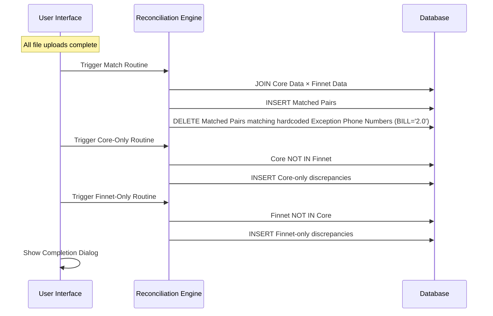
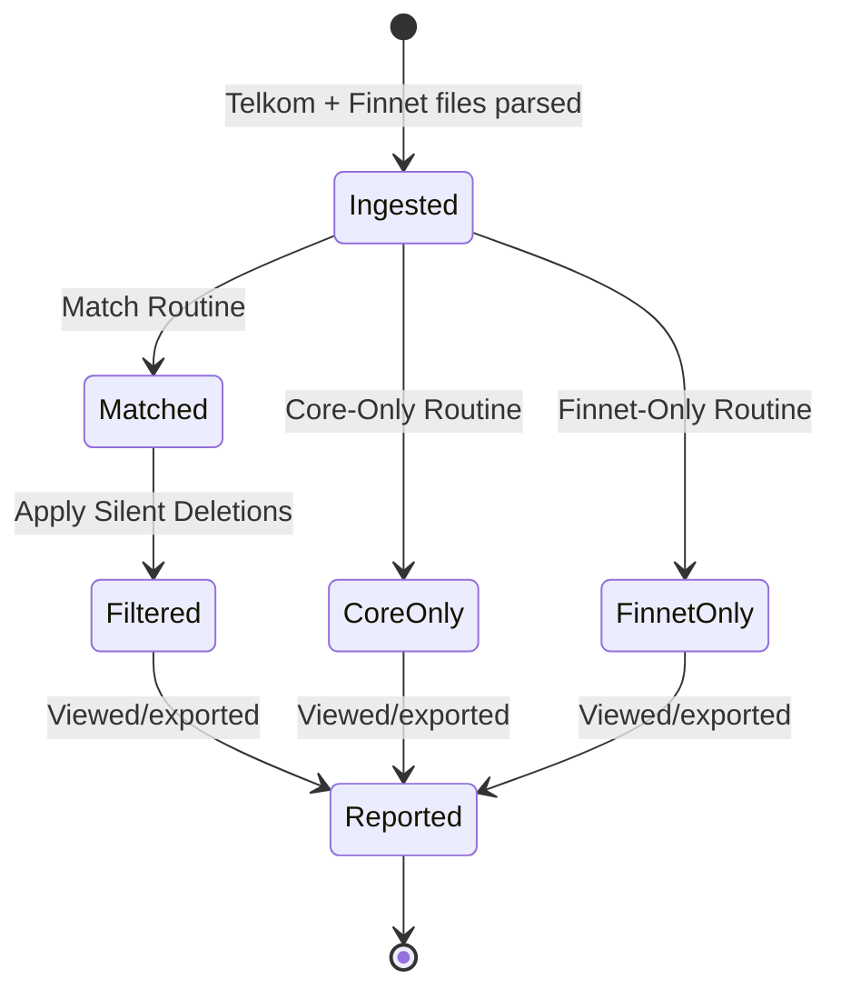

# Module: Telkom Reconciliation Engine
> **Sub-program**: Rekon Telkom  
> **Module ID**: `telkom-reconciliation-engine`  

**CHANGELOG**
- Documented silent deletions of specific phone numbers before matching results are committed.
- Abstracted legacy SQL query strings into general business rules and joining logic.

---

## 1. Module Overview

This module implements the matching logic for Telkom bill-payment reconciliation. It compares the bank's Core Banking Telkom records against Finnet settlement data to produce three result sets:

1. **Match** — Telkom/Core records matched against Finnet records.
2. **Core-Only** — Telkom/Core records with no Finnet counterpart.
3. **Finnet-Only** — Finnet records with no Telkom/Core counterpart.

The matching involves a single domain (Telkom vs Finnet) and three straightforward matching procedures.

### Scope Boundaries
- **IN scope**: Matching execution (3 methods), result set generation, implicit filtering rules.
- **OUT of scope**: File parsing (→ `mod_file_ingestion`), result display/export (→ `mod_reporting_export`).

---

## 2. Local Functional Flows & Scenarios

### 2.1 Matching Execution

After all file ingestion is complete, three methods execute sequentially:

1. **Match Routine**
   - Matches records on composite keys (e.g. Area + Phone Number vs Phone Number).
   - Results are staged as Matched Pairs.
   - **Hidden Logic (Silent Deletions)**: Before committing the final match results, the system actively deletes matches containing specific hardcoded exception phone numbers if they have `BILL = '2.0'` and `FLAG = 'MATCH'`. The hardcoded numbers are: `302220640`, `3520528`, `3538679`, `3810357`, `5017836`, `5030867`, `5033326`, `5941232`, `5963677`, `5995713`, `5997707`, `7318863`, `7321449`, `7323319`, `7480696`, `7481718`, `7482200`, `7495129`, `8911367`, `8914179`, `8914247`, `8965941`, `99534887`, and `352117146`.

2. **Core-Only Routine**
   - Identifies Telkom/Core records that do NOT exist in the Finnet settlement data (by comparing composite Area+Phone+Amount).
   - Saves records as Core-only.

3. **Finnet-Only Routine**
   - Identifies Finnet records that do NOT exist in the Telkom/Core data (by comparing Phone Number and Amount).
   - Saves records as Finnet-only.

4. On success: A completion flag is sent to the UI.

### 2.2 Matching Sequence Diagram

### 2.3 Known Constraints

| Constraint | Detail |
|---|---|
| **No deduplication** | If files are re-uploaded for the same date, duplicate staging data exists; matching may produce duplicates |
| **Single domain** | Only one matching domain (Telkom vs Finnet) — no multi-domain complexity |
| **No outstanding management** | Telkom has no formal outstanding tracking system. It relies purely on daily disjoint sets. |
| **No manual status override** | Discrepancies require manual Database intervention to resolve |

---

## 3. Local Technical Flows & Data Life Cycle

### 3.1 Result Data Models

| Entity | Description |
|---|---|
| `RekapTelkomMatch` | Matched Telkom-Finnet pair |
| `RekapTelkom` | Core-only (Telkom without Finnet) |
| `RekapFinnet` | Finnet-only (without Core) |

### 3.2 Data State Transitions

---

## 4. Dependencies

### 4.1 Inbound Dependencies

| Source | Data / Trigger | Description |
|---|---|---|
| **File Ingestion Module** | Populated raw Telkom and Finnet data | Prerequisites for matching |
| **User Input** | Target Date | Matching scope |

### 4.2 Outbound Dependencies

| Target | Data / Trigger | Description |
|---|---|---|
| **Database** | Result Sets | Saved to match tables, core-only tables, and finnet-only tables |
| **Reporting & Export Module** | Read queries | Uses populated result tables to render reports |
