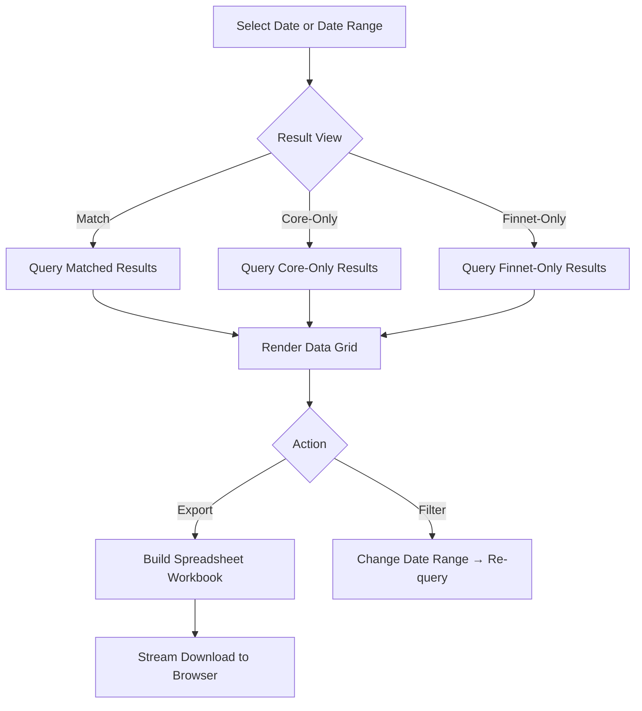

# Module: Telkom Reporting & Export
> **Sub-program**: Rekon Telkom  
> **Module ID**: `telkom-reporting-export`  

**CHANGELOG**
- Abstracted legacy UI Framework (ZK) and Spreadsheet libraries (HSSF/XSSF) references into general presentation and export requirements.
- Ensured consistency with the abstract Data Architecture specifications.

---

## 1. Module Overview

This module handles the presentation and export of Telkom reconciliation results. It provides three result views — Match, Core-Only, and Finnet-Only — with date filtering and spreadsheet download capabilities.

Compared to other sub-programs, the Telkom reporting module is the simplest: there is no multi-sheet conditional export, no outstanding management, and no monthly aggregation reports.

### Scope Boundaries
- **IN scope**: Querying result sets, rendering data grids, date-range filtering, spreadsheet export.
- **OUT of scope**: File ingestion (→ `mod_file_ingestion`), matching (→ `mod_reconciliation_engine`).

---

## 2. Local Functional Flows & Scenarios

### 2.1 Viewing Results

1. User selects a result view: **Match**, **Core-Only**, or **Finnet-Only**.
2. Inputs date filter (specific date, or date range).
3. The system queries the corresponding result datasets.
4. Data grids render the results.

### 2.2 Spreadsheet Export

1. User clicks **Export/Download**.
2. A spreadsheet workbook is built.
3. All result types are included unconditionally.
4. The file stream is provided to the browser for download.

### 2.3 Scenarios

#### Scenario A — Daily Match Report
1. Officer selects a specific date.
2. Opens **Match** view.
3. Grid shows all matched Telkom-Finnet transactions.
4. Exports to spreadsheet.

#### Scenario B — Weekly Discrepancy Review
1. Supervisor sets a date range (e.g. Mon–Fri).
2. Views **Core-Only** view → Telkom payments not confirmed by Finnet.
3. Views **Finnet-Only** view → Finnet records without Core counterpart.
4. Downloads both reports for investigation.

#### Scenario C — Empty Result Set
1. No reconciliation data for selected date.
2. Grids render empty.
3. Export produces a headers-only file.

### 2.4 Reporting Flowchart

---

## 3. Local Technical Flows & Data Life Cycle

### 3.1 Result Data Models

| Entity | Description |
|---|---|
| `RekapTelkomMatch` | Matched Telkom-Finnet transaction report |
| `RekapTelkom` | Core-only (Telkom without Finnet) report |
| `RekapFinnet` | Finnet-only report |

### 3.2 State Variables

| Variable | Description |
|---|---|
| Date Filter | Single-date filter or Date range filter |
| Display Filters | Optional merchant code/name filters |
| Selected Row | Grid selection state |

### 3.3 Known Technical Debt

| Issue | Impact |
|---|---|
| No conditional sheet selection | All sheets exported unconditionally (unlike other subsystems) |
| No outstanding tab | Discrepancies cannot be tracked/resolved within the system |
| No manual status override | Resolving issues requires manual Database intervention |

---

## 4. Dependencies

### 4.1 Inbound Dependencies

| Source | Data / Trigger | Description |
|---|---|---|
| **Reconciliation Engine** | Populated result sets | Query data source |
| **User Input** | Date or date range | Filter scope |

### 4.2 Outbound Dependencies

| Target | Data / Trigger | Description |
|---|---|---|
| **Data Service** | Data retrieval calls | Pulls data to render the grid |
| **Browser** | Downloaded Spreadsheet | Streamed file export |
