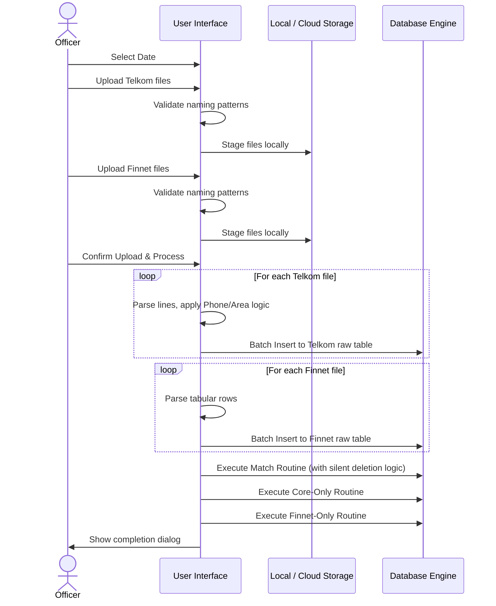

# Rekon Telkom — System Documentation
> **Source of Truth** for developers and AI coding agents  
> Module path: `reconcile-system/Rekon Telkom`  
> Last reverse-engineered: 2026-06-07

**CHANGELOG**
- Added comprehensive section on hidden logic extracted from backend services (area code handling, phone trimming, hardcoded silent deletion logic).
- Removed explicit legacy framework (ZK, Java EE, Apache POI) dependency language to mandate system behavior over implementation specifics.

---

## 1. Executive Summary & High-Level Requirements

### 1.1 Business Purpose
**Rekon Telkom** is the reconciliation module that cross-checks telecommunications bill-payment transactions processed by Bank Maspion Indonesia against two 3rd-party settlement sources:

1. **Telkom Reconciliation Files** — Fixed-width text files produced by Telkom Indonesia's billing system. These represent telephony/internet bill payments (Indihome, PSTN, etc.) collected at bank branches and via ATM. Up to **10 distinct Telkom file types** can be uploaded per day, each identified by a 6-digit code (050003, 050004, 050001, 050007, 030002, 030001, 010001, 010003, 070005, 020001).
2. **Finnet Reconciliation Files** — Tabular spreadsheet files from Finnet Indonesia (a Telkom Group subsidiary), representing digital payment aggregation data. Up to **6 Finnet file types** per day (FINNET-01 through FINNET-07, excluding 06).

The system reconciles the bank's Core Banking System records against both Telkom and Finnet settlement files, identifying matched transactions, Core-only discrepancies, and Finnet-only discrepancies.

### 1.2 Core High-Level Functional Requirements

| # | Requirement | Description |
|---|---|---|
| FR-01 | Upload up to 10 Telkom fixed-width files | Managed via 10 distinct UI slots |
| FR-02 | Upload up to 6 Finnet tabular files | Managed via 6 distinct UI slots |
| FR-03 | Validate uploaded file names | Strict validation against the `{yyMMdd}` date prefix |
| FR-04 | Parse Telkom files | Extract Area, Phone number, Card number, Bill references, Transaction value, Timestamp |
| FR-05 | Parse Finnet files | Extract transaction fields from tabular format |
| FR-06 | Persist Telkom transaction records | Insert parsed data into DB |
| FR-07 | Persist Finnet transaction records | Insert parsed data into DB |
| FR-08 | Execute matching: Telkom Core vs. Finnet | Cross-check and identify matched records |
| FR-09 | Execute matching: Telkom-Only | Identify Core records without a Finnet pair |
| FR-10 | Execute matching: Finnet-Only | Identify Finnet records without a Core pair |
| FR-11 | View matched transactions | Render result sets filtered by date |
| FR-12 | View Core-only discrepancies | Render result sets filtered by date |
| FR-13 | View Finnet-only discrepancies | Render result sets filtered by date |
| FR-14 | Filter results by a date range | Allow ranges for viewing weekly/monthly reports |
| FR-15 | Export reconciliation results | Download reports as spreadsheet files |
| FR-16 | Handle multi-format Telkom file variants | Each code produces slightly different fixed-width layouts |
| FR-17 | Skip header/footer lines in Telkom files | Discard non-transactional metadata |

---

## 2. User Scenarios & Personas

### 2.1 Personas

| Persona | Role | Key Actions |
|---|---|---|
| **Telkom Settlement Officer** | Daily Telkom/Finnet reconciliation operator | Upload up to 16 files, trigger matching, view results |
| **Back-Office Supervisor** | Discrepancy resolution and reporting | View all result sets, export data |
| **Finance Analyst** | Billing revenue analysis | Filter and download reconciliation data |

### 2.2 End-to-End User Scenarios

#### Scenario A — Full Daily Reconciliation (Happy Path)
1. Officer logs in via the parent portal.
2. Selects **reconciliation date** (e.g., 03 October 2024).
3. Uploads Telkom files one-by-one:
   - `241003REKONTELKOM-050003.TXT`
   - `241003REKONTELKOM-050004.TXT`
   - ... up to 10 files.
4. Uploads Finnet files:
   - `241003FINNET-01.XLS`
   - ... up to 6 files.
5. Clicks **Upload Files** → confirmation dialog.
6. Confirms → system parses all files sequentially, persists to DB, then runs the 3 matching procedures.
7. Completion popup.
8. Views **Match** tab, filters by date, downloads export.

#### Scenario B — Partial Upload
1. Officer only has 3 Telkom file codes for the day plus 2 Finnet files.
2. Uploads only those files; leaves other slots empty.
3. System gracefully skips empty file references.
4. Matching runs on available data; discrepancy set may be larger.

#### Scenario C — Wrong Filename
1. Officer uploads `241003REKONTELKOM-050003.TXT` but selected date is October 4th.
2. System detects the mismatch.
3. File rejected with error dialog.

#### Scenario D — Re-Upload / Reset
1. Officer discovers data issue after upload.
2. Uses a **Reset File** action to clear all file slots.
3. Re-selects files and re-uploads with corrections.

---

## 3. Functional Architecture & Workflows

### 3.1 Step-by-Step Business Logic

1. **Initialisation** — Session injected from parent portal. Output directories are validated.
2. **File Name State Management** — The system tracks up to 16 file slots.
3. **File Upload Validation** — Validates the filename prefix matches the selected date `{yyMMdd}`.
4. **Telkom Fixed-Width Parsing** — Parses text lines:
   - Skips lines starting with: `00`, `20`, `Al`, `=`, `==`, `A`, `BA`, or blank.
   - Valid lines: extract fixed-width fields. Includes **Hidden Logic**: area code indexing varies by known area code prefixes; phone number fields explicitly strip leading zeros.
5. **Finnet Tabular Parsing** — Parses tabular formats.
6. **DB Persistence** — Batches are inserted per file.
7. **Matching Execution** — Three procedures run sequentially:
   - Match Routine (includes **Hidden Logic**: silently deletes matched pairs matching hardcoded exception phone numbers with `BILL = 2.0`).
   - Core-Only Routine.
   - Finnet-Only Routine.
8. **Viewing Results** — Renders data via data grids.
9. **Export** — Generates and streams spreadsheet downloads.

### 3.2 Telkom File Code Reference

| File Code | Description |
|---|---|
| 050003 | Telkom branch payment type 3 |
| 050004 | Telkom branch payment type 4 |
| 050001 | Telkom branch payment type 1 |
| 050007 | Telkom branch payment type 7 |
| 030002 | Telkom merchant type 2 |
| 030001 | Telkom merchant type 1 |
| 010001 | Telkom product type 1 |
| 010003 | Telkom product type 3 |
| 070005 | Telkom channel type 5 |
| 020001 | Telkom channel type 1 |

### 3.3 Finnet File Reference

| File | Description |
|---|---|
| FINNET-01.XLS | Finnet payment category 1 |
| FINNET-02.XLS | Finnet payment category 2 |
| FINNET-03.XLS | Finnet payment category 3 |
| FINNET-04.XLS | Finnet payment category 4 |
| FINNET-05.XLS | Finnet payment category 5 |
| FINNET-07.XLS | Finnet payment category 7 (note: no category 06) |

---

## 4. Technical Architecture & Data Flow

### 4.1 Key Data Models

| Entity | Description |
|---|---|
| `RekonTelkom` | Raw parsed Telkom fixed-width record |
| `DataFinnet` | Raw parsed Finnet record |
| `RekonTelkomMatch` | Staging model: Telkom-Finnet pair match |
| `RekapTelkomMatch` | Query result: matched transaction report |
| `RekapTelkom` | Query result: Core-only (Telkom without Finnet) report |
| `RekapFinnet` | Query result: Finnet-only report |

### 4.2 Data Flow: File Upload to Matching

---

## 5. State Management & Constraints

### 5.1 Technical Constraints

| Constraint | Detail |
|---|---|
| **Telkom Filename Format** | Must be `{yyMMdd}REKONTELKOM-{code}.TXT` (uppercase, exact match) |
| **Finnet Filename Format** | Must be `{yyMMdd}FINNET-{num}.XLS` (uppercase, exact match) |
| **Fixed-Width Parsing Positions** | Strictly tied to character positions for Telkom text files |
| **Area Code Logic (Hidden Logic)** | Known area codes (`0341`, `0361`, `0411`, `0343`, `0321`, `0711`, `0271`, `0298`, `0281`, `0315`) use positions 0–4; all others use 2–4 |
| **Phone Trimming (Hidden Logic)** | Leading zeros in phone field (pos 6–9) are explicitly detected and stripped |
| **Silent Deletion (Hidden Logic)** | A hardcoded array of dummy phone numbers triggers deletion of matched records if `BILL=2.0` |
| **File Processing Order** | Files are processed sequentially (050003 → 050004 → ... → Finnet01). Each file is batch-inserted |
| **No Deduplication on Upload** | Re-uploading the same date will duplicate records |
| **File Code 06 Absent** | Finnet numbering skips 06 |

### 5.2 Error Handling

| Scenario | Response |
|---|---|
| Date not selected | Interactive error prompt |
| Mismatched Telkom filename | Interactive error prompt |
| Mismatched Finnet filename | Interactive error prompt |
| File IO error | Bubble up and render error to user |
| Service/DB exception | Transaction rollback and render error |
| Missing file slots | Checked gracefully; loops bypass null slots |

### 5.3 Known Technical Debt / Issues

| Issue | Impact |
|---|---|
| No deduplication on re-upload | Duplicate DB records if same date is re-processed without manual cleanup |
| Fixed array-style position parsing | Brittle to Telkom format shifts; requires manual code change if layout varies |
| Unconditional Exports | Report generation exports all results without conditional toggles |
